```text
PROJECT: الجهاد
DOCUMENT: PHASE 1 — FINAL CONSOLIDATED DOMAIN & DATA ARCHITECTURE
STATUS: FINAL DESIGN BASELINE — PENDING HUMAN APPROVAL
IMPLEMENTATION: NOT AUTHORIZED
PHASE 2: NOT AUTHORIZED
```

## DOCUMENT HISTORY

```text
PHASE 1 Revised (v1.1)
    → Remediation Report        (CF-01, RC-05, RC-03, RC-04, RC-12)
    → PHASE 1.2 Closure Audit   (4 corrections: replay provenance, create-collision
                                  isModified guard, notification guarantee wording,
                                  missing organizationId)
    → PHASE 1.3 Closure Verify  (C-01 request-fingerprint, C-02 historical
                                  ScheduleRule versions, C-03 three-layer
                                  notification model)
    → PHASE 1 FINAL CONSOLIDATED (this document)
```

This document supersedes, as a single authoritative text, the four separate amendment
documents above. Nothing in this document contradicts an earlier one; where a later
pass corrected an earlier rule, only the corrected rule appears here (the superseded
wording is not reproduced). Section numbering from PHASE 1 REVISED (v1.1) is kept
unchanged wherever the underlying section was not itself amended; new subsections
introduced by later passes are marked inline.

# PHASE 1 — DOMAIN MODEL & DATA ARCHITECTURE (FINAL CONSOLIDATED)

**المشروع:** الجهاد — Teacher Management & Private Tutoring Platform
**الإصدار:** 1.1-REVISED (بعد Architectural Review Decision) — **غير معتمد بعد**؛ بانتظار Architecture Gate
**المرجع:** PHASE 0 v0.1 + MASTER INITIAL ARCHITECTURE PROMPT
**اللغة:** العربية، مع إبقاء المصطلحات التقنية بالإنجليزية
**الجمهور:** أي مهندس أو نموذج ذكاء اصطناعي يستلم هذه الوثيقة دون شرح شفهي

> لا يحتوي هذا الملف على كود تنفيذي. الرسوم Mermaid والجداول وأسماء الحقول **تصميم** وليست تنفيذًا.

---

## 0. كيف تُقرأ هذه الوثيقة

| القسم | المحتوى |
|---|---|
| 1–2 | الملخص التنفيذي وقرارات ADR · المراجعة النقدية (بما فيها نتائج مراجعة المزامنة §2.9) |
| 3 | **سجل القرارات المعتمدة (Decision Register)** |
| 4 | الاصطلاحات (Conventions) والحقول الأساسية |
| 5 | **Lessons Carried Forward From Al Hossam** |
| 6 | **ARCHITECTURAL BOUNDARIES** |
| 7 | **SOURCE OF TRUTH MATRIX** |
| A | Entity Dictionary |
| B / C | العلاقات · آلات الحالة (Lesson، Sync، **License بمحورين**) |
| D | IndexedDB |
| E | Sheets (بما فيها **WAL**) |
| F | هوية المزامنة + **F.2 الهوية الحتمية** |
| G | خوارزمية المزامنة + **G.12 الضمانات + G.13 الأداء** |
| H | **Bootstrap ببوابة القرار + `bootstrapState` (ADR-R01)** |
| I | **الإشعارات + Capability Matrix + Spike + I.9 طبقات الضمان الثلاث (Layer A/B/C)** |
| J / K | Calendar (Layer C صراحة، §I.9) · Drive |
| L | **بوابة ولي الأمر (معدَّلة)** |
| M / N | المصادقة (فحص منظمة ثلاثي) · **الترخيص (معدَّل)** |
| O / P / Q / R | المنظمات · الترحيل · النسخ الاحتياطي · ERD |
| S | **TIME & DATE ARCHITECTURE** |
| T | **DATA LIFECYCLE POLICY** |
| U | **FAILURE MATRIX** |
| V | **النشر وملكية البيانات** |
| W | **Apps Script Blueprint** |
| X / Y | **Design System Foundation · Repository Structure (أولي)** |
| 8–9 | الأداء · التسليم إلى PHASE 2 وقائمة الـSpikes |
| 10–14 | **Exit Criteria · Open Questions · Risks · Invariant Catalog (61) · Next Phase & Final Gate** |

**تصنيف الإصدارات:** `V1` = الإصدار الأول، `V1.1/V1.2/V1.3/V2` = مؤجل لكن النموذج جاهز، `∞` = نقطة توسّع بلا كيان الآن.

**ما تغيّر عن 1.0 (سجل المراجعة):** حسم OQ-01/04/06/13 · ترخيص بمحورين مع Lease وإبطال · بوابة قرار Bootstrap (فتح القاعدة ≠ الإذن) · Calendar فوق الإشعارات صار Fallback مع Capability Matrix وSpike · إصلاح ذرية المزامنة (WAL) وثغرات S-01…S-08 · مواصفة الهوية الحتمية · مسار تفعيل ولي الأمر وإدارة العلاقات · نشر مزدوج وملكية بيانات · ستة أقسام جديدة + نموذج أعطال · تصنيف 56 ثابتًا.

**ما أضافه هذا الدمج (فوق 1.1، عبر Remediation → 1.2 → 1.3):** `Installation.bootstrapState` + `FIRST_BOOTSTRAP_RESUME` (§H) · إبطال Reminder بطبقتين + `sourceSnapshot` (§A.7) · `ScheduleRuleVersionSnapshot` غير قابلة للتغيير (§A.4) · حارس `isModified` يسبق أي مقارنة إصدار في تصادم الإنشاء (§F.2.3, §G.4) · بصمة طلب كاملة في `_Ops` تميّز `ALREADY_APPLIED`/`NOOP_CONVERGED`/`IDEMPOTENCY_KEY_REUSE` (§G.12.6) · فحص منظمة ثلاثي (غائبة/مختلفة/مطابقة، §G.4/§M.4) · ثلاث طبقات ضمان إشعار صريحة Layer A/B/C (§I.9) · خمسة ثوابت جديدة (INV-57…61) وخمسة قرارات تصحيحية (ADR-R01…R05).

---

## 1. الملخص التنفيذي

### 1.1 الصورة في ست جمل

1. **قاعدة التشغيل هي IndexedDB.** كل قراءة وكتابة تمر عبر Repositories، ولا تنتظر Google أبدًا.
2. **كل كتابة محلية = معاملة واحدة** تحفظ السجل + عملية الـOutbox + سجل التدقيق معًا. لا يوجد «حُفظ محليًا لكن لم يُصفّ للإرسال».
3. **المزامنة Incremental بمؤشر revision** (`cursor`) عبر سجل تغييرات append-only على الخادم. لا Full Sync عند الفتح، ولا تحميل كامل للـSheets.
4. **Apps Script طبقة API فقط:** Router → Auth → Authorization → Sync → Repository → Adapters. لا منطق تطبيق داخل `Code.gs`.
5. **Google Sheets = تخزين مزامنة قابل للقراءة البشرية**، وليست Domain Model. أسماء الأعمدة إنجليزية ثابتة، والعناوين العربية في ورقة `_Schema` منفصلة.
6. **Calendar / Gmail / Drive / Forms / WhatsApp Adapters** لا تدخل الـDomain، وفشلها لا يوقف Sync ولا يوقف التطبيق.

### 1.2 القرارات الجوهرية (ملخص ADR)

| ADR | القرار | البديل المرفوض | السبب المختصر |
|---|---|---|---|
| ADR-001 | **Backend-per-Organization (BYO Google):** كل منظمة لها مشروع Apps Script + Spreadsheet خاصان في حساب المالك | خادم مركزي متعدد المستأجرين | لا تكلفة استضافة، سيادة بيانات للعميل، يناسب V1. عزل المنظمات مادي + منطقي (`organizationId` في كل سجل) |
| ADR-002 | **معرّفات UUIDv7 تُولَّد على العميل** (وUUIDv5 حتميّ للسجلات المشتقة) | معرّفات تسلسلية من الخادم | تعمل Offline، لا تكرار عند إعادة المحاولة، ترتيب زمني صديق للفهارس |
| ADR-003 | **سجل تغييرات رفيع `_Changes` + رقم `serverRevision` عام** يُمنح تحت قفل | مسح الأوراق بحثًا عن `updatedAt` | قراءة الـdelta بتكلفة O(delta) وحساب الصف بالرياضيات (§E.4) |
| ADR-004 | **كشف التعارض بطريقة 3-way على مستوى الحقل** (`from → to`) لا على مستوى السجل كله | Last-Write-Wins بالساعة | ساعات الأجهزة غير موثوقة؛ التعارض الحقيقي فقط ما يصل للمستخدم |
| ADR-005 | **Lesson Instances تُنتج مسبقًا (materialized) بمعرّف حتمي** من `ruleId + occurrenceKey` | توليد عند العرض فقط | جهازان offline ينتجان نفس السجل بنفس المعرّف فلا تكرار |
| ADR-006 | **Calendar إسقاط أحادي الاتجاه (Jihad → Calendar)** بحدث مستقل لكل Lesson | مزامنة ثنائية الاتجاه / أحداث متكررة RRULE | تجنب التعارض والهشاشة؛ الإلغاء وإعادة الجدولة تُنسخ 1:1؛ وCalendar **ليس** محرك الإشعارات الأساسي (ADR-014) |
| ADR-007 | **ملاحظات المدرس الداخلية وملاحظات ولي الأمر كيانان منفصلان** وأوراق منفصلة | حقل `visibility` على كيان واحد | تسريب البيانات يتطلب فعلًا مقصودًا لا خطأ فلترة |
| ADR-008 | **Portal Projection:** بوابة ولي الأمر تقرأ فقط من أوراق `pv_*` مبنية على الخادم بحقول Whitelist | الاستعلام من أوراق النطاق مباشرة | عزل الأبناء وسرية الملاحظات وأداء أفضل |
| ADR-009 | **الترخيص: توقيع ECDSA P-256 يُتحقق منه Offline بـWebCrypto**، الإصدار من جهة البائع فقط، مع Lease وقائمة إبطال | مفتاح سري في التطبيق / تحقق خادم فقط (Apps Script نقطة ثقة وحيدة) | لا أسرار في العميل، ويعمل بلا إنترنت (الحدود الصريحة §N.6) |
| ADR-010 | **قواعد الـDomain النقية تُشارَك بين PWA وApps Script** بخطوة بناء (concatenate) | نسختان مكتوبتان يدويًا | منع الانحراف بين تحقق العميل وتحقق الخادم |
| ADR-011 | **Schema Registry** ملف وصفي واحد لكل كيان يُشتق منه/يُختبر به: مخزن IDB، أعمدة Sheets، المدققات | تعريفات متفرقة | مصدر حقيقة واحد للتصميم |
| ADR-012 | **قاعدتا IDB:** `jihad_meta` (تثبيت/ترخيص/جلسات) و`jihad_org_<orgId>` (البيانات) | قاعدة واحدة | عزل المنظمة وسهولة المسح والاستعادة |
| ADR-013 | **عقد API مستقل عن التخزين** (لا يكشف Sheets)؛ يمكن نقل الخلفية خلفه لاحقًا | ربط الواجهة بشكل الأوراق | مسار توسّع للبوابة والحجم الكبير دون إعادة بناء العميل |
| ADR-014 | **Notification Engine داخلي هو الأساس؛ Calendar مزوّد/Fallback** | Calendar كمحرك تذكير أساسي | PWA لا تضمن الجدولة؛ وCalendar مقيّد بما يدعمه ويحتاج مزامنة حساب Google |
| ADR-015 | **الترخيص بمحورين (Validity × Lease Freshness) + Lease + قائمة إبطال من البائع** | حالة ترخيص واحدة مرتبطة باتصال الخادم | الصلاحية ≠ توفر الخادم؛ إبطال بنافذة معلنة؛ Apps Script ليس نقطة الثقة الوحيدة |
| ADR-016 | **نموذج نشر مزدوج** (Template+Wizard / نشر ذاتي) وبيانات في حساب العميل | خادم مركزي/Provisioning آلي في V1 | خصوصية وبساطة وقابلية النقل |
| ADR-017 | **بوابة قرار Bootstrap:** فتح القاعدة ≠ السماح بالاستخدام (`AccessGrant`) | اعتبار فتح القاعدة دخولًا | منع كشف/كتابة قبل التحقق |
| ADR-018 | **Write-Ahead Log + `committedRevision`** لالتزام دفعات Push | كتابة ثلاثية غير ذرية | منع فقدان تحديث صامت عند انقطاع التنفيذ |
| ADR-019 | **مواصفة الهوية الحتمية** (UUIDv5 + قواعد التقسيم والحذف والأفق) | «UUID حتمي» بلا مواصفة | منع التكرار والانحراف بين الأجهزة |

### 1.2.1 قرارات المعالجة والإغلاق (ADR-R01…R05)

هذه قرارات صدرت أثناء إصلاح ثغرات اكتشفها تدقيق خصومي لاحق (لا PHASE 2 ولا كود)، وتبقى مرقّمة بسلسلتها الخاصة (لا تُدمَج في ترقيم ADR-001…019) لتمييزها كقرارات تصحيحية:

| ADR | القرار (بصيغته النهائية بعد كل التصحيحات) | البديل المرفوض | السبب المختصر |
|---|---|---|---|
| ADR-R01 | **Bootstrap Recovery / Atomicity:** حقل `Installation.bootstrapState` صريح + فرع `FIRST_BOOTSTRAP_RESUME`، بدل محاكاة معاملة عبر قاعدتي IndexedDB | قفل عالمي/منسّق خارجي بين القاعدتين | لا معاملة ذرية ممكنة عبر قاعدتين منفصلتين؛ حقل حالة صريح + استئناف دقيق يعوّض عن غيابها |
| ADR-R02 | **Reminder Invalidation بطبقتين:** إبطال نشط عند مصدر التغيير (Layer A، محلي بالكامل) + فحص صلاحية قبل التسليم (Layer B)؛ **مع تصنيف صريح لثلاث طبقات ضمان** (§I.9): Layer A) OS-native = Best-Effort/Platform-Dependent، Layer B) يتحكم به التطبيق = Architecturally Controlled، Layer C) إسقاط خارجي مجدوَل (Calendar) = Best-Effort/Provider-Dependent. **لا يُدَّعى أبدًا أن إلغاء تسجيل نظام التشغيل أو الإسقاط الخارجي مضمون رياضيًا** قبل إثبات SP-1 | معرّف Reminder غير معتمد على القيمة المتغيّرة؛ أو ادعاء ضمان مطلق لأي قناة خارج تحكم التطبيق | معرّف حتمي مبني على قيمة متغيّرة يحتاج إبطالًا صريحًا لا اعتمادًا على تغيّر المعرّف وحده؛ Calendar تحديدًا قناة خارجية بضمان مختلف جوهريًا عن Layer B |
| ADR-R03 | **Deterministic Create Collision:** حارس `isModified` يسبق أي مقارنة إصدار (لا استبدال أبدًا لتعديل بشري)؛ عند غيابه، تحقق خادمي **مستقل** عبر إعادة تشغيل دالة التوليد المشتركة ضد **`ScheduleRuleVersionSnapshot`** غير قابلة للتغيير (لا ثقة بادعاء العميل لرقم الإصدار وحده) | «الأعلى `ruleVersion` يفوز» دون قيد أو تحقق | استبدال أعمى بالإصدار الأعلى قد يمحو تعديلًا بشريًا حقيقيًا؛ والتحقق يحتاج مصدرًا تاريخيًا فعليًا لا افتراض توفره |
| ADR-R04 | **Idempotent Replay vs Conflict:** إثبات `ALREADY_APPLIED` يتطلب **تطابق بصمة الطلب الكاملة** (`entityType/entityId/opType/requestFingerprint`) مع ما هو مخزَّن بنفس `operationId` في `_Ops`، لا وجود `operationId` مجردًا ولا تطابق قيمة نهائية وحدها؛ `NOOP_CONVERGED` لتطابق القيمة بلا Provenance، و`IDEMPOTENCY_KEY_REUSE` لإعادة استخدام نفس المفتاح لعملية مختلفة فعليًا | تمديد نافذة `_Ops` إلى ما لا نهاية؛ أو قبول تطابق القيمة النهائية وحده كدليل Replay | كلاهما يخلق ادعاء Provenance زائفًا أو تكلفة تخزين غير متناسبة؛ التمييز الثلاثي (`ALREADY_APPLIED`/`NOOP_CONVERGED`/`IDEMPOTENCY_KEY_REUSE`) يحل المشكلة بصدق وبلا بنية تحتية جديدة تتجاوز الحاجة |
| ADR-R05 | **Organization Authorization Invariant:** نطاق المنظمة يُشتَق حصرًا من `_Meta.organizationId` الخادمي؛ أي `organizationId` واردة من العميل تُستخدَم للمطابقة فقط؛ **غيابها يُرفَض فورًا دون استدلال أو قيمة افتراضية** | الاعتماد على تطابق قيمتين مُرسَلتين من العميل (جلسة + طلب) كفحص كافٍ | هش أمام تزوير متزامن لكليهما؛ ولا يجوز استنتاج منظمة من غياب الحقل |

### 1.3 النقاط الثلاث الخاصة بالكفاءة (من «الحسام») وأين تُحقَّق

| النقطة | أين تُحقَّق |
|---|---|
| 1. لا تحميل شامل عند كل فتح؛ الفتح من IndexedDB ثم مزامنة في الخلفية | §H (Bootstrap)، §G.2 (Bootstrap مقسّم ومستأنف)، الثابت INV-05 و INV-11 |
| 2. Incremental/Delta + Queue + Batch + Idempotent مع معالجة الانقطاع | §G (خوارزمية كاملة)، §F (هوية العملية)، §E.4 (سجل التغييرات) |
| 3. Apps Script طبقة API فقط، مع Adapters منفصلة | §E.7 (حدود الوحدات)، §I–K، الثابت INV-18 |

---

## 2. المراجعة النقدية: التعارضات التي وُجدت

طُلب صراحةً عدم تجاهل التعارضات. هذه أهمها وقرارها المعماري. **لم تُغيَّر أي متطلبات أساسية**؛ التعديلات تخص «طريقة تحقيقها».

### 2.1 التنبيهات المحلية Offline مقابل حدود منصة PWA (خطر عالٍ)

**المشكلة:** المتطلب «التنبيهات المحلية أساسية وتعمل بلا إنترنت». لكن PWA لا تضمن إطلاق إشعار مجدول والتطبيق مغلق في كل تشكيلة Android/متصفح؛ Notification Triggers لم تصبح معيارًا، وPeriodic Background Sync مقيّدة، وiOS أكثر تقييدًا. **(معلومات منصة يجب تحقيقها بـSpike؛ ليست حقائق نهائية.)**

**القرار (بعد المراجعة):** المنتج يطلب **أقوى سلوك موثوق تدعمه بيئة الجهاز/المتصفح المستهدفة مع نمذجة صريحة للقيود ومزوّدين احتياطيين**، لا وعدًا بما لا يمكن ضمانه.
- **Notification Engine داخلي هو الأساس:** Reminder → Notification → Delivery مع `ProviderRouter` و**Capability Matrix** (§I.4).
- **Google Calendar ليس محرك الإشعارات الأساسي.** هو **Provider/Fallback** وإسقاط لما يستطيع دعمه (ADR-014).
- **Notification Spike** على الأجهزة المستهدفة **قبل** اعتماد التنفيذ (§I.8).
- **Catch-up عند الفتح** و**غلاف أصلي مستقبلًا** (`native_local`) كنقاط توسّع.

**النتيجة:** الإشعارات المحلية تبقى ضمن رؤية المنتج، لكن الضمان يُثبت بالتجربة لا بالافتراض، وتعرض شاشة «موثوقية التذكيرات» الحالة الفعلية للمستخدم.

### 2.2 Calendar «إسقاط» مقابل تعديل المستخدم له مباشرة

لو عدّل المدرس حدثًا في Google Calendar فلن ينعكس في الجهاد (ADR-006). **الحل:** نخزن `contentHash` و`etag` لكل إسقاط؛ عند الإسقاط التالي إن وُجد اختلاف خارجي يُوسَم `driftDetected` ويُعاد الكتابة أو يُترك بحسب إعداد. استيراد Busy Blocks للقراءة فقط (لحساب الوقت الحر) مؤجل V1.2.

### 2.3 الترخيص Offline بمفتاح عام مقابل إنفاذ حقيقي

Apps Script لا يوفر تحقق توقيع بمفتاح عام (يوفّر التوقيع وHMAC فقط)، وهو تحت سيطرة عميل المنظمة؛ والكود في المتصفح قابل للفحص. **القرار (OQ-04): Commercial-Grade Practical Enforcement** دون ادعاء DRM:
- التحقق **Offline في العميل** بـECDSA P-256 (WebCrypto) من قطع صادرة عن **License Authority عند البائع**.
- **Lease قصير الأجل + قائمة إبطال موقّعة** تعالج الإبطال بنافذة معلنة.
- **Validity ≠ Server Availability** (محوران متعامدان، §N.4).
- ربط بـInstallation ومفتاح غير قابل للتصدير، وحارس ساعة، وEntitlements، وTransfer، وGrace.
- **Apps Script ليس نقطة الثقة الوحيدة.**
- الحد موثَّق: «License security in a client-side PWA cannot provide absolute protection against a determined owner of the client environment.»

### 2.4 قاعدة «لا تعارض جدولي» مقابل جهازين Offline

القاعدة تُفرض **محليًا** (تحذير/منع عند الإدخال). لكن جهازين offline قد ينتجان حصتين متداخلتين. **القرار:** الخادم **لا يرفض** بسبب التداخل؛ يقبل ويسجّل `SyncConflict(kind=schedule_overlap)` تحذيريًا يظهر في صندوق التعارضات. الرفض يُحفظ للانتهاكات البنيوية (FK مفقود، انتقال حالة غير شرعي، صلاحية).

### 2.5 Apps Script كواجهة وحيدة لبوابة ولي الأمر

كل طلب ولي أمر يستهلك حصة الحساب المالك (تنفيذ متزامن محدود وحصص يومية). **القرار:** Portal Projection + CacheService + قراءة أوراق ضيقة + تحديث غير متكرر. عتبة التوسّع (آلاف أولياء الأمور النشطين يوميًا) تستوجب نقل الـBackend خلف **نفس عقد الـAPI** (ADR-013: عقد API مستقل عن التخزين).

### 2.5.1 حصص Apps Script (تُراجع قبل PHASE 2)

| المورد | الأثر على التصميم |
|---|---|
| زمن التنفيذ الأقصى للطلب (~6 دقائق) | دفعات Push صغيرة (≤50 عملية) وصفحات Pull (≤500) |
| تنفيذات متزامنة محدودة | قفل قصير `LockService`، لا عمليات طويلة داخل القفل، Backoff عند `BUSY` |
| إنشاء أحداث Calendar / رسائل Gmail يوميًا | Projection بنافذة زمنية فقط، طابور بمعدل، بلا رسائل جماعية V1 |
| حجم الخلية 50,000 حرف | حقول JSON محدودة، لا Blob في Sheets |
| سرعة القراءة/الكتابة | قراءة أعمدة ضيقة، `setValues` مجمّعة، خريطة `id→row` مخزّنة |

**(الأرقام الدقيقة تتغير؛ تُتحقق من توثيق Google في PHASE 2. هذه الوثيقة تعتمد على وجودها كقيود لا على قيمها.)**

### 2.6 تشفير البيانات المحلية مقابل الفهرسة

التشفير الكامل للحقول يمنع الفهرسة والبحث. **القرار V1:** لا تشفير حقول؛ نعتمد قفل التطبيق (PIN) + قفل الجهاز + تقليل البيانات. تشفير مغلَّف اختياري V1.x (Open Question OQ-07).

### 2.7 اقتلاع IndexedDB (Eviction)

المتصفحات قد تحذف التخزين تحت ضغط الذاكرة، وبعضها يحدّد عمر التخزين لغير المثبّتة. **القرار:** طلب `storage.persist()`، تشجيع تثبيت PWA، **ومن ثم اعتبار فقدان قاعدة محلية حالة عادية قابلة للتعافي** (Re-bootstrap + Backup) لا كارثة. (§Q)

### 2.7.1 تعدد التبويبات

قد يفتح المستخدم التطبيق في تبويبين. **القرار:** محرك المزامنة يعمل في **تبويب واحد** فقط عبر Web Locks؛ ترقية IDB تستجيب لـ`versionchange` بإغلاق آمن.

### 2.8 ما لم يتغير

كل المتطلبات الأساسية في الموجّه (Offline-First، IndexedDB، Adapters، Backup≠Sync، Portal Isolation، Migrations، Licensing من البداية) بقيت كما هي.


### 2.9 نتائج مراجعة خوارزمية المزامنة (Revision Pass)

أُعيدت مراجعة الخوارزمية حول `_Changes` و`serverRevision` و`operationId` و`entityId` و`entityVersion` و`tombstone`. وُجدت ثغرات في النسخة 1.0 **أُصلحت في هذه النسخة**:

| # | الاكتشاف | الخطورة | الإصلاح | أين |
|---|---|---|---|---|
| S-01 | الكتابة في `ent_*` ثم `_Changes` ليست ذرية. انقطاع Apps Script بينهما (Timeout/Quota) يترك سجلًا محدَّثًا **لن يصل لأي جهاز أبدًا** | **عالية (فقدان تحديث صامت)** | **Write-Ahead Log** (`_Wal`) + نقطة التزام واحدة `committedRevision` + تعافٍ يعيد تنفيذ الخطة | §E.4، ADR-018 |
| S-02 | قد يقرأ Pull دفعة نصف مكتملة | عالية | القراءة **حتى `committedRevision` فقط** وبلا قفل | §E.4، §G.8 |
| S-03 | `_Ops` يُمسح بعد 30 يومًا؛ عميل Offline طويل قد يعيد عملية نُفّذت سابقًا | متوسطة | دفاع متعدد الطبقات: كل نوع عملية **Idempotent بذاته** + عمليات أقدم من الهامش تمرّ بمراجعة | §G.12 |
| S-04 | استلام نسخة أقدم من سجل بعد نسخة أحدث (إعادة ترتيب/تداخل Bootstrap) | متوسطة | **Monotonic Apply**: لا يُكتب سجل بمراجعة أقل من المحلية | §G.12، INV-47 |
| S-05 | التباس مصطلح `entityVersion` | منخفضة | `entityVersion ≡ serverRevision` للسجل؛ لا عدّاد ثانٍ | §G.12 |
| S-06 | حصة مولَّدة حذفها المستخدم ثم تُنظَّف Tombstone وتُعاد بالتوليد | متوسطة | الحصة المولَّدة **تُلغى ولا تُحذف**؛ وأفق التوليد (≤120 يومًا) **أقل** من الاحتفاظ بالـTombstones (≥180) | §F.2، §T، INV-46 |
| S-07 | مقارنة `from` في الدمج الثلاثي بلا تمثيل قانوني للقيم | متوسطة | Canonical Equality (JSON قانوني، تطبيع نصوص/أرقام، `null≡غياب`) | §G.12 |
| S-08 | جهازان يولّدان الحصة نفسها من نسختين مختلفتين للقاعدة | متوسطة | `Lesson.ruleVersion` ← الأعلى يفوز | §F.2 |

---

## 3. سجل القرارات المعتمدة (Decision Register)

القرارات أدناه صدرت من **Architectural Review Decision** على النسخة 1.0 وأُدرجت في هذه النسخة.

| # | القرار | الحالة | أين |
|---|---|---|---|
| D-01 | **OQ-01:** أول ربط للجهاز بالمنظمة يحتاج إنترنت. بعد نجاح أول Bootstrap، **التشغيل Offline إلزامي** والإنترنت اختياري وفق سياسة الترخيص | ✅ ACCEPTED | §H، §V |
| D-02 | **OQ-04:** Commercial-Grade Practical Enforcement. ليس DRM مطلقًا. ECDSA P-256 + Offline verification + Installation/Device identity + Entitlements + Expiration/Transfer/Grace + Revocation عند الاتصال. **Apps Script ليس نقطة الثقة الوحيدة** | ✅ ACCEPTED | §N، ADR-009/015 |
| D-03 | **License Validity ≠ Server Availability** (محورا حالة متعامدان) | ✅ ACCEPTED | §C.10، §N.4، INV-37 |
| D-04 | **OQ-06:** ولي الأمر: دعوة + رمز تفعيل + PIN أولي ثم جلسة. لا رمز دائم في الرابط | ✅ ACCEPTED | §L، INV-42 |
| D-05 | **حساب واحد لولي الأمر يرى كل أبنائه المصرَّح لهم** عبر `ParentStudentRelationship`، مع دعم إضافة/إزالة/تغيير العلاقة وحفظ التاريخ | ✅ ACCEPTED | §L، §A.1، §T |
| D-06 | **OQ-13:** نموذج نشر مزدوج: مستخدم عادي (Template + Wizard) ومتقدم (نشر ذاتي) | ✅ ACCEPTED | §V، ADR-016 |
| D-07 | **Client owns client data**: Spreadsheet وDrive وCalendar وGmail في حساب العميل/المنظمة | ✅ ACCEPTED | §V، INV-41 |
| D-08 | **V1 بلا Cloud Provisioning معقد:** Template → Setup → Bind → Register → Ready | ✅ ACCEPTED | §V، INV-48 |
| D-09 | **فتح IndexedDB أولًا**، مع الفصل بين *فتح القاعدة* و*السماح باستخدام التطبيق* (بوابة قرار صريحة) | ✅ ACCEPTED (بتصميم معدَّل) | §H، INV-38، ADR-017 |
| D-10 | **Google Calendar ليس محرك الإشعارات الأساسي**؛ هو Provider/Fallback | ✅ ACCEPTED | §I، §J، ADR-014، INV-40 |
| D-11 | Capability Matrix كاملة للمزوّدين + **Notification Spike** قبل اعتماد التنفيذ | ✅ ACCEPTED | §I.4، §I.8 |
| D-12 | `organizationId` **ليس حدًا أمنيًا وحده**؛ التحقق الخادمي = هوية + منظمة + دور/صلاحية + نطاق المورد | ✅ ACCEPTED | §M.4، INV-39 |
| D-13 | أقسام جديدة إلزامية: Boundaries، Source of Truth، Failure Matrix، Data Lifecycle، Time & Date، Invariant Catalog | ✅ منفَّذة | §6، §7، §U، §T، §S، §13 |
| D-14 | Design System Foundation + Repository Structure **أولية فقط**؛ النهائي في PHASE 2 | ✅ منفَّذة كمواصفة موجزة | §X، §Y |
| D-15 | التوقف بعد هذه النسخة؛ لا PHASE 2 قبل الموافقة الصريحة | ✅ ملتزَم | §14 |

**تعبيران ملزمان (كما وردا في القرار):**

> «License security in a client-side PWA cannot provide absolute protection against a determined owner of the client environment.»

> «The system must provide the strongest reliable local notification behavior supported by the target device/browser environment, while explicitly modeling platform limitations and fallback providers.»

---

## 4. الاصطلاحات (Conventions)

### 4.1 الأنواع

| النوع | المعنى | التخزين في IDB | العمود في Sheets |
|---|---|---|---|
| `uuid` | معرّف UUIDv7/v5 نصي | string | نص `@` |
| `text` | نص | string | نص `@` |
| `int` | عدد صحيح | number | رقم |
| `bool` | منطقي | boolean | `0/1` رقم (لا TRUE/FALSE) |
| `date` | تاريخ محلي `YYYY-MM-DD` | string | نص `@` |
| `time` | وقت محلي `HH:mm` | string | نص `@` |
| `instant` | لحظة مطلقة UTC بالميلي ثانية | number | رقم |
| `tz` | معرّف IANA مثل `Africa/Cairo` | string | نص `@` |
| `enum<…>` | قيمة من قائمة مغلقة (snake_case) | string | نص `@` |
| `json` | كائن منظم صغير (<20KB) | object | نص JSON `@` |
| `money` | عدد صحيح بوحدة صغرى + `currency` | number | رقم |
| `?` بعد الاسم | اختياري (nullable) | | |

**قاعدة الوقت:** الحصص تخزّن `startsAtUtc` (المطلق) + `timeZone` + `localDate` + `localStart`؛ الأخيرة للفهرسة والتكرار حسب التوقيت المحلي (مصر لديها توقيت صيفي، فلا تُحسب المواعيد المتكررة بإزاحة UTC ثابتة).

### 4.2 الحقول الأساسية المشتركة (BASE)

تُضاف إلى **كل كيان مزامَن** ولا تُكرَّر في الجداول أدناه:

| الحقل | النوع | ملاحظة |
|---|---|---|
| `id` | uuid | PK. UUIDv7 عميل، أو UUIDv5 حتمي للمشتقات |
| `organizationId` | uuid | مطلوب. النطاق والعزل |
| `createdAt` | instant | ساعة العميل، للعرض |
| `createdBy` | uuid | `User.id` أو `system` |
| `updatedAt` | instant | ساعة العميل، للعرض والتشخيص (لا تُستخدم للفصل في التعارض) |
| `updatedBy` | uuid | |
| `serverRevision` | int | 0 = لم يُؤكَّد بعد من الخادم. يمنحه الخادم |
| `deletedAt` | instant? | Tombstone. `null` = غير محذوف |

**سبب عدم إضافة `rev` و`schemaV` و`originInstallationId` على كل سجل:** يكفيه ما في الـOutbox وسجل التدقيق (لا أعمدة بلا حاجة).
**الحالة (`status`)** تُعرَّف داخل كل كيان يحتاجها (Active/Archived).

### 4.3 فئات المزامنة (Sync Class)

| الرمز | الفئة | السياسة |
|---|---|---|
| **M** | Mergeable | دمج 3-way على مستوى الحقل؛ تعارض الحقل الواحد → صندوق التعارضات |
| **S** | State-machine | يُتحقق من شرعية الانتقال على الخادم؛ السباق → `INVALID_TRANSITION` |
| **A** | Append-only | لا تعديل؛ إدخال فقط بمفتاح فريد (لا تعارض) |
| **V** | Server-authoritative | يكتبها الخادم/المالك فقط؛ العميل يقرأ |
| **L** | Local-only | لا تُزامَن (مخزن جهاز أو Cache مشتق) |
| **X** | Server-only | لا تغادر الخادم أبدًا (أسرار/جلسات) |

### 4.4 دورة الحياة (Lifecycle)

`Active → Archived → Deleted(Tombstone) → Purged`. الأرشفة عبر `status`. الحذف عبر `deletedAt`. الـPurge نهائي فقط عبر سياسة الاحتفاظ (§Q) وليس من الواجهة. الكيانات التي لا تُحذف إطلاقًا (Append-only): AuditLog، FinancialTransaction، AssessmentResult (تُصحَّح بسجل جديد).

---

## 5. Lessons Carried Forward From Al Hossam

قسم رسمي. كل درس مربوط بمكانه في التصميم. الدروس 1–15 هي التي حدّدها قرار المراجعة؛ 16–22 أضيفت من مراجعات الحسام السابقة لأنها ذات صلة مباشرة بالجهاد. **ما حدث فعليًا في الحسام** مذكور فقط حيث كان معروفًا؛ وإلا فالدرس مبدأ وقائي.

| # | الدرس | ما حدث في الحسام | يُطبَّق في الجهاد عبر |
|---|---|---|---|
| L-01 | فشل Update يجب ألا يتحول صامتًا إلى Create | `apiUpdateRow` يرجع إلى `apiAddRow` عند فشل البحث ⇒ صف مكرر | `NOT_FOUND` صريح؛ لا Fallback ضمني (INV-12، INV-36) — §G.4 |
| L-02 | قيم مثل `"2025/1234"` يجب ألا تتحول إلى Date | أرقام القضايا بلا حماية نصية تتحول لتواريخ | أعمدة `@` + ترميز أنواع + اختبار قبول — §E.3 |
| L-03 | المزامنة لا تعتمد على الإقلاع/اليدوي فقط | `SyncCoordinator` لم يكن مربوطًا بـ visibility/pageshow/online | مصفوفة محفزات + منسّق واحد — §G.7 |
| L-04 | أحداث Visibility/Online تدخل جدولة المزامنة | (نفس السابق) | §G.7 |
| L-05 | النجاح الجزئي لا يُعرض نجاحًا كاملًا | فشل بعض الأوراق يظهر كنجاح | نتيجة لكل نوع كيان + `partial` — §G.8، INV-35 |
| L-06 | Backup وSync نظامان مختلفان | — | فصل الكود والحالة والفشل — §Q.1، INV-06 |
| L-07 | الواجهة لا تعالج التخزين مباشرة | — | UI→Application→Repository فقط — §6، INV-01 |
| L-08 | Service Worker بلا منطق أعمال | — | دوره Cache/Lifecycle فقط — INV-04 |
| L-09 | الصلاحيات في العميل وحدها غير كافية | — | 4 طبقات تحقق، السلطة للخادم — §M.4، INV-10/39 |
| L-10 | Bootstrap المحلي لا يكتب فوق بيانات الخادم أعمى | — | أول ربط يسحب أولًا؛ `dataEpoch`؛ القاعدة المستعادة تدخل بمراجعة — §G.9، INV-50 |
| L-11 | تغيير المخطط يحتاج Migration | — | سلاسل ترحيل محلية/بعيدة موثّقة — §P، INV-14 |
| L-12 | لا تنزيل كامل للأوراق/القاعدة عند كل إقلاع | — | UI_READY محلي؛ Delta Sync — §H، §G، INV-11 |
| L-13 | إعادة المحاولة Idempotent | Timeout في OfflineQueue قد يكتب الصف مرتين | `operationId` + `_Ops` + معرّف عميل + Idempotency ذاتي لكل عملية — §G.4، §G.12 |
| L-14 | الأخطاء تحفظ معلومات كافية للتعافي | — | أخطاء مصنّفة برمز/سياق/`correlationId`؛ Quarantine بدل الحذف — §G.5، INV-51 |
| L-15 | السجلات التاريخية لا تُتلف عرَضًا | — | Soft Delete + دورة حياة موثّقة + احتفاظ — §T، INV-13 |
| L-16 | لا طبقات «تغليف» متراكمة حول Use Case | `saveCase()` مغلَّفة عبر سبعة ملفات | **Application Service واحدة لكل Use Case** + معاملة واحدة — §D.5، §6 |
| L-17 | العلاقات بالمعرّف لا بمطابقة نصية | الجلسات ↔ القضية بمطابقة نصية | FK بالمعرّف فقط (INV-21) — §B.2 |
| L-18 | أسماء الأعمدة العربية ليست مفاتيح قانونية | الأعمدة العربية كأسماء حقول | مفاتيح إنجليزية + `_Schema` — §E.2 |
| L-19 | الترخيص لا يُضاف بعد اكتمال البرنامج | — | نموذج وتدفق وحالات من PHASE 1 — §N |
| L-20 | الحقول المُعبَّأة تلقائيًا (Autofill) تُعرَّف في Domain وتُختبر | `autofillSessionFromCase()` لا يملأ رقم الدعوى أبدًا | INV-52: كل حقل مشتق/مُعبَّأ له قاعدة Domain واختبار Golden — §6 |
| L-21 | حالة المزامنة تُشتق من آخر نجاح فعلي | حالة «منذ يوم» ظلت قديمة | `lastSuccessAt` مسجَّل + محفزات؛ INV-53 — §G.8 |
| L-22 | قيود عرض الهاتف (تقطيع/اختفاء مع `fixed`/`backdrop-filter`…) | قواعد سلامة العرض على الهاتف في الحسام | تُدرج كقيد في نظام التصميم (PHASE 2) — §X |

---

## 6. ARCHITECTURAL BOUNDARIES

### 6.1 الاتجاه المسموح للاعتماد

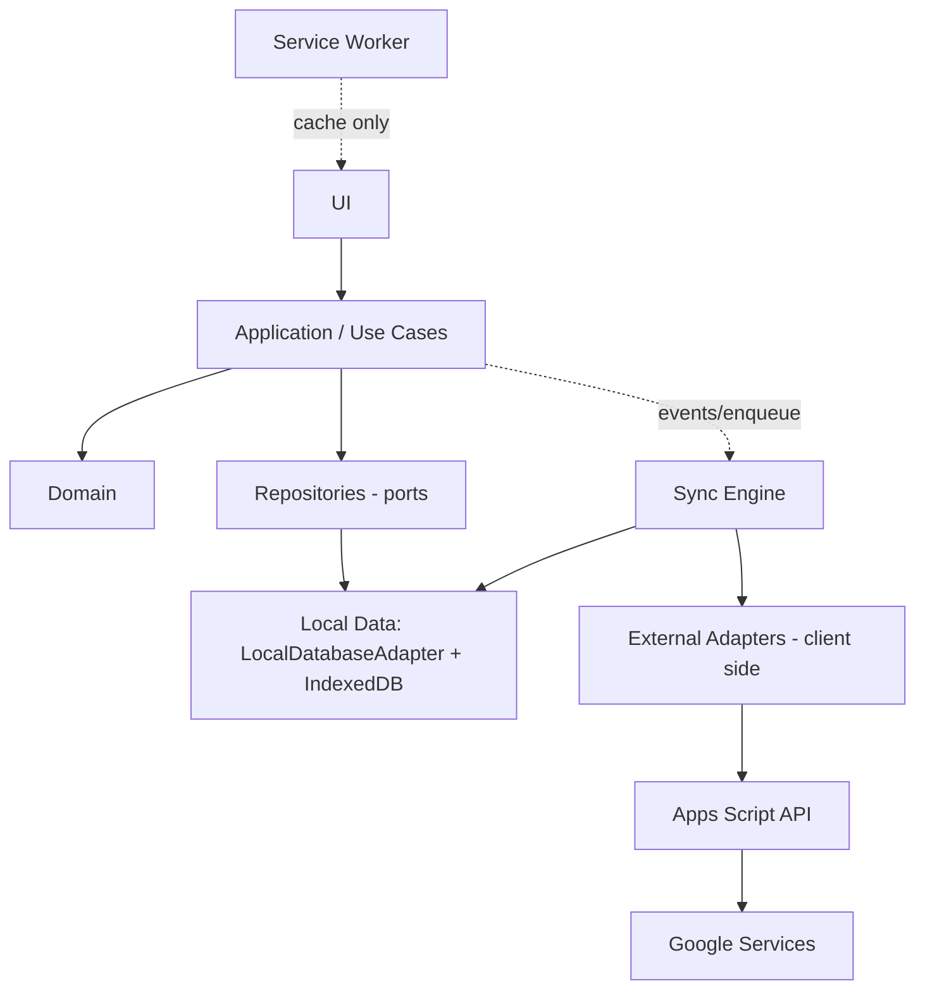

**الاعتماد يتجه لأسفل فقط.** Domain في الأسفل ولا يعتمد على شيء. لا أحد يعتمد على UI. Service Worker جانبي: لا يستدعي Application ولا Domain.

### 6.2 حدود كل طبقة

| الطبقة | ماذا تعرف (May know) | ماذا تستدعي (May call) | ما يُمنع منعًا باتًا (Must never call) |
|---|---|---|---|
| **UI** | View Models، واجهات Application (Commands/Queries)، Tokens، i18n | Application فقط + APIs العرض في المتصفح | Repositories، IndexedDB، `fetch` إلى Apps Script، أي Google API، Sync Internals، تعديل كيانات Domain مباشرة |
| **Application** (Use Cases) | Domain، Ports (Repository/Clock/IdGenerator/Outbox)، Authorization المحلي، Entitlement، AccessGuard | Domain، Repository Ports، Unit of Work، Event Bus | IndexedDB API، `fetch`/Google، DOM، Service Worker، منطق عرض |
| **Domain** | نفسه فقط: كيانات، قيم، قواعد، آلات حالة، حسابات وقت | وحدات Domain أخرى | **أي I/O**: شبكة، تخزين، DOM، `Date.now()`/`Math.random()` مباشرة (تُحقن عبر Ports)، Google |
| **Repository** | مخطط التخزين، Mapping كيان↔سجل، عقد LocalDatabaseAdapter، Unit of Work | LocalDatabaseAdapter، OutboxWriter (داخل المعاملة) | الشبكة، Sync Engine، UI، Google، اتخاذ قرارات أعمال |
| **Local Data** | IndexedDB، المخازن، الفهارس، الترحيلات | IndexedDB فقط | Domain rules، الشبكة، UI |
| **Sync** | Outbox/Cursor/Conflicts (عبر SyncStore)، عقد الـAPI، سياسات الدمج (Domain نقي) | SyncStore، ApiClient، قواعد Domain النقية | UI، IndexedDB خارج SyncStore، Google APIs، **استدعاء Use Cases** (مثل `CompleteLesson`)، منطق أعمال |
| **External Adapters (عميل)** | DTOs الخارجية: ApiClient، NotificationProviders، LicenseVerifier (WebCrypto)، FilePicker | `fetch`، Notification API، WebCrypto | تعديل كيانات Domain، الوصول المباشر إلى Repositories، UI |
| **Apps Script** | عقد الـAPI، Schema Registry، قواعد Domain المشتركة (بناء) | Google Services **عبر Repositories/Adapters فقط**، Domain المشتركة | التفاعل مع UI، الثقة في العميل، كونه **نقطة الثقة الوحيدة للترخيص**، منطق أعمال خارج Services/Domain |
| **Google Services** | لا شيء عن التطبيق | — | لا يُستدعى إلا من Adapters/Repositories داخل Apps Script |

### 6.3 قواعد إضافية

1. **تنفيذ الحدود آليًا** (PHASE 2): قواعد اعتماد (Dependency Rules) في CI + اختبارات معمارية تفشل عند مخالفة الاتجاه.
2. **Ports & Adapters:** كل ما يخص العالم الخارجي (وقت، عشوائية، شبكة، تخزين، إشعار) يدخل Application/Domain عبر Port قابل للاستبدال والاختبار.
3. **Sync يكتب عبر مسار التطبيق للسحب فقط** (`ApplyPulledPage`) ولا يمر بـUse Cases الأعمال، كي لا تُنتج المزامنة أحداثًا وتذكيرات مكررة؛ التذكيرات تُعاد تخطيطها **بعد** التطبيق عبر ReminderPlanner.
4. **Events:** Domain Events تُطلق من Application بعد نجاح المعاملة (Outbox داخلي عند الحاجة) وليس من داخل Domain مباشرة إلى الخارج.

---

## 7. SOURCE OF TRUTH MATRIX

### 7.1 مستويان للسلطة (لحل ظاهر التعارض)

| المستوى | المعنى | من |
|---|---|---|
| **Working Authority** | الحقيقة التي **يعمل عليها المستخدم الآن** (بما فيها ما لم يُرسل بعد) | **Local DB** (INV-07) |
| **Converged Authority** | الحقيقة **المتفق عليها بين الأجهزة** بعد الالتزام بترتيب `serverRevision` | **Google Sheets** (عبر الخادم) |

لا تعارض بين المستويين: الأول يقود الواجهة Offline، والثاني يحسم عند التقاء الأجهزة. **Calendar وDrive وGmail ليست أيًّا منهما** إلا حيث يُذكر صراحة (بايتات الملفات).

### 7.2 المصفوفة

| البيانات | Local DB | Google Sheets | Calendar | Drive | أخرى | **Authoritative Source** | **Cached / Projected / External** |
|---|---|---|---|---|---|---|---|
| **Student** | ✔ عمل | ✔ `ent_Student/Person` | — | صورة (ملف) | `pv_Child` | Local (غير ملتزَم) → **Sheets** (ملتزَم) | `pv_Child` (إسقاط)، اسمه داخل عنوان حدث Calendar (إسقاط) |
| **Parent** | ✔ | ✔ | — | — | `pv_*` | Local → **Sheets** | `PortalAccount` (خادمي)، إسقاط البوابة |
| **Lesson** | ✔ | ✔ | حدث مُسقَط | — | `pv_Lesson` | Local → **Sheets** | حدث Calendar، `pv_Lesson`، `DailyPlan` |
| **Schedule** (`ScheduleRule`) | ✔ | ✔ | — (لا أحداث متكررة) | — | — | Local → **Sheets** | الحصص المولَّدة (اشتقاق) |
| **Attendance** | ✔ | ✔ | — | — | `pv_Attendance` | Local → **Sheets** | `pv_Attendance`، Aggregates |
| **Assessment / Result** | ✔ | ✔ | — | — | Google Forms/Sheets (خام) | Local → **Sheets** (بعد الاستيراد) | ردود Forms **مدخل خارجي** لا حقيقة؛ `pv_Result` |
| **Reminder** | ✔ (مشتق) | القواعد + التذكير اليدوي فقط | — | — | — | **`ReminderRule` + Lesson** (التذكير المشتق يُعاد بناؤه) | `Reminder(derived)` Cache محلي |
| **Notification** | ✔ (ذاتي) | الموجَّه لولي أمر فقط | — | — | Gmail (تسليم) | Local (الذاتي) / **Sheets** (الموجَّه) | سجل الإرسال في Gmail = دليل خارجي لا مصدر |
| **File** | Blob Cache + وصف | ✔ وصف | — | ✔ **البايتات** | — | **الوصف: Sheets؛ البايتات: Drive** | Blob محلي (LRU)، Thumbnail |
| **Calendar Event** | `CalendarProjection` (حالة) | ✔ حالة الإسقاط | ✔ الحدث | — | — | **Lesson/PersonalEvent** (Domain) | الحدث نفسه إسقاط قابل للإعادة (INV-17) |
| **License** | Token + Lease مخزَّنان | `_Activations` (سجل) | — | — | **License Authority (البائع)** | **البائع (مصدر التوقيع)**، والتحقق المحلي ينفَّذ Offline | التوكن المخزَّن نسخة موقّعة، سجل الخادم غير حاسم للصلاحية |
| **Installation** | ✔ `jihad_meta` | `_Installations` (سجل) | — | — | البائع (طلب التفعيل) | **`jihad_meta` لهويته** + **Sheets لتسجيله** | سجل الخادم = تسجيل، لا يولّد الهوية |
| **Device** | Cache | ✔ `_Devices` | — | — | البائع (خانات الترخيص) | **Sheets (تسجيل)** + **البائع (حد الخانات)** | عرض «أجهزتي» محلي |
| TeacherNote / ParentNote | ✔ | ✔ ورقتان منفصلتان | — | — | `pv_Note` (Parent فقط) | Local → **Sheets** | `pv_Note` لـParentNote فقط |
| PortalAccount / Session | ✔ وصف فقط | ✔ وصف؛ الأسرار `X` | — | — | — | **الخادم (V/X)** | لا نسخة محلية لأسرار |
| AuditLog | ✔ | ✔ | — | — | — | **Sheets** (ملحق فقط) | — |

**قاعدة الحسم:** عند اختلاف قيمتين لنفس المعلومة: (1) الترتيب بـ`serverRevision`؛ (2) الإسقاطات (Calendar/`pv_*`/Cache) **تُعاد بناؤها ولا تُقرأ لاستعادة الحقيقة**؛ (3) لا يُستخدم Calendar ولا Drive ولا Gmail كمصدر لإصلاح Domain.

---

# A. Entity Dictionary

**كيف تُقرأ بطاقة الكيان:**
`PK` المفتاح الأساسي. `FK` المفاتيح الأجنبية (كلها بـ`id`، لا مطابقة نصية). `Fields` الحقول **إضافة إلى BASE** بصيغة `اسم:نوع` (`?` = اختياري، الباقي مطلوب). `Life` دورة الحياة. `Sync` فئة المزامنة (§4.3). `Owner` من ينشئه ويملك القرار. `Ver` الإصدار المستهدف.
**نطاق المنظمة والتدقيق:** كل كيان مزامَن يحمل `organizationId` وحقول التدقيق في BASE، وأي تغيير يُسجَّل أيضًا في `AuditLog` (§A.12) حيث يذكر ذلك.

---

## A.1 الهوية والمنظمة والوصول

### Organization  `V1`
الهدف: نطاق البيانات والعزل. **ليست المدرس ولا الترخيص ولا الجهاز.**
PK `id`. Fields: `name:text`, `slug:text` (ASCII، لأسماء المجلدات)، `defaultTimeZone:tz`, `defaultCurrency:text` (ISO 4217)، `locale:text` (`ar-EG`)، `weekStartsOn:int` (1–7 ISO)، `status:enum<active|suspended|archived>`.
Life: Active→Archived. Sync `V` (يُنشأ في Setup). Owner: Setup/Owner.

### Person  `V1`
الهدف: الهوية البشرية الأصلية (اسم، اتصال). يُبنى عليها Student/Parent/User دون تكرار بيانات.
PK `id`. Fields: `displayName:text`, `givenName:text?`, `familyName:text?`, `phone:text?` (E.164 مُطبَّع)، `whatsapp:text?`, `email:text?`, `birthDate:date?`, `photoFileId:uuid?` → File.
Life: Active→Archived→Deleted (لا حذف إن كان مرتبطًا بسجلات تاريخية؛ يُخفى). Sync `M`. Owner: من أنشأ الطالب/ولي الأمر.
تقليل البيانات: لا جنس ولا رقم قومي ولا عنوان داخل Person (العنوان = Location).

### User  `V1`
الهدف: **حساب دخول موظف** داخل المنظمة (Owner/Teacher/…). مختلف عن Person وعن Student وعن PortalAccount.
PK `id`. FK `personId`→Person. Fields: `authProvider:enum<google|pin_only>`, `authSubject:text?` (معرّف Google `sub`)، `status:enum<invited|active|suspended|archived>`, `lastLoginAt:instant?`.
لا كلمات مرور ولا أسرار هنا. Life: Invited→Active→Suspended/Archived. Sync `V`. Owner: Owner.

### Role  `V1`
PK `id`. Fields: `key:text` (`owner|teacher|assistant|secretary|accountant|administrator`)، `name:text`, `isSystem:bool`.
الأدوار النظامية تُزرع عند Setup ولا تُحذف. Sync `V`. Owner: Setup. (أدوار مخصصة `V1.3`.)

### RolePermission  `V1`
PK `id`. FK `roleId`. Fields: `permissionKey:text`.
**قائمة الصلاحيات (Permission Catalog) ثابتة في الكود** وبصيغة `<module>.<resource>.<action>` (مثل `students.record.read`)؛ لا جدول Permission. الجدول يربط الدور بمفاتيحها فقط. Unique(`roleId`,`permissionKey`). Sync `V`.

### UserRole  `V1`
PK `id`. FK `userId`, `roleId`. Fields: `scope:enum<organization|own>` (الافتراضي `organization`)، `validFrom:date?`, `validTo:date?`.
`own` = يرى/يعدّل ما يملكه فقط (طلابه/مجموعاته). مستخدم واحد قد يحمل أدوارًا متعددة (المدرس المالك = `owner` + `teacher`). Sync `V`.

### Student  `V1`
الهدف: الكيان الأكاديمي للطالب، منفصل عن الشخص.
PK `id`. FK `personId`→Person, `defaultLocationId`→Location?. Fields: `studentCode:text?` (فريد داخل المنظمة)، `schoolName:text?`, `status:enum<active|paused|graduated|archived>`, `startedOn:date?`.
**المرحلة والصف ليسا هنا** (→ StudentEnrollment). Life: Active↔Paused→Graduated→Archived→Deleted. Sync `M`. Owner: Teacher/Secretary.

### Parent  `V1`
PK `id`. FK `personId`→Person. Fields: `preferredChannel:enum<in_app|email|whatsapp|phone>?`, `status:enum<active|archived>`.
ولي الأمر شخص واحد قد يكون له عدة أبناء. Sync `M`.

### ParentStudentRelationship  `V1`
PK `id`. FK `parentId`, `studentId`. Fields: `relation:enum<father|mother|guardian|other>`, `isPrimary:bool`, `canViewPortal:bool`, `canReceiveMessages:bool`, `validFrom:date`, `validTo:date?`.
**مصدر الحقيقة لنطاق البوابة.** Unique(`parentId`,`studentId`,`validFrom`). Sync `M` (تغييرها يُعيد بناء Projection فورًا).
**إدارة العلاقة (D-05):** إضافة طفل = صف جديد؛ إزالة = `validTo` (لا حذف)؛ تغيير النوع/الأعلام = إنهاء الصف وإنشاء آخر (أو تعديل موثّق)؛ أكثر من ولي لطفل = صفوف متعددة و`isPrimary` لواحد. **نقطة توسّع:** حقل `permissions` إضافي بـMigration عند الحاجة (∞). التاريخ يُحفظ (§L.4، §T).

---

## A.2 النموذج الأكاديمي

### AcademicYear `V1`
PK `id`. Fields: `label:text` (`2026/2027`)، `startsOn:date`, `endsOn:date`, `isCurrent:bool`. Unique(`label`). Sync `M`. سنة حالية **واحدة فقط** تُفرض بقاعدة Domain.

### EducationalStage `V1`
PK `id`. Fields: `name:text`, `sortOrder:int`, `status`. مثال: ابتدائي/إعدادي/ثانوي. تُزرع كبيانات مرجعية قابلة للتعديل. Sync `M`.

### Grade `V1`
PK `id`. FK `stageId`. Fields: `name:text`, `sortOrder:int`, `status`. Sync `M`.

### Subject `V1`
PK `id`. Fields: `name:text`, `code:text?`, `colorToken:text?` (اسم Token لا لون خام)، `status:enum<active|archived>`. Sync `M`.

### TeacherSubject `V1`
PK `id`. FK `userId`, `subjectId`. Fields: `since:date?`. Unique(`userId`,`subjectId`). (المدرس يدرّس أكثر من مادة.) Sync `M`.

### Curriculum `V1`
PK `id`. FK `subjectId`, `gradeId`. Fields: `title:text`, `systemLabel:text?` (وطني/دولي…)، `academicYearId:uuid?`, `status`. Sync `M`.

### CurriculumUnit `V1`
PK `id`. FK `curriculumId`. Fields: `title:text`, `sortOrder:int`. Sync `M`.

### CurriculumTopic `V1`
PK `id`. FK `unitId`. Fields: `title:text`, `sortOrder:int`, `plannedLessons:int?`. Sync `M`.
(سلسلة Subject→Curriculum→Unit→Topic؛ تقدّم الطالب يُحسب لا يُخزَّن — §A.14.)

### StudentEnrollment `V1`
الهدف: **التاريخ الأكاديمي** (سنة/مرحلة/صف) دون تدمير القديم.
PK `id`. FK `studentId`, `academicYearId`, `gradeId`. Fields: `schoolName:text?`, `startedOn:date`, `endedOn:date?`, `status:enum<active|completed|withdrawn>`.
Unique(`studentId`,`academicYearId`,`gradeId`). المرحلة تُشتق من `Grade.stageId`. Sync `M`.

### StudentSubjectEnrollment `V1`
PK `id`. FK `studentEnrollmentId`, `subjectId`, `teacherUserId`→User. Fields: `startedOn:date`, `endedOn:date?`, `status:enum<active|paused|completed|withdrawn>`.
(طالب↔مادة عبر تسجيل، لا «طالب له مادة واحدة».) Sync `M`.

### Group `V1`
PK `id`. FK `subjectId`, `teacherUserId`, `gradeId?`, `academicYearId?`, `defaultLocationId?`. Fields: `name:text`, `capacity:int?`, `status:enum<active|paused|archived>`. Sync `M`.

### GroupMembership `V1`
PK `id`. FK `groupId`, `studentId`. Fields: `joinedOn:date`, `leftOn:date?`, `status:enum<active|left|transferred>`, `reason:text?`.
فترات زمنية لا تتداخل لنفس (`groupId`,`studentId`). الانتقال = إنهاء عضوية + إنشاء أخرى. Sync `M`.

---

## A.3 الأماكن والوقت

### Location `V1`
PK `id`. Fields: `name:text`, `type:enum<student_home|teacher_home|center|other|online>`, `addressLine:text?`, `area:text?`, `city:text?`, `lat:number?`, `lng:number?`, `onlineUrl:text?`, `notes:text?`, `status`. Sync `M`.
**سجل الحصص القديمة لا يتأثر بتغيير العنوان:** الحصة تحمل `locationSnapshot` عند البدء/الإكمال (§A.4).

### TravelEstimate `V1.1`
PK `id`. FK `fromLocationId`, `toLocationId`. Fields: `mode:enum<walking|driving|transit|other>`, `durationMin:int`, `distanceM:int?`, `source:enum<manual|heuristic|maps>`, `estimatedAt:instant`.
Cache للتقدير وليس حقيقة؛ Unique(`from`,`to`,`mode`). Sync `M`. Maps ليس شرطًا (`manual` يكفي).

### TravelBuffer `V1.1`
PK `id`. FK `userId?` (فارغ = افتراضي المنظمة). Fields: `prepMin:int`, `minBetweenLessonsMin:int`, `defaultTravelMin:int?`. Sync `M`. **سياسة** لا قياس.

### AvailabilityRule `V1`
الهدف: ساعات العمل الأسبوعية/الفترات المحجوبة (تعريف «الحر»).
PK `id`. FK `userId`. Fields: `weekday:int` (1–7)، `startLocal:time`, `endLocal:time`, `kind:enum<working|blocked>`, `validFrom:date?`, `validTo:date?`. Sync `M`.

### AvailabilityException `V1.1`
PK `id`. FK `userId`. Fields: `date:date`, `kind:enum<extra_working|day_off>`, `startLocal:time?`, `endLocal:time?`, `reason:text?`. Sync `M`.

### PersonalEvent `V1`
مواعيد المدرس الشخصية (تدخل في حساب الوقت الحر).
PK `id`. FK `userId`, `locationId?`. Fields: `title:text`, `startsAtUtc:instant`, `endsAtUtc:instant`, `timeZone:tz`, `localDate:date`, `allDay:bool`, `kind:enum<personal|travel|prep|other>`, `notes:text?`. Sync `M`. (تكرار الأحداث الشخصية `V2`؛ يكفي AvailabilityRule `blocked`.)

### NonTeachingPeriod `V1.1`
PK `id`. FK `userId?`. Fields: `startsOn:date`, `endsOn:date`, `reason:text?`. عطلة تمنع توليد الحصص. Sync `M`.

---

## A.4 الجدولة والحصص

### ScheduleRule `V1`
**قاعدة التكرار (ما يفترض أن يحدث).** لا تحمل تاريخًا تاريخيًا.
PK `id`. FK `teacherUserId`, `subjectId`, `studentId?`, `groupId?` (**أحدهما مطلوب بالضبط**)، `locationId?`. Fields: `timeZone:tz`, `frequency:enum<weekly>`, `interval:int` (=1)، `byWeekday:json` (مصفوفة 1–7)، `startsOn:date`, `untilOn:date?`, `startLocal:time`, `durationMin:int`, `status:enum<active|paused|ended>`, `generatedThrough:date?`, `version:int`.
تعديل «هذه وما بعدها» = إنهاء القاعدة القديمة (`untilOn`) + إنشاء قاعدة جديدة. Sync `M`. أنماط أخرى (شهري/يوم محدد) `V2`.
**`version` عدّاد على هذا السجل نفسه (يُستبدَل لا يُحتفَظ بتاريخه)؛ المصدر التاريخي غير القابل للتغيير لكل زيادة هو `ScheduleRuleVersionSnapshot` أدناه — لازم لتحقق تصادم الإنشاء الحتمي (§F.2.3 #5، §G.4).**

### ScheduleRuleVersionSnapshot `V1` — `A` (Append-only، غير قابلة للتغيير)
**المصدر التاريخي الوحيد** لإعادة توليد أي إصدار سابق من `ScheduleRule` للتحقق من تصادم الإنشاء الحتمي (§F.2.3 #5). **ليست تأريخًا عامًا للكيان** — فقط الحقول التي تستهلكها `GenerateInstances` (§F.2.4).
PK مركَّب (`scheduleRuleId`, `version`). Fields: `timeZone:tz`, `byWeekday:json`, `startLocal:time`, `durationMin:int`, `locationId?:uuid`, `subjectId:uuid`, `studentId?:uuid`, `groupId?:uuid`, `snapshotAt:instant`.
**يُكتَب إلزاميًا ضمن نفس دفعة WAL (§E.4) التي تزيد `ScheduleRule.version`** — لا كتابة منفصلة، لا حالة يمكن فيها التزام إصدار جديد لـ`ScheduleRule` بلا لقطته المقابلة.
**الاحتفاظ ≥180 يومًا** (نفس عتبة Tombstones القائمة، INV-46/§Q.5 — لا رقم منفصل). هذه المدة تتجاوز أفق التوليد (≤120 يومًا، §F.2.4) وأطول انقطاع Offline واقعي موصوف في هذه الوثيقة، فتبقى أي نسخة قد يحتاجها تحقق تصادم إنشاء متاحة عمليًا دائمًا ضمن السيناريوهات الموصوفة.

### ScheduleException `V1`
PK `id`. FK `scheduleRuleId`. Fields: `occurrenceKey:date`, `kind:enum<skip|move>`, `newStartsAtUtc:instant?`, `reason:text?`.
تمنع توليد/تعدّل نسخة **قبل** أن تُنتَج فعليًا. Unique(`scheduleRuleId`,`occurrenceKey`). Sync `M`.

### Lesson `V1` (أهم كيان)
**الحصة الفعلية (Instance).**
PK `id` — **حتمي UUIDv5** من (`scheduleRuleId`,`occurrenceKey`) للمولَّدة، وUUIDv7 لليدوية.
FK `teacherUserId`, `subjectId`, `locationId?`, `groupId?`, `scheduleRuleId?`, `relatedLessonId?`, `academicYearId?`.
Fields: `occurrenceKey:date?`, `startsAtUtc:instant`, `endsAtUtc:instant`, `timeZone:tz`, `localDate:date`, `localStart:time`, `status:enum<scheduled|in_progress|completed|cancelled|rescheduled>`, `statusReason:text?`, `cancelledBy:enum<teacher|student|parent|other>?`, `relationType:enum<rescheduled_from|makeup_for|replaces>?`, `startedAt:instant?`, `completedAt:instant?`, `locationSnapshot:json?`, `title:text?`, `ruleVersion:int?` (نسخة القاعدة التي ولّدتها؛ **قرار الاستبدال يتحدد بحارس `isModified` + تحقق خادمي مستقل، لا بمقارنة رقمية مجردة**، §F.2.3 #5)، `isModified:bool` (عُدّلت يدويًا فلا تُعاد كتابتها بالتوليد؛ **يمنع أيضًا أي استبدال من إنشاء مولَّد متأخر بصرف النظر عن `ruleVersion`**).
Life: انظر §C.1. Sync `S` (الحالة) + `M` (بقية الحقول). Owner: Teacher/Assistant.
`locationSnapshot` = `{name,addressLine,lat,lng}` يُجمَّد عند `in_progress`. مصدر السعر التاريخي `V1.2` (يُضاف `pricingSnapshot` بـMigration).
Unique(`scheduleRuleId`,`occurrenceKey`) عند عدم الفراغ.

### LessonParticipant `V1`
PK `id`. FK `lessonId`, `studentId`, `groupMembershipId?`. Fields: `source:enum<group|direct|added_late>`.
حصة المجموعة تُنتج مشاركين **بالأفراد** عند التوليد (لقطة العضوية وقتها) وتُجمَّد عند `in_progress`. Unique(`lessonId`,`studentId`). Sync `M`.

### Attendance `V1`
PK `id`. FK `lessonParticipantId` (**1:1**)، وللفهرسة `lessonId`, `studentId`. Fields: `status:enum<present|absent|late|excused|not_recorded>`, `lateMinutes:int?`, `note:text?`, `recordedAt:instant`, `recordedBy:uuid`.
التاريخ عبر AuditLog. Sync `M` (الحقل `status` سياسته: أول وصول للخادم + إشعار، §G.6). لماذا كيان منفصل: سياسة تعارض مختلفة وإسقاط Portal مختلف.

### LessonCoverage `V1`
ما تم شرحه.
PK `id`. FK `lessonId`, `topicId?`. Fields: `customTitle:text?` (أحدهما مطلوب)، `level:enum<introduced|practiced|completed>`, `sortOrder:int`, `note:text?`. Sync `M`.
**قاعدة الاحتساب:** يُحتسب التقدّم للطالب من الحصص التي كان فيها `present|late` (الغائب لا يُنسب إليه). (OQ-05)

---

## A.5 الواجبات والملاحظات

### Homework `V1`
PK `id`. FK `subjectId`, `lessonId?`, `groupId?`. Fields: `title:text`, `description:text?`, `assignedOn:date`, `dueOn:date?`, `maxScore:number?`, `parentVisible:bool`, `status:enum<draft|assigned|closed|cancelled>`. المرفقات عبر FileReference. Sync `S`+`M`.

### HomeworkSubmission `V1`
PK `id`. FK `homeworkId`, `studentId`. Fields: `status:enum<assigned|submitted|late|missing|excused|graded>`, `submittedAt:instant?`, `score:number?`, `feedback:text?`, `gradedAt:instant?`. تُنتج لكل مشارك عند إسناد الواجب. Unique(`homeworkId`,`studentId`). Sync `S`.

### TeacherNote `V1`  — داخلية فقط
PK `id`. Fields: `targetType:enum<student|lesson|group|homework|assessment>`, `targetId:uuid`, `body:text`, `pinned:bool`. **لا تدخل أي Projection أبدًا.** Sync `M`. الصلاحية `notes.teacher.read`.

### ParentNote `V1` — مكتوبة لولي الأمر
PK `id`. Fields: `targetType:enum<student|lesson|homework|assessment>`, `targetId:uuid`, `body:text`, `publishedAt:instant?`. لا تحتوي حقل `visibility`؛ وجودها = مقصودة للبوابة (بعد النشر). «تحويل ملاحظة داخلية» = **نسخ** لا قلب علم. Sync `M`.

---

## A.6 الاختبارات

### Assessment `V1.1`
PK `id`. FK `subjectId`, `groupId?`, `sourceId?`. Fields: `title:text`, `type:enum<quiz|exam|oral|other>`, `sourceType:enum<manual|google_forms>`, `heldOn:date`, `maxScore:number`, `weight:number?`, `parentVisible:bool`, `status:enum<draft|published|closed|cancelled>`. Sync `S`+`M`.

### AssessmentResult `V1.1`
PK `id`. FK `assessmentId`, `studentId`, `importBatchId?`. Fields: `attemptNo:int` (=1)، `score:number?`, `maxScoreSnapshot:number`, `status:enum<scored|absent|excused>`, `origin:enum<manual|import|manual_override>`, `externalResponseId:text?`, `feedback:text?`, `gradedAt:instant?`.
Unique(`assessmentId`,`studentId`,`attemptNo`) وUnique(`sourceId`,`externalResponseId`) لإعادة استيراد آمنة. لا حذف؛ التصحيح بسجل/تعديل موثّق. Sync `M`.

### ExternalAssessmentSource `V1.1`
PK `id`. Fields: `adapter:enum<google_forms>`, `externalRef:text` (معرّف الورقة/النموذج)، `columnMapping:json`, `studentMatchBy:enum<studentCode|phone|email>`, `status`. Sync `V`.

### AssessmentImportBatch `V1.1`
PK `id`. FK `sourceId`, `assessmentId`. Fields: `startedAt:instant`, `rowsRead:int`, `rowsAccepted:int`, `rowsRejected:int`, `errors:json?`. Sync `A`.

---

## A.7 التذكير والإشعارات

### ReminderRule `V1`
PK `id`. FK `userId?`. Fields: `kind:enum<before_lesson|morning_schedule|depart|homework_due|assessment|custom>`, `offsetMin:int?`, `timeLocal:time?`, `channels:json` (مفاتيح Providers)، `quietFrom:time?`, `quietTo:time?`, `enabled:bool`. Sync `M`.

### Reminder `V1`
**نية تذكير مخطَّطة** (متى + ماذا).
PK `id` — **حتمي** = UUIDv5(`ruleId`,`targetType`,`targetId`,`fireAtUtc`). Fields: `ruleId:uuid?`, `targetType:text`, `targetId:uuid`, `fireAtUtc:instant`, `origin:enum<derived|user>`, `status:enum<planned|fired|skipped|cancelled>`, `sourceSnapshot:json?` (`{startsAtUtc, status}` للكيان المصدر وقت التخطيط — يُستخدَم لفحص الصلاحية قبل التسليم، §I.9 Layer B).
`derived` = **Local-only** (يُعاد بناؤه من الحصص والقواعد)، `user` (تذكير مخصص) = مزامَن. Sync `L`/`M` بحسب `origin`.
**عند أي تغيير في `Lesson.startsAtUtc` أو انتقالها لحالة نهائية (`cancelled`)، يُبطَل ضمن نفس المعاملة المحلية كل `Reminder` بحالة `planned` مرتبط عبر الفهرس `[targetType,targetId]` (§D.3) — إبطال نشط، لا اعتماد على تغيّر المعرّف وحده (INV-59).**

### Notification `V1`
**المحتوى** (ماذا نقول ولمن).
PK `id` — **حتمي** = UUIDv5(`dedupeKey`). Fields: `dedupeKey:text`, `recipientType:enum<self|parent>`, `recipientId:uuid?`, `title:text`, `body:text`, `deepLink:text?`, `reminderId:uuid?`, `createdFrom:enum<reminder|domain_event|admin>`, `status:enum<created|scheduled|delivered|failed|dismissed|expired>`.
`recipientType=self` = Local-only؛ `parent` = مزامَن (ينفَّذ خادميًا). Sync `L`/`M`.

### NotificationDelivery `V1`
**التسليم عبر قناة.**
PK `id`. FK `notificationId`. Fields: `provider:enum<inapp|local_push|local_scheduled|calendar|email|whatsapp|web_push|native_local>`, `status:enum<queued|scheduled|sent|delivered|failed|dismissed|clicked|expired>`, `attempt:int`, `error:text?`, `providerRef:text?`, `at:instant`.
`provider ∈ {inapp,local_push,local_scheduled,native_local}` → Local-only؛ غير ذلك → مزامَن. Sync `L`/`A`.

---

## A.8 Calendar

### CalendarTarget `V1.1`
PK `id`. FK `userId`. Fields: `googleCalendarId:text`, `mode:enum<dedicated>`, `windowPastDays:int`, `windowFutureDays:int`, `remindersMin:json`, `enabled:bool`. تقويم مخصص يُنشئه الـAdapter باسم «الجهاد». Sync `V`.

### CalendarProjection `V1.1`
PK `id` — حتمي من (`sourceType`,`sourceId`,`targetId`). FK `targetId`. Fields: `sourceType:enum<lesson|personal_event>`, `sourceId:uuid`, `externalEventId:text?`, `etag:text?`, `contentHash:text`, `status:enum<pending|synced|failed|orphaned|detached>`, `lastAttemptAt:instant?`, `error:text?`.
حقول الحالة يكتبها الخادم فقط. Sync `V`.

---

## A.9 الملفات

### File `V1`
PK `id`. Fields: `name:text`, `mimeType:text`, `sizeBytes:int`, `sha256:text`, `storageProvider:enum<local|drive>`, `storageRef:text?` (معرّف Drive)، `status:enum<local_only|uploading|available|missing|deleted>`, `thumbFileId:uuid?`. **لا Blob في السجل.** Sync `M` (الحالة/`storageRef` من الخادم).

### FileReference `V1`
PK `id`. FK `fileId`. Fields: `targetType:text`, `targetId:uuid`, `purpose:enum<student_photo|homework_attachment|report|other>`, `parentVisible:bool`, `sortOrder:int`. Sync `M`.

---

## A.10 بوابة ولي الأمر

### PortalAccount `V1`
PK `id`. FK `parentId` (**1:1**). Fields: `loginId:text` (هاتف/بريد مُطبَّع)، `status:enum<invited|active|suspended|revoked>`, `lastLoginAt:instant?`. **بلا أي سر.** Sync `V`.

### PortalInvite `V1` — `X` Server-only
PK `id`. FK `portalAccountId`. Fields: `codeHash:text`, `expiresAt:instant`, `usedAt:instant?`, `attempts:int`.

### PortalCredential `V1` — `X`
PK `id`. FK `portalAccountId`. Fields: `secretHash:text`, `salt:text`, `algorithm:text`, `failedCount:int`, `lockedUntil:instant?`, `changedAt:instant`.

### PortalSession `V1` — `X`
PK `id`. FK `portalAccountId`. Fields: `tokenHash:text`, `deviceLabel:text?`, `issuedAt:instant`, `expiresAt:instant`, `absoluteExpiresAt:instant`, `lastSeenAt:instant`, `revokedAt:instant?`.

---

## A.11 الترخيص (الجانب المحلي + جانب البائع)

> **خارج التطبيق (جهة البائع):** Product، Customer، سجل إصدار التراخيص، المفتاح الخاص. **داخل التطبيق:** Installation، Device، License Token موقّع، Activation Certificate، Lease، Revocation List. التفاصيل في §N.

### Product / Customer  `vendor-side`
Product: `productKey`, `editions`. Customer: `customerId`, `name`, `contact`. **لا يُزامَنان إلى تطبيق العميل ولا إلى خادم المنظمة.**

### Installation `V1` (في `jihad_meta`)
PK `installationId:uuid` (**عشوائي، لا Fingerprint عتادي**). Fields: `organizationId?`, `createdAt`, `appVersion:text`, `status:enum<active|retired>`, `publicKeyJwk:json` (مفتاح التثبيت العام؛ الخاص غير قابل للتصدير)، `hint:text?`.
يُنشأ عند أول تشغيل ويموت بمسح التخزين.

### Device `V1`
**خانة جهاز مسجّلة** يفهمها المستخدم (لا تعريف عتاد).
PK `id`. Fields: `label:text`, `platform:text`, `registeredAt:instant`, `status:enum<active|replaced|revoked>`, `currentInstallationId:uuid?`. Sync `V`.

### License Token `V1` — لقطة موقّعة (لا تُعدَّل)
Fields: `licenseId, productKey, edition, customerRef, organizationBinding?, notBefore, expiresAt, entitlements:json, maxInstallations, maxDevices, expirationPolicy, graceDays, offlinePolicy:{leaseDays, softRefreshDays, offlineGraceDays}, formatVersion, keyId, signature`. تُخزَّن كما هي في `jihad_meta`.

### LicenseLease `V1` — تفويض قصير الأجل (في `jihad_meta`)
Fields: `leaseId, licenseId, installationId, issuedAt, validUntil, revocationListVersion, keyId, signature`. يُجدَّد عند الاتصال.

### RevocationList `V1` — قائمة إبطال موقّعة (في `jihad_meta`)
Fields: `version:int, issuedAt, revokedLicenseIds:json, revokedActivationIds:json, keyId, signature`.

### Activation `V1`
PK `id`. Fields: `licenseId, installationId, deviceId, activatedAt, status:enum<active|deactivated|transferred|revoked>, lastCheckInAt?, certificate:text` (موقّعة من البائع). Sync `V`.

### Entitlement `V1`
**قيم مشتقة** من License (لا جدول): `maxStudents, maxTeachers, portal, assessments, advancedReports, googleIntegration, finance`. تُقرأ عبر `EntitlementService` (نقطة وحيدة).

### LicenseTransfer `V1`
PK `id`. Fields: `licenseId, fromInstallationId, toInstallationId?, requestedAt, completedAt?, status:enum<requested|completed|rejected|expired>`. Sync `V`.

---

## A.12 المزامنة والبنية التحتية

### SyncOperation (Outbox) `V1` — `L`
انظر §G.3. PK `operationId`. Fields: `clientSeq:int`, `batchId:uuid?`, `entityType`, `entityId`, `opType:enum<create|patch|delete|restore|command>`, `changes:json` (قائمة `{field,from,to}`)، `baseServerRevision:int`, `payload:json?`, `status:enum<pending|processing|acked|failed|conflict|blocked|quarantined>`, `attempts:int`, `nextAttemptAt:instant?`, `lastError:json?`, `createdAt:instant`, `installationId`, `deviceId`, `userId`.

### SyncConflict `V1` — `L` + سجل خادم
PK `id`. Fields: `operationId`, `entityType`, `entityId`, `kind:enum<field_diverged|deleted_elsewhere|invalid_transition|schedule_overlap|forbidden|dependency_missing|validation_failed>`, `localValue:json`, `serverValue:json`, `status:enum<open|resolved_local|resolved_server|dismissed>`, `detectedAt:instant`, `resolvedAt:instant?`.

### SyncCursor `V1` — `L`
PK (`scope`). Fields: `lastServerRevision:int`, `dataEpoch:int`, `lastSuccessAt:instant?`, `lastAttemptAt:instant?`, `status:enum<idle|running|partial|failed>`, `perTypeResult:json`.

### ChangeLogEntry `V1` — `V` (ورقة `_Changes`)
Fields: `serverRevision:int` (PK)، `entityType`, `entityId`, `op:enum<upsert|delete|restore>`, `serverAt:instant`, `operationId?`.

### ServerOperation `V1` — `X` (ورقة `_Ops`)
PK `operationId`. Fields: `installationId`, `batchId`, `receivedAt`, `status`, `serverRevision?`, `result:json` (قصير)، **`entityType`, `entityId`, `opType`, `requestFingerprint`** (تجزئة قانونية لـ`{entityType, entityId, opType, changes/payload}` بنفس آلية §G.12.2). تُحتفظ 30 يومًا.
**`operationId` وحده لا يُثبت Replay** — الإثبات يتطلب تطابق `requestFingerprint` أيضًا (§G.4 خطوة 2، INV-61).

### AuthSession `V1` — `X`
PK `id`. FK `userId`. Fields: `tokenHash`, `refreshHash`, `installationId`, `issuedAt`, `expiresAt`, `refreshExpiresAt`, `revokedAt?`.

### Backup `V1`
PK `id`. Fields: `kind:enum<client_export|drive_snapshot|sheet_copy>`, `createdAt`, `appVersion`, `dbVersion:int`, `serverSchemaVersion:int`, `dataEpoch:int`, `entityCounts:json`, `checksum:text`, `location:text`, `status:enum<running|complete|failed|verified|expired>`, `verifiedAt?`. Sync `A` (سجل فقط؛ الحمولة خارجها).

### AuditLog `V1` — `A`
PK `id`. Fields: `at:instant`, `actorType:enum<user|portal|system>`, `actorId:uuid?`, `installationId`, `action:text`, `entityType:text?`, `entityId:uuid?`, `changedFields:json?` (أسماء + قيم غير حساسة/Hash)، `outcome:enum<ok|rejected|error>`, `correlationId:uuid`, `reason:text?`.
لا كلمات مرور ولا أسرار. الاحتفاظ: سنتان افتراضيًا (OQ-09).

### AppSetting `V1`
PK `id`. Fields: `scope:enum<organization|user|device>`, `scopeId:uuid?`, `key:text`, `value:json`. `device` = Local-only. Unique(`scope`,`scopeId`,`key`). Sync `M`/`L`.

### FeatureFlag `V1`
PK `id`. Fields: `key:text`, `enabled:bool`, `source:enum<entitlement|remote|local>`. Sync `V`.

---

## A.13 المالية — `V1.2` (قيود تصميمية الآن فقط)

**Payment** (دفعة مستلمة: `studentId`, `payerParentId?`, `amount:money`, `currency`, `method`, `receivedOn:date`) و**FinancialTransaction** (سجل محاسبي **Append-only**: `kind`, `amount:money`, `currency`, `refType/refId`, `reversalOf?`).
القيود: المبالغ أعداد صحيحة بوحدة صغرى + `currency`؛ التصحيح بقيد عكسي لا تعديل؛ لا تؤثر تغييرات السعر على الحصص القديمة (`pricingSnapshot` يُضاف للـLesson بـMigration وقت تفعيل الوحدة). Sync `A`.

---

## A.14 نماذج قراءة مشتقة (Local-only، تُعاد بناؤها)

| الاسم | الغرض | المصدر | ملاحظة |
|---|---|---|---|
| DailyPlan | خط زمني ليوم معيّن: تحضير→سفر→حصة→حر | Lesson + PersonalEvent + TravelEstimate + TravelBuffer | مخزَّن للسرعة، يُبطل عند تغيّر المدخلات |
| FreeSlot | فترات متاحة (لا تُحجز تلقائيًا) | AvailabilityRule − Lessons − Buffers − Events | قيمة محسوبة لا كيان |
| CurriculumProgress | نسبة الإنجاز لكل (طالب + مادة + فترة) | LessonCoverage + Attendance + CurriculumTopic | Aggregate قابل لإعادة البناء |
| SearchIndex | بحث مركزي | Person/Student/Parent/Lesson… | رموز مُطبَّعة عربيًا؛ المُطبِّع يُحدَّد في PHASE 2 |
| ReminderPlan | التذكيرات المشتقة | ReminderRule + Lesson | = Reminder بـ`origin=derived` |

---

# B. Relationships

## B.1 جدول العلاقات (Cardinality)

| العلاقة | النوع | التنفيذ | قيد/ملاحظة |
|---|---|---|---|
| Organization → (كل كيان مزامَن) | 1:N | `organizationId` | مطلوب دائمًا |
| Person → User | 1:0..1 | `User.personId` | شخص واحد لا يملك أكثر من حساب موظف في المنظمة |
| Person → Student | 1:0..1 | `Student.personId` | |
| Person → Parent | 1:0..1 | `Parent.personId` | نفس الشخص قد يكون Parent وUser (مدرس وولي أمر) دون تكرار Person |
| Parent ↔ Student | **N:M** | `ParentStudentRelationship` (زمني) | ولي أمر بعدة أبناء وطالب بأكثر من ولي |
| Parent → PortalAccount | 1:0..1 | `PortalAccount.parentId` | حساب واحد لولي الأمر مهما بلغ الأبناء |
| User ↔ Role | N:M | `UserRole` | نطاق `organization|own` |
| Role ↔ Permission | N:M | `RolePermission` + كتالوج ثابت | |
| User ↔ Subject | N:M | `TeacherSubject` | |
| Subject → Curriculum → Unit → Topic | 1:N متسلسلة | FK مباشر | Curriculum مرتبط أيضًا بـGrade |
| Grade → EducationalStage | N:1 | `Grade.stageId` | |
| Student ↔ AcademicYear/Grade | N:M زمني | `StudentEnrollment` | |
| StudentEnrollment ↔ Subject | N:M | `StudentSubjectEnrollment` | + المدرس المسؤول |
| Student ↔ Group | **N:M زمني** | `GroupMembership` | فترات غير متداخلة |
| ScheduleRule → Lesson | 1:N | `Lesson.scheduleRuleId` + `occurrenceKey` | معرّف حتمي |
| ScheduleRule → ScheduleException | 1:N | | |
| Lesson → LessonParticipant | 1:N | | فردي = مشارك واحد |
| LessonParticipant → Attendance | **1:1** | `Attendance.lessonParticipantId` | |
| Lesson → LessonCoverage | 1:N | | يشير لـTopic أو نص حر |
| Lesson ↔ Lesson | N:1 اختياري | `relatedLessonId` + `relationType` | إعادة جدولة/تعويض/استبدال |
| Lesson → Location | N:1 | | + لقطة `locationSnapshot` |
| Group / Student → Location (افتراضي) | N:1 | `defaultLocationId` | |
| Homework → HomeworkSubmission | 1:N | لكل مشارك | |
| Assessment → AssessmentResult | 1:N | Unique(assessment,student,attempt) | |
| Assessment → ExternalAssessmentSource | N:1 | | |
| ReminderRule → Reminder → Notification → NotificationDelivery | 1:N متسلسلة | | Reminder/Notification حتميّة الهوية |
| Lesson/PersonalEvent → CalendarProjection | 1:N (حسب Target) | | |
| File ↔ (أي كيان) | N:M | `FileReference` | |
| License → Activation → (Installation, Device) | 1:N | | |
| Installation → Device | N:1 (حاليًا) | `Device.currentInstallationId` | استبدال جهاز = Transfer |

## B.2 قواعد سلامة العلاقات (Data Integrity Rules)

1. **لا FK يشير لسجل بمنظمة أخرى.** يُفحص محليًا وعلى الخادم.
2. **لا حذف مادي لسجل مُشار إليه** (RESTRICT)؛ الحذف = Tombstone، والتعامل مع التابعين يُقرَّر في Use Case (أرشفة/حذف تتالي منطقي موثّق).
3. **`ScheduleRule`**: أحد (`studentId`,`groupId`) فقط.
4. **`GroupMembership`**: لا تداخل فترات لنفس (المجموعة، الطالب).
5. **`Lesson`**: `endsAtUtc > startsAtUtc`؛ ومشاركون ≥ 1 عند الانتقال إلى `in_progress`.
6. **`AssessmentResult`**: الطالب ضمن نطاق الاختبار (مجموعة/تسجيل مادة).
7. **`ParentStudentRelationship`**: `validTo ≥ validFrom`. وصول البوابة يتطلب `canViewPortal` وفترة سارية.
8. **مفاتيح خارجية معلّقة** (Dangling) أثناء Sync (الأب لم يصل بعد) تُعالج بـ`dependency_missing` → إعادة محاولة لا رفض نهائي (§G.5).
9. **لا مطابقة أسماء لربط السجلات** (درس الحسام L-17).
10. **الحصص المولَّدة:** لا Tombstone بقرار المستخدم (تُلغى/تُتخطى)؛ أفق التوليد < مدة الاحتفاظ بالـTombstones (§F.2، INV-46).

---

# C. State Machines

## C.1 Lesson

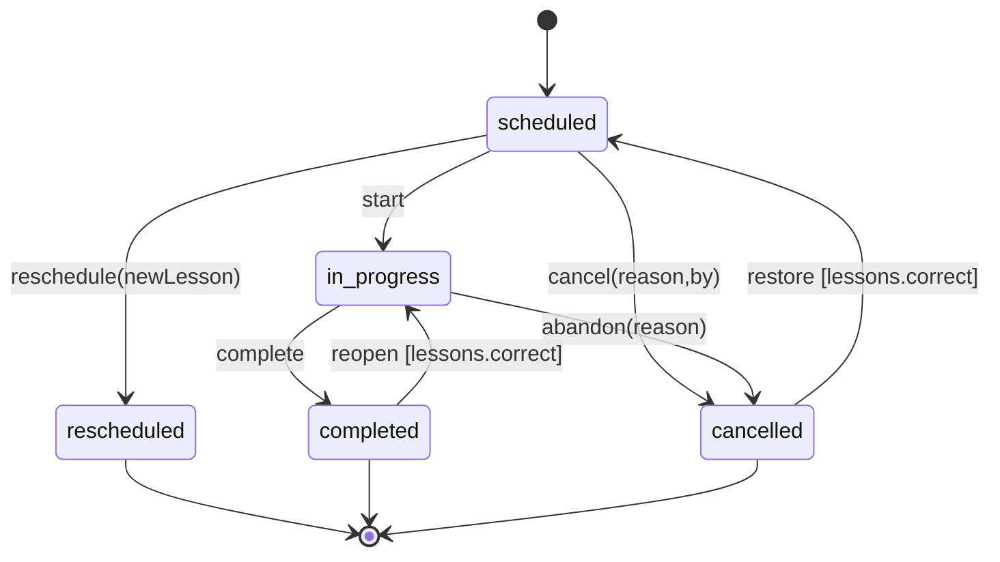

| الانتقال | الحارس (Guard) | الأثر (في نفس المعاملة) |
|---|---|---|
| `scheduled→in_progress` | مشاركون ≥1؛ المدرس هو المسؤول أو مخوَّل | تجميد المشاركين + `locationSnapshot` + `startedAt` |
| `in_progress→completed` | لا شرط؛ يُنبَّه إن `Attendance` كلها `not_recorded` | `completedAt`؛ تحديث Coverage/Homework؛ حدث `LessonCompleted`؛ إبطال Progress/Plan؛ تحديث Projection |
| `scheduled→cancelled` | `statusReason` و`cancelledBy` مطلوبان | إلغاء Reminders؛ وسم Calendar للإزالة |
| `scheduled→rescheduled` | ينشئ Lesson جديدة `relationType=rescheduled_from` | الأصلية تحتفظ بـ`originalStartsAt`؛ القاعدة تبقى |
| `completed→in_progress` | صلاحية `lessons.correct` + سبب + تدقيق | لا تُحذف Attendance/Coverage |

- **لا انتقال تلقائي بسبب الوقت.** حصة فات وقتها دون بدء تحمل علم مشتق `needsResolution` يظهر في Dashboard؛ المستخدم يقرّر (ثقة المستخدم §154).
- **سباق جهازين** (إلغاء مقابل بدء): الأول وصولًا للخادم ينجح؛ الثاني يرجع `INVALID_TRANSITION` ويظهر كتعارض للمستخدم مع الخيارين.
- **«لم يحضر الطالب»** = `completed` مع كل الحضور `absent` (لا حالة إضافية)؛ **«استبدلت»** = `cancelled` + حصة جديدة `replaces`؛ **«أعيدت/تعويض»** = حصة جديدة `makeup_for`.

## C.2 ScheduleRule

`active ⇄ paused → ended`. `ended` نهائي؛ التعديل الجوهري = إنهاء + قاعدة جديدة. الإيقاف لا يمسّ الحصص الماضية؛ يوقف التوليد ويُلغي غير المعدّلة المستقبلية (`isModified=false`).

## C.3 HomeworkSubmission

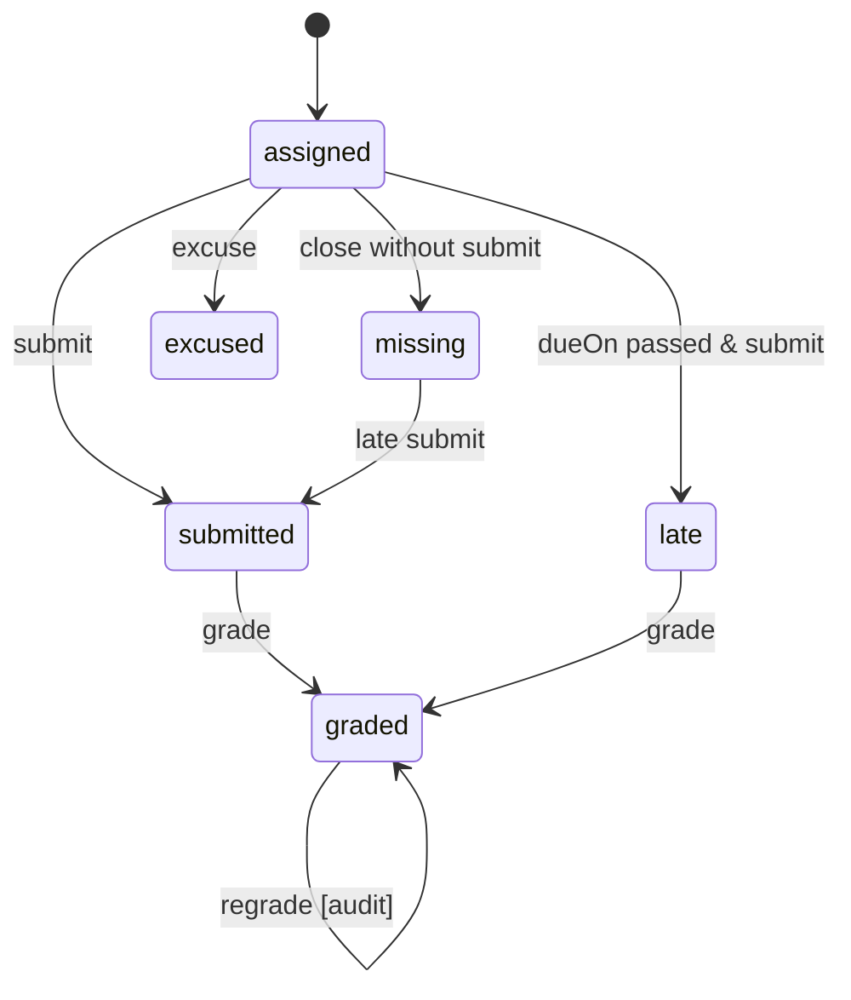

`Homework`: `draft → assigned → closed`، و`assigned/draft → cancelled`.

## C.4 Assessment

`draft → published → closed`، و`draft|published → cancelled`. النتائج تُقبل فقط في `published`. إعادة الفتح `closed→published` بصلاحية وتدقيق.

## C.5 Attendance

الحالات: `not_recorded` (ابتدائية) → `present|absent|late|excused`. أي حالة يمكن تصحيحها إلى أخرى (كل تغيير في AuditLog). لا حالة نهائية؛ تُجمَّد فقط مع Lesson `completed` ما لم تُعَد فتحها.

## C.6 Student / GroupMembership / StudentEnrollment

- Student: `active ⇄ paused → graduated → archived`.
- GroupMembership: `active → left | transferred` (تُنشئ الأخيرة عضوية جديدة).
- StudentEnrollment: `active → completed | withdrawn`.
- عند أرشفة Student: تُجمَّد حصصه المستقبلية (`participant` يُزال من غير المجمَّدة) وتبقى التاريخية.

## C.7 Reminder → Notification → NotificationDelivery

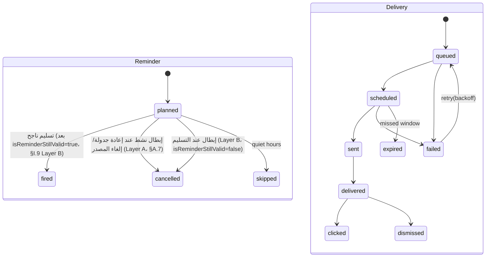

قاعدة عدم التكرار: مفتاح `dedupeKey` فريد → إعادة مزامنة نفس الحصة لا تُنتج إشعارًا ثانيًا (§94 من PHASE 0). **الإبطال (Layer A/B) موصوف بالتفصيل في §I.9.**

## C.8 SyncOperation

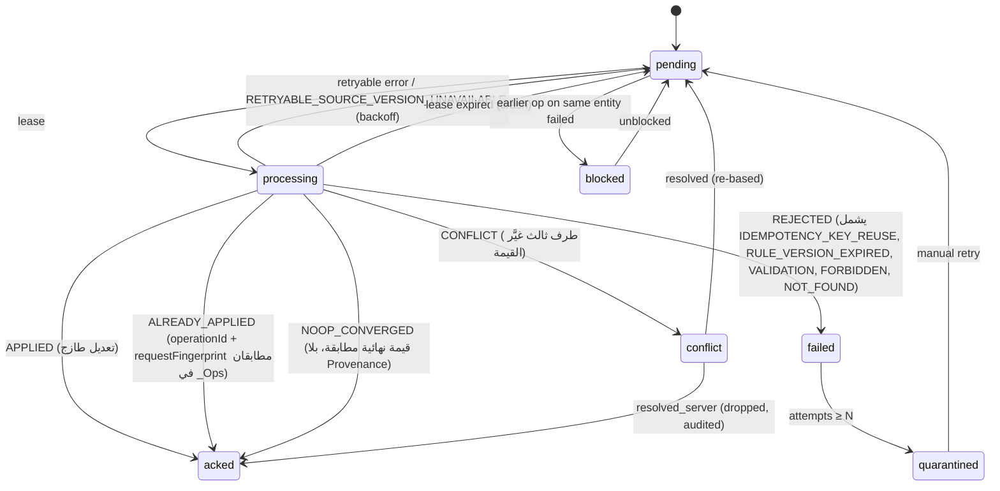

**نتائج `acked` الثلاث (`APPLIED`/`ALREADY_APPLIED`/`NOOP_CONVERGED`) متطابقة من منظور المستخدم (لا خطأ يظهر أبدًا)؛ الفارق داخلي فقط في إسناد `AuditLog` (§G.12.6 Operation Result Model). `IDEMPOTENCY_KEY_REUSE` و`RULE_VERSION_EXPIRED` سببا رفض ضمن `REJECTED` (لا حالتان عليا جديدتان — سلوك العميل تجاههما مطابق لأي `REJECTED` آخر: Quarantine + سبب مقروء).**

## C.9 PortalAccount / PortalInvite

`PortalAccount`: `invited → active ⇄ suspended → revoked`. `PortalInvite`: `issued → used | expired | revoked` (استخدام واحد). `PortalSession`: `active → expired | revoked`.

## C.10 License / Activation (محوران متعامدان)

**القرار D-03:** حالة الترخيص **محوران** لا محور واحد: **Validity** (هل الحق ساري؟) و**Lease Freshness** (مدى حداثة التفويض القصير). **توفر الخادم ليس حالة ترخيص**؛ هو ظرف يؤثر فقط عبر تجديد الـLease.

الآلات الكاملة وجدول `Validity × Freshness → AccessMode` في **§N.4**. ملخص:

| Validity | معنى | Freshness المؤثّر |
|---|---|---|
| `UNACTIVATED` | لا تفعيل | — |
| `ACTIVE` / `EXPIRING` | ساري (ينتهي قريبًا) | FRESH→STALE→LEASE_GRACE→OVERDUE |
| `GRACE` | منتهٍ ضمن سماح | كما أعلاه |
| `EXPIRED` | منتهٍ بعد السماح | تُطبَّق `expirationPolicy` **حتى مع اتصال** |
| `REVOKED` | مُبطَل (قائمة/رفض Lease) | — |
| `INVALID` | توقيع/ربط فاسد | — |
| `CLOCK_SUSPECT` | الساعة < `maxSeenTime` | يتطلب إعادة تحقق أونلاين |
| `TRANSFERRING/DEACTIVATED` | نقل | — |

**النتيجة `AccessMode`:** `FULL` · `FULL_NOTICE` · `READ_EXPORT_ONLY` · `ACTIVATION_REQUIRED`. لا يُحجب تصدير البيانات في أي وضع (INV-24).

**Activation (خادم):** `active → deactivated | transferred | revoked`.

## C.11 File / CalendarProjection / Backup

- File: `local_only → uploading → available`، و`available → missing` (تعذّر الوصول) و`* → deleted`.
- CalendarProjection: `pending → synced | failed`، و`synced → orphaned` (المصدر حُذف والحدث باقٍ) `→ detached`.
- Backup: `running → complete → verified`، و`running → failed`، و`* → expired` (تجاوز الاحتفاظ).

---

# D. Local IndexedDB Architecture

## D.1 القاعدتان

| القاعدة | الاسم | المحتوى |
|---|---|---|
| Meta | `jihad_meta` | Installation، Device، **License Token، LicenseLease، RevocationList**، Activation، قائمة المنظمات المعروفة، حالة المصادقة المحلية/قفل التطبيق، آخر منظمة، مفاتيح جهاز غير قابلة للتصدير |
| Org | `jihad_org_<organizationId>` | كل بيانات المنظمة + بنية المزامنة + Caches |

المعاملات **لا تمتد** عبر القاعدتين؛ لذلك تُصمَّم كتابات Meta لتكون **قابلة لإعادة التنفيذ (idempotent)** ومشتقّة عند الحاجة.
**في قاعدة المنظمة `organizationId` ثابت** فلا يدخل في المفاتيح والفهارس (يبقى في السجل للتصدير/الدمج).

## D.2 استراتيجية الإصدار

- `DB_VERSION` رقم صحيح يزيد بـ**Migration مُسمّاة** فقط (§P).
- قاعدة أحدث من التطبيق ⇒ **يرفض التطبيق فتحها** (`DB_NEWER_THAN_APP`) ويطلب التحديث؛ لا Downgrade.
- ترقية البنية (Schema) داخل `versionchange` فقط (إنشاء/فهرسة مخازن)؛ **تحويلات البيانات الثقيلة** تُجرى بعد الفتح كـData Migration قابلة للاستئناف وتُسجَّل في `_migrations`.
- `onversionchange` ⇒ إغلاق الاتصال وإعادة تحميل هادئة؛ `blocked` ⇒ إشعار.
- طلب `navigator.storage.persist()` وقياس `storage.estimate()` في شاشة الصحة.

## D.3 المخازن والمفاتيح والفهارس (قاعدة المنظمة)

`PK` مفتاح المخزن. الفهارس بـ`[a,b]` مركّبة. **`u`** = فريد. الفهارس التي تتضمن قيمة `null` لا تُفهرَس (سلوك IDB) — يُستفاد منه في الفهارس الفريدة الاختيارية.

| المخزن | PK | الفهارس | ملاحظات |
|---|---|---|---|
| `persons` | id | `byName`(نص مُطبَّع)، `byPhone`، `byEmail` | |
| `students` | id | `byPersonId`(u)، `byStatus`، `byCode`(u) | |
| `parents` | id | `byPersonId`(u) | |
| `parent_student` | id | `byParent`، `byStudent` | |
| `users`، `roles`، `role_permissions`، `user_roles` | id | `byUser`، `byRole` | |
| `academic_years`، `stages`، `grades`، `subjects` | id | `byStage`(grades)… | صغيرة |
| `curricula`، `curriculum_units`، `curriculum_topics` | id | `bySubjectGrade`، `byCurriculum`، `byUnit` | |
| `student_enrollments` | id | `byStudent`، `byYearGrade` | |
| `student_subject_enrollments` | id | `byEnrollment`، `bySubject`، `byTeacher` | |
| `groups` | id | `byTeacher`، `bySubject`، `byStatus` | |
| `group_memberships` | id | `byGroup`، `byStudent`، `[groupId,status]` | |
| `locations` | id | `byName`، `byType` | |
| `availability_rules`، `personal_events` | id | `[userId,weekday]`، `[userId,localDate]`، `byStartsAt` | |
| `schedule_rules` | id | `byTeacher`، `byStudent`، `byGroup`، `byStatus` | |
| `schedule_exceptions` | id | `[scheduleRuleId,occurrenceKey]`(u) | |
| **`lessons`** | id | `byLocalDate`، `[teacherUserId,localDate]`، `byStartsAt`، `[groupId,localDate]`، `[status,startsAtUtc]`، `[scheduleRuleId,occurrenceKey]`(u)، `byRelated` | أهم مخزن أداء |
| `lesson_participants` | id | `byLesson`، `byStudent`، `[lessonId,studentId]`(u) | |
| `attendance` | id | `byParticipant`(u)، `byLesson`، `byStudent` | |
| `lesson_coverage` | id | `byLesson`، `byTopic` | |
| `homework`، `homework_submissions` | id | `bySubject`، `byDue`، `[homeworkId,studentId]`(u)، `byStudent` | |
| `teacher_notes`، `parent_notes` | id | `[targetType,targetId]` | مخزنان منفصلان |
| `assessments`، `assessment_results` | id | `[assessmentId,studentId,attemptNo]`(u)، `byStudent`، `[sourceId,externalResponseId]`(u) | |
| `reminder_rules`، `reminders` | id | `byFireAt`، `[targetType,targetId]`، `byStatus` | `reminders` تضم المشتقة |
| `notifications`، `notification_deliveries` | id | `byDedupeKey`(u)، `byStatus`، `byNotification` | |
| `calendar_targets`، `calendar_projections` | id | `[sourceType,sourceId]`، `byStatus` | |
| `files` | id | `byStatus`، `bySha256` | |
| `file_references` | id | `[targetType,targetId]`، `byFile` | |
| `file_blobs` | fileId | — | Blob محلي (LRU) |
| `file_upload_queue` | uploadId | `byStatus`، `byFile` | رفع مجزّأ قابل للاستئناف |
| `portal_accounts` | id | `byParent`(u) | |
| `audit_logs` | id | `byAt`، `[entityType,entityId]` | |
| `app_settings`، `feature_flags` | id | `[scope,scopeId,key]`(u)، `byKey` | |
| `backups` | id | `byCreatedAt` | |
| **`sync_outbox`** | operationId | `byClientSeq`(u)، `byStatus`، `[entityType,entityId]`، `byNextAttempt` | §G.3 |
| `sync_conflicts` | id | `byStatus`، `[entityType,entityId]` | |
| `sync_cursor` | scope | — | صف لكل نطاق |
| `sync_bootstrap` | entityType | — | تقدّم الـBootstrap للاستئناف |
| `sync_coverage` | id | `[entityType]` | النطاقات المحمّلة فعليًا (§G.2) |
| `_migrations` | id | — | سجل الترحيلات |
| `_kv` | key | — | إعدادات الجهاز الصغيرة |
| `plan_cache`، `progress_cache`، `search_index` | متنوع | حسب الحاجة | **Caches مشتقة** قابلة للحذف وإعادة البناء |

**قاعدة عدم التطبيع المشروط:** لا يُخزَّن حقل مكرر لتسهيل الفهرسة إلا إن كان **مفتاح فهرسة مشتقًا** يحافظ عليه الـRepository داخل نفس المعاملة ويُوثَّق (مثل `localDate` المشتق من `startsAtUtc+timeZone`). لا نُكرّر أسماء الطلاب في الحصص.

## D.4 طبقة الوصول

```text
UI → Application Services (Use Cases) → Repositories → LocalDatabaseAdapter → IndexedDB
                                    ↘ Domain (قواعد نقية) ↙
```

- **Repository لكل Aggregate** (`LessonRepository`, `StudentRepository`…) بعقد ثابت: `get`, `getMany`, `query(spec)`, `save(entity)`, `archive`, `softDelete`, `restore`؛ **كل كتابة تمر عبر Unit of Work** (§D.5).
- **`LocalDatabaseAdapter`** هو الطبقة الوحيدة التي تعرف IndexedDB. يمكن استبداله (SQLite/OPFS) دون لمس الـRepositories.
- استعلامات صفحية (`limit` + `cursor`) إلزامية في القوائم الكبيرة؛ لا `getAll()` على مخازن حجمها غير محدود.

## D.5 المعاملات (Unit of Work)

كل Use Case يكتب داخل **معاملة `readwrite` واحدة** تشمل: مخازن الكيانات المتأثرة + `sync_outbox` + `audit_logs` (+ إبطال Caches المشتقة كعلامات). **لا يوجد كتابة محلية بلا عملية Outbox (إلا الكيانات Local-only).**

| Use Case | المخازن داخل المعاملة |
|---|---|
| CreateStudent | persons، students، (parent_student)، sync_outbox، audit_logs |
| ScheduleLesson | lessons، lesson_participants، reminders، sync_outbox، audit_logs |
| CompleteLesson | lessons، lesson_participants، attendance، lesson_coverage، homework، homework_submissions، sync_outbox، audit_logs |
| ApplyPulledPage (المزامنة) | مخازن الكيانات المستلمة، sync_cursor، sync_conflicts |
| RestoreFromBackup | تُبنى في قاعدة مؤقتة ثم تُبدَّل (§Q) |

**قيود IDB:** لا `await` لعمليات غير IndexedDB داخل المعاملة (تنتهي تلقائيًا)؛ الحسابات الثقيلة قبلها، والنتائج تُكتب داخلها.

## D.6 الحذف الناعم والأرشفة والتاريخ

- الـRepository يخفي `deletedAt != null` افتراضيًا (`includeDeleted` صريح للمزامنة والتعافي).
- الاستعادة (`restore`) تُمسح `deletedAt` وتُسجَّل عملية `restore`.
- **لا Purge من الواجهة.** فقط سياسة احتفاظ (§Q.5).

## D.7 قفل التبويبات

محرك المزامنة يعمل داخل `navigator.locks.request('jihad-sync-<org>')`؛ بقية التبويبات تقرأ فقط وتستقبل تحديثات عبر `BroadcastChannel`.

---

# E. Remote Google Sheets Mapping

## E.1 المبادئ

1. **Sheets = Remote Persistence / Sync Store** لا تُقرأ عند فتح التطبيق (INV-05).
2. **الاستراتيجية:** Logical Data Model (§A) → Local Storage Model (§D) → Remote Sheet Mapping (هذا القسم). أي تغيير في الأخير لا يمس الأولين.
3. **كل Spreadsheet = منظمة واحدة** (ADR-001). العزل المنطقي بـ`organizationId` يظل قائمًا ويُتحقق منه.
4. **ورقة لكل كيان مزامَن** (`ent_<Entity>`)، وأوراق بنية تحتية بحرف `_`، وأوراق Portal بـ`pv_`.
5. **الكتابة عبر الخادم فقط.** لا يفتح أحد الـSpreadsheet للتعديل اليدوي على أوراق `ent_*` (قراءة/تقارير فقط)؛ تُحمى بنطاقات محمية، وتوثَّق «منطقة أعمدة بشرية» يمينًا للحسابات الخاصة (تتجاهلها الـAdapter).

## E.2 التسمية والمخطط (Schema)

- **الصف 1 = مفاتيح الأعمدة الآلية** بإنجليزية `camelCase` مطابقة لأسماء الحقول في §A. **الـAdapter يربط بالاسم لا بالموضع** ⇒ إضافة عمود لا تكسر شيئًا.
- **العناوين العربية** في ورقة `_Schema` فقط (`entity, column, type, required, labelAr, since`). (درس L-18)
- الأعمدة بالترتيب: BASE الثمانية ثم حقول الكيان. لا أعمدة بلا حاجة.

## E.3 ترميز القيم (لمنع التحويل التلقائي — درس L-02)

| النوع | الترميز في الخلية | الكتابة |
|---|---|---|
| `text/uuid/date/time/tz/enum/json` | نص | عمود بصيغة `@` (Plain text) **قبل** الكتابة، ثم `setValues` مجمَّعة |
| `instant` | رقم صحيح ميلي ثانية | رقم |
| `int/money` | رقم | رقم |
| `bool` | `0/1` | رقم |
| `null` | خلية فارغة | |
| الأرقام المرجعية (`studentCode`، أرقام هاتف) | نص دائمًا | `@` |

لا تستخدم تواريخ Sheets الأصلية أبدًا. **اختبار قبول:** كتابة `2025/1234` و`0100…` و`1-2` وقراءتها يجب أن تعيد النص حرفيًا.

## E.4 سجل التغييرات ورقم المراجعة (قلب المزامنة)

### أوراق البنية

| الورقة | الأعمدة | الغرض |
|---|---|---|
| `_Meta` | `key, value` | `organizationId, schemaVersion, apiVersion, committedRevision, minClientVersion, dataEpoch, logBaseRevision, createdAt, setupCodeHash…` |
| `_Schema` | كما أعلاه | وصف الأعمدة |
| `_Changes` | `serverRevision, entityType, entityId, op, serverAt, operationId` | **Append-only، صف لكل مراجعة** |
| `_Wal` | `batchId, fromRev, toRev, planJson, status(planned/done), at` | **خطة الالتزام (Write-Ahead Log)**؛ تحتفظ 7 أيام |
| `_Ops` | `operationId, installationId, batchId, receivedAt, status, serverRevision, resultJson` | تكرار آمن (احتفاظ 30 يومًا) |
| `_Sessions`، `_PortalCreds`، `_PortalInvites` | (X) | أسرار مُجزَّأة، **لا تُعرَض في Pull أبدًا** |
| `_Installations`، `_Devices`، `_Activations` | | سجل الخادم |
| `_Backups`، `_Health`، `_CalQueue` | | تشغيلية |

### الخوارزمية (بعد المراجعة: Write-Ahead Log + نقطة التزام)

**المشكلة (S-01):** ثلاث كتابات منفصلة (السجل، `_Changes`، المؤشر) قد ينقطع التنفيذ بينها. **الحل:** كل دفعة تُلتزم عبر خطة مسجّلة مسبقًا (WAL) ثم نقطة التزام واحدة.

1. **قفل قصير** `LockService` (Script Lock). عند فشل الحصول عليه ⇒ `BUSY` retryable.
2. **تعافٍ أولًا:** إن وُجد سجل `_Wal` بحالة `planned` بلا `done` (بقية تنفيذ منقطع) ⇒ **يُعاد تنفيذ خطته** (الخطوة 5–6) قبل قبول دفعة جديدة.
3. **التحقق والتخطيط بلا كتابة:** لكل عملية مقبولة (بعد Idempotency/Authz/Validation/Conflict، §G.4) تُعيَّن مراجعة متتابعة `C+1, C+2, …` حيث `C = committedRevision`. تُبنى الخطة `plan[] = {rev, operationId, entityType, entityId, op, record}`.
4. **كتابة الخطة:** صف/صفوف في `_Wal` (`batchId, fromRev, toRev, planJson(chunks), status=planned`).
5. **التطبيق:** كتابة صفوف `ent_*` (`setValues` مجمّعة) ← إلحاق نطاق صفوف متجاور في `_Changes` ← إلحاق `_Ops`. **كل خطوة Idempotent** (Upsert بالمعرّف/المراجعة؛ الإلحاق فقط للمراجعات الأكبر من آخر صف في السجل).
6. **نقطة الالتزام:** كتابة خلية واحدة `_Meta.committedRevision = toRev`، ثم `_Wal.status = done`.
7. **إطلاق القفل.**

**قواعد القراءة:** Pull يقرأ **فقط** المراجعات `≤ committedRevision` **دون قفل**؛ لذلك لا يرى دفعة نصف مكتملة. `committedRevision` هو الحقيقة الوحيدة لعدّاد المراجعات (لا عدّاد ثانٍ في Script Properties).

**التعافي:** أي تنفيذ يبدأ بـ«تعافٍ أولًا» فيُكمل ما انقطع بشكل حتمي لأن الخطة تحمل السجلات كاملة. **اختبار قبول:** قتل التنفيذ بعد كل خطوة (4، 5-أ، 5-ب، 5-ج) ثم التحقق من التقارب.

**الحساب المباشر للصف:** الصف الذي يحمل المراجعة `N` = `N − logBaseRevision + 2` (لم يتغير). يُتحقق منه بمقارنة قيمة الصف المقروء بـ`N` (Self-check) وإلا يُرفع `LOG_CORRUPT` ويُفحص.

**البديل المرفوض:** ترتيب كتابات ذكي بلا WAL (يترك دائمًا نافذة إخفاق) أو قفل يشمل القراءة (يقتل التزامن).
**التكلفة:** كتابة إضافية للخطة لكل دفعة (مقبولة مقابل سلامة التزامن). تُقاس في Spike SP-3.

**`_Wal`:** يُحتفظ بآخر 7 أيام ثم يُنظَّف.

### التقليص (Compaction)

- عند تجاوز حجم ورقة `_Changes` عتبة (مثلاً 200 ألف صف) تُنقل الصفوف القديمة إلى ورقة `_Changes_<yyyy>` أرشيفية وتُحدَّث `logBaseRevision` و**`floorRevision`**.
- عميل مؤشره `< floorRevision` يتلقى `CURSOR_TOO_OLD` ⇒ **Re-bootstrap** (§G.2) وليس Pull. لذلك يجب أن تتجاوز مدة الاحتفاظ بالـTombstones أطول انقطاع متوقع (§Q.5).

## E.5 خريطة الكيانات → الأوراق

كل ورقة `ent_<Entity>` بالأعمدة (BASE + حقول §A). الجدول يبيّن **الهوية وطريقة البحث** فقط.

| الكيان | الورقة | مفتاح البحث الثانوي | ملاحظة |
|---|---|---|---|
| Organization | `ent_Organization` | — | صف واحد |
| Person / Student / Parent / ParentStudentRelationship | `ent_Person` … | `personId`، `studentCode` | Unique(studentCode) يُتحقق على الخادم |
| User / Role / RolePermission / UserRole | `ent_User`… | `authSubject` | |
| AcademicYear / EducationalStage / Grade / Subject / TeacherSubject | `ent_*` | — | صغيرة |
| Curriculum / Unit / Topic | `ent_*` | `curriculumId`, `unitId` | |
| StudentEnrollment / StudentSubjectEnrollment | `ent_*` | `studentId` | |
| Group / GroupMembership | `ent_*` | `groupId`, `studentId` | |
| Location / TravelEstimate / TravelBuffer | `ent_*` | — | |
| AvailabilityRule / AvailabilityException / PersonalEvent / NonTeachingPeriod | `ent_*` | `userId` | |
| ScheduleRule / ScheduleException | `ent_*` | `scheduleRuleId` | |
| **Lesson** | `ent_Lesson` | (`scheduleRuleId`,`occurrenceKey`) Unique | **أضخم ورقة**؛ تُقسَّم سنويًا `ent_Lesson_<yyyy>` عند اللزوم (الوصول عبر `localDate`) |
| LessonParticipant / Attendance / LessonCoverage | `ent_*` (تُقسَّم مثل Lesson) | `lessonId` | |
| Homework / HomeworkSubmission | `ent_*` | `homeworkId`, `studentId` | |
| TeacherNote / ParentNote | `ent_TeacherNote` / `ent_ParentNote` | `targetId` | **ورقتان منفصلتان** |
| Assessment / AssessmentResult / ExternalAssessmentSource / AssessmentImportBatch | `ent_*` | (`sourceId`,`externalResponseId`) Unique | |
| ReminderRule / Reminder(user) / Notification(parent) / NotificationDelivery(remote) | `ent_*` | `dedupeKey` | المشتقة المحلية لا تُرفع |
| CalendarTarget / CalendarProjection | `ent_*` | `sourceId` | |
| File / FileReference | `ent_File` / `ent_FileReference` | `sha256`, `targetId` | |
| PortalAccount | `ent_PortalAccount` | `loginId` | بلا أسرار |
| Backup / AuditLog / AppSetting / FeatureFlag / SyncConflict(server log) | `ent_*` | | |
| License/Activation/Device | `_Activations`, `_Devices` (`X`) | | |

## E.6 استراتيجية البحث (Lookup)

- **`id → row`:** خريطة تُبنى بقراءة **عمود `id` وحده** (سريعة)، وتُخزَّن في `CacheService` مقسّمة إلى قطع مع ختم `serverRevision`؛ الصفوف الجديدة تُلحَق بالنهاية فيُوسَّع الـCache تزايديًا. عند الفقد تُعاد قراءة العمود.
- **لا `getDataRange()` كاملًا في مسار المزامنة.** قراءة أعمدة/نطاقات محددة فقط.
- **تحديث الدفعة:** تُجمَّع الصفوف المعدلة وتُكتب بنطاقات متجاورة أو `setValues` لمجموعة، لا خلية بخلية.
- **`TextFinder`** احتياطي للحالات النادرة فقط.
- **Unique Constraints** (مثل `studentCode`) تُفحص عبر خريطة عمود مخصص.

## E.7 حدود وحدات Apps Script (تمهيد PHASE 2)

```text
Router → Auth → Authorization → Validation → Sync/Portal Services
              → Repositories (SheetsRepository, SchemaRegistry, ChangeLog, OperationLedger)
              → Adapters: Drive | Calendar | Gmail | FormsImport
   جانبية: Audit · Config · Setup · Health · Backup · RateLimit · Projection
```

**قواعد الحدود:** Router لا يعرف Sheets. Services لا تستدعي `SpreadsheetApp/DriveApp/GmailApp/CalendarApp` مباشرة. لا ملف يتجاوز حجمًا معقولًا؛ ولا منطق أعمال خارج الـServices/Domain المشتركة (ADR-010).

## E.8 أوراق Portal Projection (`pv_*`)

يبنيها `ProjectionService` **خادميًا** عند Commit أي تغيير يخص بيانات ولي أمر، **بحقول Whitelist فقط**:

| الورقة | المحتوى | المفتاح |
|---|---|---|
| `pv_Child` | اسم الطالب، الصف، المواد (عرض) | `studentId` |
| `pv_Snapshot` | لقطة «اليوم/القادم/الأخير» صغيرة (JSON ≤ 40KB) | `studentId` |
| `pv_Lesson` | الحصص المنتهية والقادمة: مادة، وقت، مكان (اسم عام)، حالة، ما شُرح | `studentId`, `localDate` |
| `pv_Attendance` | حضور الطالب لكل حصة | `studentId` |
| `pv_Homework` | واجبات منشورة وحالتها | `studentId` |
| `pv_Result` | نتائج اختبارات منشورة | `studentId` |
| `pv_Note` | ParentNote المنشورة فقط | `studentId` |

استعلام البوابة يبدأ دائمًا بـ`studentId ∈ allowedStudents(parent)` محسوبة خادميًا (§L). لا يقرأ من `ent_*` إطلاقًا.

---

# F. Sync Identity

| المعرّف | التوليد | العمر | الاستخدام |
|---|---|---|---|
| `organizationId` | UUID عند Setup | دائم | نطاق كل سجل/عملية |
| `entityId` | UUIDv7 عميل، أو UUIDv5 حتمي من (`ruleId`,`occurrenceKey`) للمشتق | دائم | هوية السجل، **بلا تكرار عند إعادة المحاولة** |
| `installationId` | UUIDv4 عند أول تشغيل | حتى مسح التخزين | مصدر العملية، كشف الاستنساخ |
| `deviceId` | مُسجَّل عند التفعيل | حتى Transfer | حدّ الترخيص وعرض «أجهزتي» |
| `userId` | من `User.id` | | فاعل العملية للتدقيق والصلاحية |
| `operationId` | UUIDv7 لكل عملية Outbox | دائم في السجل 30 يومًا | **Idempotency Key** |
| `batchId` | UUIDv7 لكل طلب Push | | تجميع/تشخيص |
| `clientSeq` | عدّاد محلي تصاعدي | لكل تثبيت | ترتيب عمليات نفس الكيان |
| `serverRevision` | خادم، عدّاد تصاعدي على مستوى المنظمة | دائم | **ترتيب الحقيقة** و`cursor` |
| `baseServerRevision` | مأخوذ من السجل عند التعديل | في العملية | قاعدة كشف التعارض |
| `dataEpoch` | خادم، يزيد عند الاستعادة/إعادة البناء | | كشف عالم بيانات مختلف |
| `clientTime` | ساعة الجهاز | | عرض فقط |
| `serverTime` | يعيده الخادم في كل استجابة | | حساب `clockOffset`؛ تحذير إن > دقيقتين |
| Tombstone | `deletedAt` + صف `op=delete` في `_Changes` | حتى Purge | نشر الحذف للأجهزة الأخرى |

**قاعدة:** ساعة الجهاد **لا تُستخدم للفصل في التعارض**؛ الترتيب بـ`serverRevision` (أول ملتزم يفوز)، والساعات للعرض.

## F.2 مواصفة الهوية الحتمية (Deterministic Identity Specification)

لا يكفي القول «UUID حتمي». هذه المواصفة الكاملة.

### F.2.1 القاعدة العامة

```text
id = UUIDv5( NAMESPACE_JIHAD_V1 , canonicalName )
canonicalName = "<entityType>|<part1>|<part2>|…"
   - الأجزاء: UUID بحروف صغيرة، تاريخ ISO YYYY-MM-DD، أعداد صحيحة بلا أصفار بادئة
   - لا نصوص حرة، لا أسماء، لا أوقات UTC (إلا حيث يُذكر)
```

`NAMESPACE_JIHAD_V1` ثابت مدى عمر الإصدار الرئيسي للتصميم؛ تغييره = توليد هوية جديدة = **Migration** موثَّقة (لا يحدث عرضًا). المصدر هو **دالة نقية في Domain** يشترك فيها العميل والخادم (ADR-010) ويُختبر بمتجهات اختبار ثابتة.

### F.2.2 الكيانات ذات الهوية الحتمية

| الكيان | `canonicalName` | لماذا حتمي |
|---|---|---|
| `Lesson` (المولَّدة) | `lesson\|<scheduleRuleId>\|<occurrenceKey>` | جهازان offline ينتجان نفس الحصة بنفس المعرّف |
| `LessonParticipant` | `lp\|<lessonId>\|<studentId>` | منع تكرار المشاركين |
| `Attendance` | `att\|<lessonParticipantId>` | علاقة 1:1 |
| `HomeworkSubmission` | `hws\|<homeworkId>\|<studentId>` | منع تكرار عند الإسناد من جهازين |
| `Reminder` (المشتق) | `rem\|<ruleId>\|<targetType>\|<targetId>\|<fireAtUtc>` | إعادة التخطيط لا تكرر التذكير |
| `Notification` | `ntf\|<dedupeKey>` | إعادة المزامنة لا تكرر الإشعار |
| `CalendarProjection` | `cal\|<targetId>\|<sourceType>\|<sourceId>` | إسقاط واحد لكل (هدف، مصدر) |
| الحصص اليدوية وباقي الكيانات | UUIDv7 عميل | لا حاجة للحتمية |

### F.2.3 الأسئلة الثمانية

| # | السؤال | الجواب |
|---|---|---|
| 1 | **ما مصدر الـidentity؟** | دالة Domain نقية `deriveId(entityType, parts)` (UUIDv5) |
| 2 | **ما الحقول الداخلة؟** | Lesson: `scheduleRuleId` + `occurrenceKey` فقط. **لا** وقت البدء، لا المدة، لا المكان، لا المدرس |
| 3 | **ماذا عند تعديل Schedule؟** | التعديل الذي يمس **المستقبل** ("هذه وما بعدها") = **تقسيم القاعدة**: القديمة `untilOn = اليوم السابق` والجديدة بـ`ruleId` جديد ⇒ هويات جديدة للحصص الجديدة. حصص القاعدة القديمة **غير المعدَّلة** بعد نقطة التقسيم تُنظَّف كتنظيف نظام (`statusReason=rule_superseded`). تعديل حقل لا يمس الهوية (المدة/المكان) لحصص **غير معدَّلة** مستقبلية = تحديث نفس السجلات (نفس المعرّف). كل تعديل قاعدة يزيد `ScheduleRule.version` ويُوسَم على الحصص المولَّدة بـ`Lesson.ruleVersion` |
| 4 | **ماذا عند حذف Lesson؟** | حذف المستخدم لحصة مولَّدة = **إلغاء** (`cancelled`) أو **تخطي** عبر `ScheduleException`؛ لا Tombstone (INV-46). إن وُجد Tombstone لأي سبب (تصحيح إداري) فإن المولِّد يعامل **وجود المعرّف** (ولو محذوفًا) كـ«موجود» فلا يعيد إنشاءه. ولا يتكرر الإنشاء بعد الـPurge لأن أفق التوليد (≤120 يومًا) < الاحتفاظ بالـTombstones (≥180 يومًا) والتوليد لا يمس الماضي |
| 5 | **ماذا عند جهازين Offline؟** | الدالة نقية ⇒ **نفس المعرّف**. الفحص الكامل عند تصادم `create` (خوارزمية موصولة بـPush فعليًا، لا سرد نظري فقط — §G.4 خطوة 6): (أ) `CanonicalEquals` مع السجل الموجود ⇒ `ALREADY_APPLIED`؛ (ب) غير مكافئ ⇒ **حارس الملكية البشرية أولًا**: `R.isModified=true` ⇒ `SUPERSEDED_BY_USER_EDIT` (لا استبدال أبدًا، بصرف النظر عن `ruleVersion`)؛ (ج) `R.isModified=false` ⇒ **تحقق خادمي مستقل** يعيد تشغيل `GenerateInstances` (§F.2.4) على نسخة الخادم من `ScheduleRuleVersionSnapshot(scheduleRuleId, payload.ruleVersion)` (§A.4) ويقارن الناتج بالحمولة — تطابق ⇒ الأعلى `ruleVersion` يفوز (استبدال مُتحقَّق منه لا أعمى)، الأقدم ⇒ يتقارب بـPull (Monotonic Apply)، نفس الإصدار بمحتوى مختلف ⇒ الأول التزامًا يفوز؛ عدم تطابق الناتج المُعاد حسابه ⇒ `REJECTED`؛ اللقطة التاريخية غير موجودة **ضمن نافذة الاحتفاظ** (سباق نادر) ⇒ `RETRYABLE_SOURCE_VERSION_UNAVAILABLE`، أو **خارجها** ⇒ `REJECTED` بسبب `RULE_VERSION_EXPIRED`. `generatedThrough` يُدمج بـ**max** (رتيب) |
| 6 | **ماذا عند تغيير Timezone؟** | `ScheduleRule.timeZone` **ثابت** بعد توليد أي حصة. تغيير المنطقة لمدرس ينتقل = تقسيم القاعدة (قاعدة جديدة بمنطقة جديدة من تاريخ معيّن). تغيير منطقة **الجهاز** أو الإعداد الافتراضي للمنظمة **لا يمس** الهوية ولا الحصص القائمة (يؤثر على العرض فقط، §S) |
| 7 | **ماذا عند تغيير Organization؟** | **غير مدعوم** كعملية عادية؛ `organizationId` ثابت للسجل. الهويات لا تتضمن المنظمة (UUID فريدة عالميًا). نقل بيانات لمنظمة جديدة = أداة **استيراد/استعادة إدارية** تحافظ على المعرّفات وتعيد كتابة `organizationId` وتُدقَّق (INV-09) |
| 8 | **هل الهوية Immutable؟** | نعم: `id` و`scheduleRuleId` و`occurrenceKey` للحصة المولَّدة **ثابتة للأبد**. `occurrenceKey` = التاريخ المحلي **الأصلي** للتكرار ولا يتغير حتى لو نُقلت الحصة (الجديدة كيان بمعرّف UUIDv7 مرتبط بـ`relatedLessonId`) |

### F.2.4 خوارزمية التوليد `GenerateInstances`

| البند | القرار |
|---|---|
| المدخلات | القاعدة (`version`)، `ScheduleException`، `NonTeachingPeriod`، `timeZone`، أفق التوليد |
| الأفق | `[اليوم, اليوم + 60]` افتراضيًا، **حد أقصى 120 يومًا** (أقل من الاحتفاظ بالـTombstones) |
| المحفزات | بعد `UI_READY` في الخلفية، بعد تعديل قاعدة، بعد Pull يغيّر قاعدة/استثناء |
| الرتابة | تنفيذ **وحيد** (Web Locks) وIdempotent: لكل تاريخ يُحسب المعرّف فإن وُجد السجل (ولو محذوفًا) لا يُنشأ |
| الوقت | يُحسب `startsAtUtc` من (`localDate` + `startLocal` + `timeZone`) بمنطق DST في §S.4 |
| لا يمس | الماضي، والحصص `isModified=true`، وما بعد `untilOn`، وتواريخ الاستثناء `skip` |
| المشاركون | تُنتج `LessonParticipant` حتمية لأعضاء المجموعة وقت التوليد |

---

# G. Sync Algorithm

## G.1 الدورة

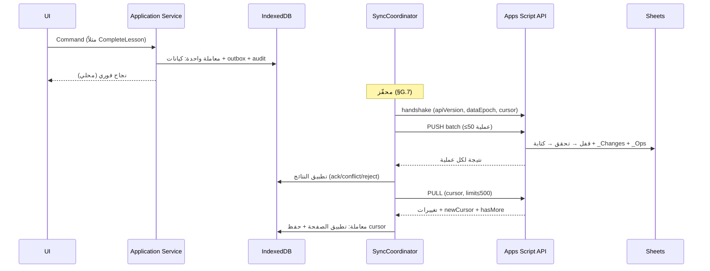

الترتيب **Push ثم Pull** حتى يرى الخادم قاعدة `baseServerRevision` الأحدث ويُحسم التعارض عنده.

## G.2 Initial Bootstrap / Incremental Bootstrap

**متى:** أول تثبيت، `dataEpoch` مختلف، `CURSOR_TOO_OLD`، أو استعادة.

1. **Handshake:** `GET meta` ⇒ `schemaVersion, apiVersion, dataEpoch, committedRevision, floorRevision, serverTime`. تحقق التوافق (وإلا وضع القراءة + دعوة للتحديث).
2. **تثبيت نقطة البداية:** `bootstrapRevision = committedRevision` وتُحفظ في `sync_bootstrap`.
3. **تنزيل بترتيب التبعيات** (كل نوع صفحات ≤500 صف، مؤشر صفحة مستأنف):
   `Organization → Roles/Permissions → Users → Persons → Subjects/Stages/Grades/AcademicYear → Locations → Students/Parents/Relationships → Curriculum* → Enrollments → Groups/Memberships → ScheduleRules → Lessons(window) → Participants/Attendance/Coverage(window) → Homework* → Assessments* → Settings/Reminder rules → Files meta`
4. **الأنواع «الحجمية»** (Lesson, LessonParticipant, Attendance, LessonCoverage, Homework*, Assessment*, AuditLog) تُحمَّل **ضمن نافذة ساخنة** افتراضية `[اليوم −90 يومًا, اليوم +180 يومًا]`. الأقدم **عند الطلب** (Lazy) من الخادم بنطاق تاريخ، ويُسجَّل في `sync_coverage` أن النطاق `[a,b]` مكتمل محليًا. الشاشات تعرض «تحميل أقدم…» عند الخروج من النافذة.
5. **بعد اكتمال الأنواع:** يبدأ **Incremental Pull من `bootstrapRevision`** (يعيد أي تغيير حدث أثناء التنزيل؛ التطبيق **Upsert بالمعرّف** ⇒ التداخل آمن).
6. **الاستئناف:** الانقطاع يترك `sync_bootstrap` بتقدّم كل نوع؛ يعود التنفيذ من آخر صفحة.
7. **Bootstrap لا يمنع الاستخدام:** بعد تنزيل **الأنواع الأساسية والنافذة القريبة** (اليوم ±7) تُفتح واجهة محدودة الشاشات المعتمدة على ما لم يصل بعد تعرض «جارٍ التحميل».
8. **Incremental Bootstrap** (تغيير `schemaVersion` أو إضافة نوع كيان جديد): يُحمَّل النوع الجديد وحده، دون مسح الباقي.

**متى يُعتبر Bootstrap لازمًا؟** فقط عند: قاعدة فارغة + منظمة معروفة، أو `dataEpoch` تغيّر، أو `CURSOR_TOO_OLD`. **ليس عند كل فتح** (INV-11).

## G.3 Outbox (طابور العمليات)

كل كتابة على كيان مزامَن تُنشئ صف `SyncOperation` **في نفس المعاملة** (§D.5).

- **`opType`:** `create` (payload كامل)، `patch` (`changes:[{field,from,to}]` + `baseServerRevision`)، `delete`، `restore`، `command` (انتقال حالة مسمّى مثل `lesson.complete`).
- **الدمج (Coalescing):** عمليات `patch` المتتالية على نفس الكيان بحالة `pending` (لم تبدأ) تُدمج في عملية واحدة (تُحفظ `from` الأصلية و`to` الأحدث).
- **الترتيب:** بـ`clientSeq`. أي عملية على كيان لها سابقة `failed|conflict` تصير `blocked` حتى تُحلّ؛ بقية الكيانات **لا تتأثر** (لا Head-of-line blocking عام).
- **الاعتماديات:** عملية على ابن لأب لم يُؤكَّد بعد تُرسل **بعد** عملية الأب (الترتيب يكفي)؛ وإن لم يجد الخادم الأب: `dependency_missing` قابلة للإعادة.
- **Lease:** عند البدء `processing` مع `leaseUntil`؛ انتهاء الـLease (تعطّل/إغلاق) يعيدها `pending` — آمن لأن Idempotent.
- **الاستمرار:** الطابور في IDB فيبقى بعد إغلاق المتصفح وإعادة تشغيل الجهاز (PHASE 0 §54).
- **الحد الأقصى:** إنذار صحة عند تجاوز عدد/عمر معيّن (مثلاً >200 عملية أو >7 أيام).

## G.4 Push (معالجة الخادم) و Idempotency

طلب Push يحمل: `apiVersion, dataEpoch, installationId, batchId, ops[≤50], clientTime`.

لكل عملية **بالترتيب داخل قفل قصير للدفعة**:

1. **المصادقة وانتماء المنظمة:** الجلسة صالحة؛ التثبيت غير مُلغى؛ الترخيص لا يمنع الكتابة (`restricted`). **فحص المنظمة (ثلاثي، لا ثنائي):** `organizationId` **غائبة** من الطلب/السجل ⇒ **`REJECT` فورًا** بلا استدلال أو قيمة افتراضية؛ **موجودة و`≠ AuthenticatedOrganization`** (المُشتقة حصرًا من `_Meta.organizationId` الخادمي، لا من الطلب) ⇒ `REJECT`؛ **موجودة ومطابقة** ⇒ تابع (INV-57).
2. **Idempotency (الفحص الكامل، لا وجود `operationId` وحده):**
   a. `operationId` موجود في `_Ops`؟ يُحسَب `requestFingerprint` **للطلب الوارد الآن** (نفس آلية §G.12.2) ويُقارَن بالمخزَّن مع نفس `operationId`.
      - تطابق ⇒ **`ALREADY_APPLIED`** — أعد النتيجة المخزَّنة، لا تنفيذ ثانٍ.
      - عدم تطابق (نفس المفتاح، عملية مختلفة فعليًا) ⇒ **`IDEMPOTENCY_KEY_REUSE`** — رفض صريح (فئة `REJECTED`)، لا تنفيذ، تسجيل تشخيصي مميَّز (إشارة صحة محتملة).
   b. غير موجود، والحقل `to` = القيمة الحالية للحقل (`current==to`) بلا هذا الـProvenance ⇒ **`NOOP_CONVERGED`** (تطابق قيمة نهائية، لا يُنسَب لهذه العملية).
   c. غير موجود، و`current==from` ⇒ عملية طازجة، تابع عاديًا (**`APPLIED`** لاحقًا).
   d. غير موجود، و`current ∉ {from,to}` ⇒ **`CONFLICT`** (انظر §G.6).
3. **Authorization:** صلاحية العملية + النطاق (`own|organization`) + ملكية الكيان.
4. **Validation:** مدققات Domain المشتركة (ADR-010) + قيود Unique + FK (`dependency_missing` إن غاب الأب).
5. **التعارض (لـ`patch`/`command` على سجل قائم):** انظر §G.6 وخطوة 2 أعلاه (`CONFLICT` عند `current ∉ {from,to}`).
6. **تصادم `create` لهوية حتمية موجودة مسبقًا (نطاق مستقل عن §G.6، لا يتقاطع معه):**
   `CanonicalEquals(payload, R)?` نعم ⇒ `ALREADY_APPLIED`. لا ⇒ حارس `isModified` (`R.isModified=true` ⇒ `SUPERSEDED_BY_USER_EDIT`, لا استبدال مهما كان `ruleVersion`) ثم عند غيابه تحقق خادمي مستقل عبر `ScheduleRuleVersionSnapshot` (§F.2.3 #5 للتفصيل الكامل: `APPLIED`/تقارب عبر Pull/`REJECTED`/`RETRYABLE_SOURCE_VERSION_UNAVAILABLE`/`RULE_VERSION_EXPIRED`).
7. **التنفيذ عبر WAL (§E.4)** (فقط لنتائج `APPLIED`؛ كل ما سبق من نتائج §G.4.2 وG.4.6 الأخرى **لا كتابة**): خطة مسجّلة ثم كتابة الصف في `ent_*` (`serverRevision=N`) + `_Changes` + `_Ops` (بحقوله الكاملة: `operationId, entityType, entityId, opType, requestFingerprint`)، ثم نقطة الالتزام `committedRevision`.
8. **`update` لسجل غير موجود ⇒ `NOT_FOUND`.** **ممنوع** أي Fallback إلى Insert (INV-12).
9. **الرد:** لكل عملية: `{operationId, status: applied|already_applied|noop_converged|conflict|rejected|retry, serverRevision?, record?, error{code,retryable}}` — انظر **Operation Result Model الكامل في §G.12.6**. الأخطاء الجزئية لا تُفشل الدفعة.
10. **حدود الدفعة:** تحويلها إلى دفعات أصغر تلقائيًا عند اقتراب الزمن/الحصص (`RETRY_LATER` مع ما لم يُعالَج).

بعد الرد يطبّق العميل النتائج في **معاملة واحدة**: `applied`/`already_applied`/`noop_converged` ⇒ تحديث `serverRevision` في السجل + وسم العملية `acked` (ثم تنظيفها بعد فترة) — **الفارق بينها داخلي فقط في إسناد `AuditLog`، لا يظهر أي منها للمستخدم كخطأ** (§G.12.6)؛ `conflict` ⇒ إنشاء `SyncConflict`؛ `rejected` (يشمل `IDEMPOTENCY_KEY_REUSE`, `RULE_VERSION_EXPIRED`, `SUPERSEDED_BY_USER_EDIT` وأسباب PHASE 1 الأصلية) ⇒ حجر (Quarantine) مع سبب، **لا حذف صامت**؛ `retry` (يشمل `RETRYABLE_SOURCE_VERSION_UNAVAILABLE`) ⇒ Backoff قياسي (§G.5).

## G.5 الأخطاء وإعادة المحاولة (Backoff)

| الفئة | أمثلة | المعالجة |
|---|---|---|
| **Retryable** | شبكة، Timeout، `BUSY`/قفل مشغول، `RETRY_LATER`، 5xx، `dependency_missing` | Backoff أسي: `min(15m, 2s·2^n)` + Jitter ±25%، وتُعاد فورًا عند حدث `online` |
| **Permanent** | `VALIDATION`, `FORBIDDEN`, `NOT_FOUND`, `INVALID_TRANSITION` | لا إعادة تلقائية؛ `failed`/`conflict` مع سبب مقروء للمستخدم |
| **Auth** | جلسة منتهية | تجديد Token؛ إن فشل ⇒ العمل محليًا + شارة «سجّل الدخول للمزامنة» (لا فقدان) |
| **Version** | `API_TOO_OLD/NEW`, `SCHEMA_MISMATCH` | وضع قراءة للمزامنة + دعوة تحديث التطبيق/الخادم |
| **Poison** | فشل متكرر لنفس العملية | بعد N=8 ⇒ `quarantined` لا يعطّل غيرها، ويظهر في الصحة |

**عند انتهاء زمن الطلب دون رد:** العميل **لا يعرف** إن نُفّذت العملية ⇒ يعيدها بنفس `operationId`؛ الخادم يجيب من `_Ops` (لا تكرار). (سيناريو L-13 المباشر.)

## G.6 سياسات التعارض لكل كيان

**نطاق هذا القسم:** يحكم تعارضات `patch` بين تعديلين على **سجل موجود بالفعل**. تصادم `create` لهوية حتمية بين سجل موجود ومحاولة **توليد** جديدة له سياسة منفصلة تمامًا (§F.2.3 #5، §G.4 خطوة 6) — لا تداخل بين السياستين لأن نوع العملية (`patch` مقابل `create`) يحدد أيّهما يُطبَّق.

**قاعدة كشف عامة (3-way على مستوى الحقل):** الخادم يقارن لكل حقل معدَّل `from` (قيمة العميل الأساسية) بقيمته الحالية على الخادم:
- تساوٍ ⇒ يطبّق التعديل **حتى لو تغيّرت مراجعة السجل** (بسبب حقول أخرى) — لا تعارض.
- اختلاف ⇒ **تعارض حقل حقيقي**.

| الكيان (الفئة) | السياسة عند التعارض |
|---|---|
| Person, Student, Parent, Location, Group, Subject, Curriculum* (M) | دمج حقول مستقلة تلقائيًا؛ **تعارض نفس الحقل**: **الأول التزامًا يفوز**، وقيمة الطرف الثاني تُحفظ في `SyncConflict` ليقرّر المستخدم (تطبيق/تجاهل) |
| Lesson — الوقت/المكان (M) | تعارض على مستوى السجل ⇒ صندوق التعارضات |
| Lesson — الحالة (S) | الأول وصولًا ينجح؛ الثاني `INVALID_TRANSITION` + خياران للمستخدم |
| Lesson — تداخل زمني (خاص) | **يُقبل ويُسجَّل** `schedule_overlap` تحذيريًا (§2.4) |
| LessonParticipant (M) | إضافة الاتحاد؛ الإزالة بعد `in_progress` مرفوضة |
| Attendance (M) | الأول التزامًا يفوز + **إشعار للطرف الآخر** + AuditLog (التعديل المتزامن نادر) |
| LessonCoverage (M) | اتحاد الصفوف (كل صف بمعرّف فريد)؛ تعديل نفس الصف ⇒ تعارض حقل |
| Homework/Submission (S+M) | الحالة بآلة الحالات؛ الدرجة: الأول + إشعار؛ باقي الحقول 3-way |
| Assessment (S+M)؛ AssessmentResult (M) | الاستيراد Idempotent بـ`externalResponseId`؛ **`manual_override` يغلب `import`** دائمًا |
| TeacherNote / ParentNote (M) | تعديل نفس الحقل ⇒ صندوق التعارضات (لا دمج نصي تلقائي) |
| ScheduleRule (M) | سجل كامل (نادر) ⇒ صندوق التعارضات |
| GroupMembership (M) | تداخل فترات ⇒ `validation_failed` واقتراح إنهاء الأقدم |
| AppSetting (organization) | الأول التزامًا يفوز |
| Role/UserRole/User/Portal*/License (V) | العميل لا يكتب؛ الخادم/المالك فقط |
| AuditLog, FinancialTransaction, NotificationDelivery(remote), AssessmentImportBatch (A) | إدخال فقط، لا تعارض |
| **حذف مقابل تعديل** | **الحذف يفوز** مؤقتًا: التعديل يعيد `deleted_elsewhere` ويعرض «استعادة؟»؛ الاستعادة عملية `restore` مسموحة داخل مدة الاحتفاظ |
| **رفض صلاحية** (سُحبت أثناء Offline) | `FORBIDDEN` ⇒ حجر مع شرح؛ لا حذف صامت |

**صندوق التعارضات (Conflict Inbox):** شاشة واحدة تعرض القيمتين وتسمح بـ«اعتمد قيمتي/قيمة الخادم»؛ الحل يُنشئ عملية جديدة مرتكزة على المراجعة الحالية.

## G.7 محفّزات المزامنة (درس L-03)

كلها تمر عبر **`SyncCoordinator` واحد** (Single-flight بـWeb Locks + Coalescing):

| المحفّز | الشرط |
|---|---|
| بعد `UI_READY` | تأخير قصير ثم دورة أولى |
| `visibilitychange → visible`، `pageshow` | إن مضى أكثر من عتبة (مثلاً 60 ث) منذ آخر محاولة |
| حدث `online` | فورًا (تصفير Backoff) |
| بعد كتابة محلية | Debounce 3–5 ث |
| مؤقّت دوري | كل ~5 دقائق والتطبيق ظاهر |
| Background Sync (`sync` tag) | فرصة إضافية حيث تدعمه المنصة |
| يدوي «مزامنة الآن» | دائمًا |
| بعد Push ناجح | Pull فوري |

## G.8 Pull الإضافي وحالة المزامنة

**طلب Pull:** `cursor, limit≤500, dataEpoch, entityTypes?` ⇒ استجابة: `changes[{serverRevision, entityType, entityId, op, record|null}]`, `newCursor`, `hasMore`, `floorRevision`, `serverTime`.
الخادم يقرأ **نطاق صفوف متجاورًا** من `_Changes` (§E.4) ثم يجلب السجلات بالمعرّفات عبر خريطة `id→row`. **لا** تُرسل أوراق `_*` ولا `pv_*` ولا بيانات `X`.

**العميل:** يطبّق كل صفحة **وحفظ `cursor` في معاملة واحدة** ⇒ انقطاع الصفحة لا يفسد الحالة. قاعدة إعادة الأساس (Rebase) لكيان له عمليات معلّقة: تُخزَّن نسخة الخادم في ظل (`shadow`) ولا يُكتب فوق المحلي؛ إن لم تتقاطع الحقول تُحدَّث `baseServerRevision` للعملية تلقائيًا، وإلا `conflict`.

**حالة المزامنة (درس L-05):** `SyncCursor.perTypeResult` يسجّل لكل نوع `ok|failed|skipped` وعدد الصفوف؛ الحالة الإجمالية `idle|running|partial|failed`. الواجهة تعرض: 🟢 متصل ومحدّث / 🟡 Offline (المحلي يعمل) / 🔄 جارٍ / ⚠️ تغييرات معلّقة (رقم) / ⚠️ مزامنة جزئية (أي الأنواع فشلت) — **النجاح الجزئي لا يُعرض نجاحًا كاملًا**.

## G.9 التعافي بعد مزامنة منقطعة

| الحالة | المعالجة |
|---|---|
| انقطاع أثناء Push | Leases تنتهي ⇒ `pending`، إعادة بنفس `operationId` |
| انقطاع أثناء Pull | `cursor` محفوظ بالصفحة؛ يستأنف |
| انقطاع أثناء Bootstrap | `sync_bootstrap` يستأنف من آخر صفحة |
| ظهور `dataEpoch` جديد (استعادة على الخادم) | تجميد الكتابة ⇒ **تصدير العمليات المعلّقة** ⇒ Re-bootstrap ⇒ عرض ما لم يُطبَّق للمراجعة |
| `CURSOR_TOO_OLD` | Re-bootstrap مع الحفاظ على الـOutbox |
| تلف قاعدة محلية | وضع التعافي (§H): محاولة إنقاذ الـOutbox ⇒ قاعدة جديدة ⇒ Bootstrap |
| Outbox تالف | حجره + تصدير + تنبيه، لا حذف |
| عملية سامّة | Quarantine (§G.5) |

## G.10 Offline وإعادة الاتصال

- Offline: كل الوظائف الأساسية محلية؛ الشارة 🟡؛ لا محاولة شبكة مكلفة (فحص `navigator.onLine` مجرد تلميح؛ الحقيقة نجاح الطلب).
- Reconnect: `online` ⇒ Coordinator ⇒ دورة كاملة. طول الانقطاع لا يغيّر الخوارزمية؛ حدّه الوحيد `floorRevision`.
- بطء الشبكة: مهلة طلب قصيرة + دفعات أصغر تلقائيًا + عدم منع الواجهة أبدًا.
- **فشل Google المؤقت (Apps Script/Sheets):** يُعامل كـ Retryable؛ التطبيق يعمل.

## G.11 ملخص عقد الـAPI (للمزامنة)

`meta` · `push` · `pull` · `bootstrapPage(type,pageToken)` · `rangeFetch(type,from,to)` · `fileUploadChunk/Complete` · `backupRun/List` · `authExchange/refresh` · `portal*`. **العقد مستقل عن Sheets** (ADR-013 مقترح) حتى يمكن نقل الخلفية لاحقًا. كل طلب يحمل `apiVersion` و`installationId` ويتحقق الخادم منهما.


## G.12 مراجعة الخوارزمية: الضمانات المطلوبة وكيف تتحقق

| المتطلب | الآلية | حالة الإخفاق المغطاة | اختبار قبول |
|---|---|---|---|
| **Pull لا يمسح كل الـSheets** | `_Changes` متجاور + حساب صف مباشر + قراءة حتى `committedRevision` + جلب السجلات المتأثرة فقط بخريطة `id→row` | ورقة ضخمة، عميل جديد بمؤشر حديث | Pull لدلتا 10 صفوف على ورقة 100 ألف صف بزمن محدود ولا `getDataRange()` |
| **Push Retry لا يُكرر** | `operationId` + `_Ops` **و** Idempotency ذاتي لكل نوع عملية (أدناه) | Timeout بعد التنفيذ، انقطاع أثناء الرد | إرسال نفس الدفعة 3 مرات ⇒ سجل واحد ومراجعة واحدة |
| **Update لا يتحول إلى Create** | `patch/command` لسجل غير موجود ⇒ `NOT_FOUND` | فشل بحث، حذف في جهاز آخر | اختبار: `patch` على معرّف غير موجود لا يُنشئ صفًا |
| **Delete قابل للمزامنة** | `delete` ⇒ `deletedAt` + سطر `_Changes(op=delete)`؛ الأجهزة تطبّقه؛ `restore` مسموح داخل الاحتفاظ | جهاز offline طويل، حذف ثم تعديل | جهاز A يحذف، B يعدّل offline ⇒ `deleted_elsewhere` |
| **كتابات Offline متزامنة لها استراتيجية** | فصل الحقول (3-way) + آلات الحالة + جدول §G.6 | تعديل نفس الحقل، سباق حالات | مصفوفة اختبار من جهازين لكل صف في §G.6 |
| **التزام الدفعة ذري** | WAL + `committedRevision` (§E.4) | انقطاع التنفيذ في منتصف الدفعة | قتل التنفيذ بعد كل خطوة ⇒ تقارب |

### G.12.1 Idempotency الذاتية لكل نوع عملية (دفاع ثانٍ خلف `_Ops`)

| العملية | لماذا تظل آمنة لو انتهى `_Ops` | 
|---|---|
| `create` | المعرّف من العميل؛ وجود الصف بمحتوى مكافئ ⇒ نجاح دون إنشاء ثانٍ |
| `patch` | **يتطلب Provenance فعلي، لا تطابق قيمة وحده (مُصحَّح، انظر §G.12.6):** `operationId`+`requestFingerprint` في `_Ops` ⇒ `ALREADY_APPLIED`. غيابه و`current==to` ⇒ `NOOP_CONVERGED` (**لا** `ALREADY_APPLIED`؛ لا يُنسَب لهذه العملية بلا دليل). غيابه و`current==from` ⇒ `APPLIED`. غير ذلك ⇒ `CONFLICT` |
| `command` | حارس الحالة **بعد** فحص Provenance: إعادة `complete` على حصة مكتملة فعلًا بنفس Provenance ⇒ `ALREADY_APPLIED`؛ بلا Provenance لكن الحالة الحالية = الهدف فعلًا ⇒ `NOOP_CONVERGED`؛ غير ذلك يُطبَّق حارس انتقال الحالة العادي |
| `delete` | الحذف المتكرر = No-op |
| `restore` | الاستعادة المتكررة = No-op |

**قاعدة الهامش:** عملية أقدم من (`opsRetention − هامش أمان`) تمرّ بـ**مراجعة المستخدم** قبل الرفع («تغييرات قديمة معلّقة»).

### G.12.2 Canonical Equality (S-07)

مقارنة `from`/`to` تتم على التمثيل القانوني: JSON بترتيب مفاتيح ثابت، أرقام بلا تنسيق، تطبيع Unicode للنص (NFC) مع الحفاظ على الحروف العربية كما هي، `null` ≡ غياب الحقل، مصفوفات `json` مرتّبة عند كونها مجموعات.

### G.12.3 `entityVersion` (S-05)

`entityVersion ≡ serverRevision` **للسجل** = رقم المراجعة العام الذي **عدّل** هذا السجل آخر مرة. لا نضيف عدّادًا ثانيًا (`rev`) لأن:
1. الترتيب والتعارض يحتاجان الترتيب العام، لا العدّاد المحلي.
2. عدّاد محلي لا يعبر الأجهزة ولا يفيد الخادم.

`baseServerRevision` في العملية = `entityVersion` الذي بُنيت عليه.

### G.12.4 Monotonic Apply (S-04)

عند تطبيق سجل مسحوب: يُكتب **فقط إن** `record.serverRevision ≥ local.serverRevision`. تساوٍ = No-op. سجل أقدم يُتجاهل (يحدث مع تداخل Bootstrap/Pull أو جلب `id→row` أحدث من صف السجل).

### G.12.5 قواعد المراجعة والتعارض عند الصمود

- عملية `blocked` لا تمنع غير المتصل بها (لا Head-of-line عام).
- عملية أقدم من هامش الاحتفاظ ⇒ مراجعة.
- `dataEpoch` مختلف ⇒ لا Push (INV-50).

## G.12.6 Operation Result Model (الحالات النهائية الكاملة، بعد كل التصحيحات)

| الحالة | الدليل/الشرط | يظهر كخطأ للمستخدم؟ | يُسجَّل كتغيير في AuditLog؟ |
|---|---|---|---|
| **APPLIED** | `current == from` (تعديل طازج)، أو `create` بتحقق سلسلة مصدر ناجح | لا | نعم، `outcome=ok` |
| **ALREADY_APPLIED** | `operationId` **و** `requestFingerprint` مطابقان في `_Ops` (Provenance كامل لنفس العملية بعينها) | لا | لا (بلا قيد تغيير مكرر) |
| **NOOP_CONVERGED** | `current == to` (أو `create` بمحتوى مكافئ من عملية أخرى) **بلا** Provenance مباشر | لا | نعم، بوسم `noop_converged` مميَّز (لا `ok`) — يحافظ على سجل أن عمليتين مستقلتين قد تكونا حدثتا فعليًا |
| **SUPERSEDED_BY_USER_EDIT** | `create` مولَّد متأخر يصطدم بسجل `isModified=true` | لا | نعم، `outcome=superseded_by_user_edit` (تشخيصي، لا خطأ) |
| **CONFLICT** | `current ∉ {from, to}` (طرف ثالث غيَّر لقيمة مختلفة) | نعم (صندوق التعارضات) | `SyncConflict` |
| **REJECTED** | فشل دائم: `VALIDATION`/`FORBIDDEN`/`NOT_FOUND`/`INVALID_TRANSITION`/**`IDEMPOTENCY_KEY_REUSE`** (نفس `operationId`، بصمة مختلفة)/**`RULE_VERSION_EXPIRED`** (لقطة تاريخية منتهية الاحتفاظ) | نعم (سبب مقروء) | `Quarantine` |
| **RETRYABLE_FAILURE** | شبكة/حصة/قفل، أو **`RETRYABLE_SOURCE_VERSION_UNAVAILABLE`** (لقطة تاريخية ضمن الاحتفاظ لكن غير موجودة مؤقتًا — سباق نادر) | غالبًا لا | Backoff (§G.5) |

**لماذا سبع حالات لا أقل؟** كل حالة لها **سلوك مختلف فعليًا** في عمود واحد على الأقل (الظهور للمستخدم أو إسناد AuditLog أو معنى إعادة المحاولة) — هذا هو نفس المعيار المُعلَن أصلًا لدمج `INVALID`/`REJECTED` سابقًا (لا فارق سلوكي بينهما)، ولا فارق هنا: `NOOP_CONVERGED` تختلف عن `ALREADY_APPLIED` في إسناد AuditLog، و`SUPERSEDED_BY_USER_EDIT` تختلف عن `CONFLICT` في عدم إظهارها للمستخدم إطلاقًا (سجل مولَّد آليًا يخسر أمام تعديل بشري، لا خلاف بين مستخدمين).

## G.13 Sync Performance Contract

```text
Launch → Local DB → UI → Background Sync        (وليس: Launch → Sheets → تنزيل كل شيء → معالجة → UI)
```

| الالتزام | القياس/الحد | أين |
|---|---|---|
| Delta فقط في التشغيل العادي | لا Bootstrap إلا الحالات الثلاث (§G.2) | INV-11 |
| Batched | Push ≤50 عملية، Pull ≤500 سجل، رفع ملفات بأجزاء | §G.3–G.8 |
| Incremental | المؤشر بمراجعة، مواصلة الصفحات | §G.8 |
| Indexed | حساب الصف مباشرة، خريطة `id→row` مخزّنة، لا مسح | §E.4، §E.6 |
| Retry-safe / Idempotent | §G.12 | |
| Background-oriented | المزامنة لا تحجب الواجهة؛ **يمكن العمل أثناء المزامنة** (الكتابة المحلية تُدرَج في Outbox وتدخل الدفعة التالية) | §G.1، §H |
| الاستهلاك | تقليل استدعاءات Apps Script: دمج Push+Pull في رحلة واحدة عند الإمكان (`sync` يعيد Pull بعد Push في نفس الطلب) | PHASE 2 (عقد الـAPI) |

---

# H. Bootstrap State Machine (من التشغيل حتى UI_READY)

## H.1 المبدأ الحاكم

```text
Opening IndexedDB ≠ Authorizing Application Use
```

فتح القاعدة المحلية **يقرأ بيانات فقط**. لا تُعرض بيانات ولا تُسمح كتابة قبل أن تُخرج **بوابة القرار (BOOTSTRAP_DECISION)** قيمة `AccessGrant` صريحة (INV-38). وتُعاد حسابها عند أي حدث يغيّر المعطيات، لا مرة واحدة عند الإقلاع.

**تعديل ترتيب PHASE 0 (بقي بعد المراجعة):** القاعدة المحلية تُفتح **قبل** فحص الترخيص لأن الترخيص/التثبيت/الجهاز مخزَّنة فيها. لكن **فحص الترخيص يسبق عرض أي بيانات**.

**اتساق أول Bootstrap عبر قاعدتي IndexedDB (ADR-R01):** لا معاملة ذرية ممكنة عبر `jihad_meta`/`jihad_org_*` (قاعدتان منفصلتان، §D.1). العوض: حقل حالة صريح واحد (`Installation.bootstrapState`) يُقرَأ عند كل إقلاع ليحدد أين توقف تسلسل أول Bootstrap تمامًا — **فتح قاعدة meta لا يُفسَّر أبدًا كمنظمة صحية جاهزة ما لم يكن `bootstrapState=READY`.**

## H.2 الآلة

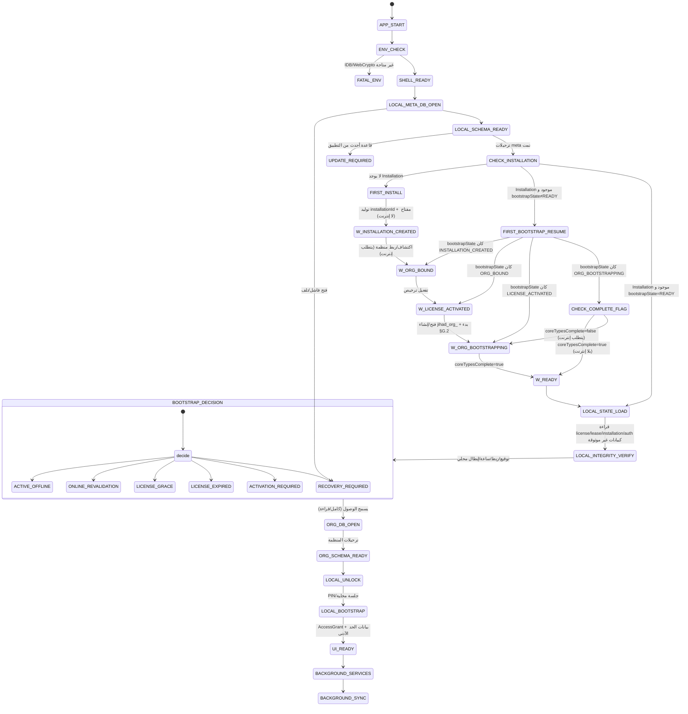

**تغييرات عن التصميم الأول (بعد ADR-R01):** (1) بوابة `CHECK_INSTALLATION` صريحة قبل أي قرار — تفصل «لا يوجد تثبيت» عن «تثبيت موجود لكن Bootstrap ناقص» عن «تثبيت جاهز»؛ (2) `FIRST_INSTALL` و`FIRST_BOOTSTRAP_RESUME` مُفصَّلان لخطوات فرعية قابلة للاستئناف بدقة (`bootstrapState`) بدل معاملتهما ككتلة واحدة؛ (3) فُصلت `LOCAL_SCHEMA_READY` (قاعدة meta) عن `ORG_SCHEMA_READY` (قاعدة المنظمة)؛ (4) `LOCAL_INTEGRITY_VERIFY` قبل القرار؛ (5) `ACTIVATION_REQUIRED`/`UPDATE_REQUIRED` فرعان مستقلان؛ (6) `ORG_DB_OPEN` بعد القرار لا قبله.

**`Installation.bootstrapState`** (حقل على سجل `Installation` في `jihad_meta`، يُكتَب دائمًا في نفس معاملة كتابة/تحديث `Installation` — INV-58):

```
enum bootstrapState:
  INSTALLATION_CREATED   — السجل أُنشئ محليًا، لا اتصال بعد
  ORG_BOUND               — منظمة مربوطة (organizationId من قراءة _Meta الخادمي، لا افتراض محلي)
  LICENSE_ACTIVATED       — القطع الموقّعة وصلت وتحققت محليًا
  ORG_BOOTSTRAPPING       — Bootstrap قاعدة المنظمة (§G.2) بدأ
  READY                   — اكتمل بالكامل (§H.3)؛ الحالة الطبيعية لكل تشغيل لاحق
```

**منع خطأ الحسام (Server-Authoritative عند عدم يقين هوية المنظمة):** الانتقال إلى `ORG_BOUND` يحدث فقط بقراءة `_Meta.organizationId` الفعلية من خادم المنظمة المستهدَف — لا يُشتَق أبدًا من افتراض محلي. إن كان الخادم غير قابل للوصول أو `Setup` لم يكتمل بعد، يبقى العميل في `INSTALLATION_CREATED` مع رسالة إعادة محاولة. **لا مسار يكتب فيه العميل بيانات منظمة افتراضية محليًا ثم يرفعها كمنظمة جديدة شرعية** دون مرور صريح بمسار `Setup` الإداري (فعل بشري مقصود، §V.3) — إنشاء منظمة جديدة اختيار واعٍ في المعالج، لا نتيجة تلقائية لفشل الاكتشاف.

**اكتمال Bootstrap بدقة (`→READY`):** بعد اجتياز (أ) كل الأنواع الأساسية غير الحجمية (§G.2 البند 3) و(ب) بدء ناجح لـIncremental Pull (§G.2 البند 5) مرة واحدة على الأقل. علم `sync_bootstrap.coreTypesComplete: bool` يُكتَب `true` عند اجتياز الشرطين (ضمن معاملة IDB الأخيرة في التنزيل)، فيسمح لـ`FIRST_BOOTSTRAP_RESUME` بفحص رخيص فوري بدل إعادة تنزيل.

## H.3 القرار (BOOTSTRAP_DECISION)

دالة **نقية** من (حالة التثبيت، حالة الترخيص والـLease، حارس الساعة، سلامة القاعدة) إلى فرع + `AccessGrant`. **تُفحَص فقط عندما `bootstrapState=READY`** (بوابة `CHECK_INSTALLATION` تحوّل أي حالة أخرى إلى `FIRST_INSTALL`/`FIRST_BOOTSTRAP_RESUME` أولًا).

| الفرع | الشرط | `AccessGrant` | السلوك |
|---|---|---|---|
| **ACTIVE_OFFLINE** | ترخيص صالح، Lease ضمن السياسة (طازج أو قديم مسموح) | `FULL` | تشغيل كامل **بلا اشتراط اتصال** |
| **ONLINE_REVALIDATION** | كالسابق لكن إعادة التحقق مستحقة (`soft`) | `FULL` | **لا يحجب الواجهة**؛ يُجدول تجديد Lease/قائمة الإبطال في الخلفية عند توفر الاتصال |
| **LICENSE_GRACE** | انتهى الترخيص (ضمن سماح) **أو** تجاوز Lease حدّه الناعم ضمن `offlineGrace` | `FULL_NOTICE` | تشغيل كامل + إشعار دائم بالعدّ التنازلي |
| **LICENSE_EXPIRED** | انتهى الترخيص/Lease وانقضى السماح، أو اشتباه بعبث بالساعة | `READ_EXPORT_ONLY` (أو ما تحدده `expirationPolicy`) | قراءة وتصدير فقط؛ **تُطبَّق السياسة ولو كان الإنترنت متاحًا** (§N.4) |
| **ACTIVATION_REQUIRED** | غير مفعّل / توقيع أو ربط فاسد / ترخيص مُبطَل | لا كتابة، تصدير بعد فتح القفل | شاشة تفعيل؛ **البيانات سليمة** (INV-24) |
| **RECOVERY_REQUIRED** | تلف/فقد قاعدة مع أثر سابق، فشل ترحيل، عدم تطابق منظمة، أو `bootstrapState=READY` بلا `coreTypesComplete=true` (تناقض داخلي غير ممكن عبر المسار الطبيعي) | حسب الحالة | §H.6 خيارات الاستعادة |
| **UPDATE_REQUIRED** | قاعدة أحدث من التطبيق | لا فتح | طلب تحديث |

**`AccessGuard`:** مكوّن في طبقة Application يقرأ `AccessGrant` قبل كل Use Case يكتب؛ الواجهة تعكسه لكن **ليست الحماية**. تُعاد الحسابة عند: العودة من الخلفية بعد مدة طويلة، قفز الساعة، نتيجة إعادة تحقق، استلام قائمة إبطال، تغيير الترخيص.

### سيناريوهات الانهيار الخمسة عبر تسلسل Bootstrap (B1–B5، اختبارات BOOT-01…05)

| # | متى ينهار التنفيذ | عند إعادة التشغيل | يحتاج إنترنت؟ | خطر Overwrite؟ |
|---|---|---|---|---|
| B1 | قبل أي كتابة meta | لا `Installation` ⇒ `FIRST_INSTALL` نظيف | نعم | لا |
| B2 | بعد `INSTALLATION_CREATED`، قبل ربط المنظمة | `FIRST_BOOTSTRAP_RESUME`، **نفس** `installationId` يُعاد استخدامه (لا تكرار) | نعم | لا |
| B3 | أثناء `ORG_BOOTSTRAPPING` | يستأنف من `sync_bootstrap` (Upsert بالمعرّف، آمن) | نعم | لا |
| B4 | بعد `coreTypesComplete=true`، قبل `READY` | فحص فوري يجد العلم صحيحًا ⇒ `READY` مباشرة | **لا** (الحالة الوحيدة التي لا تحتاج اتصالًا) | لا |
| B5 | بعد `READY` | المسار الطبيعي (`ACTIVE_OFFLINE`...) | حسب سياسة الترخيص العادية | لا |

## H.4 جدول الحالات (الاعتماد على الإنترنت)

| الحالة | ماذا تفعل | تعتمد على الإنترنت؟ |
|---|---|---|
| ENV_CHECK / SHELL_READY | تحقق البيئة، الهيكل من Cache | لا |
| LOCAL_META_DB_OPEN / LOCAL_SCHEMA_READY | فتح `jihad_meta` وترحيله | لا |
| CHECK_INSTALLATION | قراءة `Installation`/`bootstrapState`، تحديد الفرع | لا |
| **FIRST_INSTALL / FIRST_BOOTSTRAP_RESUME** | معالج أول ربط، أو استئناف من `bootstrapState` المسجَّل | **نعم، إلا استئناف B4 (لا يحتاج اتصالًا، §H.2)** |
| LOCAL_STATE_LOAD | قراءة الترخيص/Lease/التثبيت/حالة المصادقة | لا |
| LOCAL_INTEGRITY_VERIFY | تحقق ECDSA، ربط `installationId`، `maxSeenTime`، قائمة الإبطال المخزّنة | لا |
| BOOTSTRAP_DECISION | فرع + `AccessGrant` | لا |
| ORG_DB_OPEN / ORG_SCHEMA_READY / LOCAL_UNLOCK | فتح وترحيل وفتح القفل | لا |
| LOCAL_BOOTSTRAP | تحميل الحد الأدنى: المستخدم، الصلاحيات، الإعدادات، حصص اليوم، الأعداد | لا |
| **UI_READY** | **رسم Dashboard** | **لا** |
| BACKGROUND_SERVICES | مطابقة الإشعارات، توليد الحصص، صحة النظام | لا (غالبًا) |
| BACKGROUND_SYNC | تجديد الجلسة/Lease، المزامنة | نعم (خلفية) |

`UI_READY` **لا ينتظر Full Sync ولا أي طلب شبكة** (INV-11). **هدف قياس مقترح:** ≤ ~1.5 ثانية على هاتف متوسط بعد أول تحميل (يُقاس في Spike، ليس التزامًا).

## H.5 أول تثبيت مقابل التعافي

```text
لا يظهر معالج «تثبيت جديد» لمجرد أن المزامنة غير متاحة، ولا لمجرد أن Bootstrap انقطع.
```

| الوضع | الكشف | المسار |
|---|---|---|
| **عودة** | `Installation` + `bootstrapState=READY` | تشغيل عادي |
| **FIRST_INSTALL** | لا `Installation` ولا «أثر سابق» | المعالج (إنترنت لازم) |
| **FIRST_BOOTSTRAP_RESUME** | `Installation` موجود، `bootstrapState≠READY` | استئناف دقيق من نقطة التوقف (§H.2)، **لا** إعادة تثبيت ولا معالج جديد |
| **RECOVERY_REQUIRED** | قاعدة تالفة/مفقودة **مع** أثر سابق (علم `installedBefore`، سجل SW)، أو تناقض `READY`/`coreTypesComplete` | استعادة من الخادم (Bootstrap) · استيراد نسخة احتياطية · متابعة كتثبيت جديد (بتحذير) |

بعد أول Bootstrap ناجح (`bootstrapState=READY`) **يصبح التشغيل Offline إلزاميًا**: انقطاع الإنترنت لا يمنع الفتح أبدًا ما دام `AccessGrant` سارٍ (D-01).

## H.6 تصنيف الفشل والتعافي

راجع **Failure Matrix (§U)** للتفصيل. الفئات: No Internet · No Remote Data · Invalid Session · New Installation · Bootstrap Interrupted · Corrupt Local State.

---

# I. Notification Model (Reminder → Notification → Delivery)


## I.1 المبدأ الحاكم

> «The system must provide the strongest reliable local notification behavior supported by the target device/browser environment, while explicitly modeling platform limitations and fallback providers.»

- **الإشعارات المحلية أساسية في رؤية المنتج (Product Requirement)، لكنها ليست ضمانًا من المتصفح (Browser Guarantee).** لا وعد للمستخدم بما لا تضمنه PWA.
- **Notification Engine داخلي هو النظام الأساسي.** Google Calendar **ليس** محرك الإشعارات؛ هو Provider/Fallback خارجي وإسقاط لما يستطيع دعمه (D-10، ADR-014، INV-40).

## I.2 الفصل بين ثلاثة مفاهيم

| المفهوم | يجيب عن | الكيان |
|---|---|---|
| **Reminder** | *متى ولماذا؟* (نية مخطَّطة) | `ReminderRule` + `Reminder` |
| **Notification** | *ماذا نقول ولمن؟* (محتوى + مستلم + `dedupeKey`) | `Notification` |
| **Delivery** | *عبر أي قناة، ومتى، وبأي نتيجة؟* | `NotificationDelivery` |

## I.3 المسار والمزوّدون

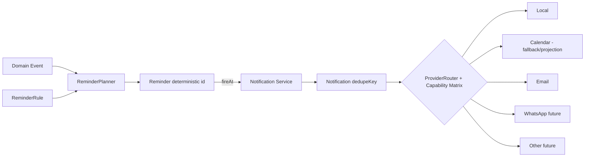

```text
Notification Provider
├── Local      (inapp · local_push · local_scheduled[تجريبي] · native_local[مستقبلي])
├── Calendar   (إسقاط تذكيرات الحدث — Fallback)
├── Email      (Gmail Adapter)
├── WhatsApp   (Future)
└── Other      (Web Push / SMS — Future، يُحدَّد بعد Spike)
```

- **ReminderPlanner:** يستجيب للأحداث ولنتائج Pull، يخطط نافذة قريبة (مثلاً 72 ساعة) بمعرّفات حتمية (§F.2).
- **NotificationService:** لا يعرف مزوّدًا بعينه؛ يسأل `ProviderRouter`.
- **الأنواع (V1):** قبل الدرس · جدول الصباح · وقت التحرك · فجوة زمنية · موعد قريب · تغيّر موعد · إلغاء · واجب · غياب · إداري.
- **عدم التكرار:** `dedupeKey = <kind>:<targetId>:<slot>:<startsAtUtc>` ⇒ `Notification.id = UUIDv5(dedupeKey)`.

## I.4 Capability Matrix

> القيم تعبّر عن **المعروف وقت التصميم** وتُعامل كـ**فرضيات تُثبَت أو تُنفى بالـSpike (§I.8)**. لا تُبنى وعود المنتج عليها قبل ذلك.

| Provider | يعمل Offline؟ | يعمل والـPWA مغلقة؟ | يحتاج إنترنت؟ | إذن المتصفح؟ | إذن النظام؟ | قدرة الجدولة | قيود الاعتمادية | Fallback |
|---|---|---|---|---|---|---|---|---|
| **inapp** | نعم | لا | لا | لا | لا | عند فتح التطبيق/بقائه في المقدمة (مؤقّتات) | يعمل فقط عند تشغيل التطبيق | Catch-up «فاتك» عند الفتح |
| **local_push** (Notification API عبر Service Worker) | نعم | **غير مضمون** (يتوقف على بقاء SW/العمل الخلفي) | لا | **نعم** (Notification permission) | **نعم** (إشعارات التطبيق/تحسين البطارية) | إظهار فوري عند نشاط SW؛ **لا جدولة أصلية مضمونة** | قد يُوقَف SW عند إغلاق التطبيق؛ سلوك يختلف بين المتصفحات/الأنظمة | Calendar ثم Catch-up |
| **local_scheduled** (Notification Triggers / Periodic Background Sync) | نعم إن توفّر | نظريًا نعم | لا | نعم | نعم (+ شروط تثبيت/نشاط) | مؤقّتات مجدولة إن دُعمت | **غير معياري/مقيّد بمتصفحات محددة** — قد لا يتوفر إطلاقًا؛ يحدد Spike | لا يُعتمد عليه؛ Fallback كما أعلاه |
| **calendar** (تذكيرات الحدث المُسقَط) — **Layer C، §I.9** | نعم بعد وصول الحدث للجهاز | **نعم** إن كان تطبيق التقويم على الجهاز يطلق التنبيه | مرة واحدة على الأقل للمزامنة | لا (في PWA) | **نعم** (إذن تنبيهات تطبيق التقويم) | تذكيرات بإزاحة ثابتة (`remindersMin`) | **إسقاط خارجي Best-Effort/Provider-Dependent، غير مكافئ لـLayer B (§I.9)**؛ مقيَّد بما يدعمه Calendar؛ يعتمد على مزامنة حساب Google وعلى إعدادات المستخدم؛ حصص Calendar API؛ **بين لحظة تغيير محلي ونجاح المطابقة (§J.3)، توقيت التنبيه الخارجي خارج سيطرة التطبيق تمامًا** | Local/Catch-up |
| **email** (Gmail Adapter) | لا | نعم | **نعم** | لا | لا | خادمي (Time-driven trigger) | **حصة إرسال يومية**؛ تأخير؛ قد يذهب Spam | Portal / إشعار داخلي |
| **whatsapp** (مستقبلي) | لا | نعم | نعم | لا | لا | خادمي | تحكمه سياسات المزوّد | Email |
| **web_push** (مرشّح، يُحدَّد بعد Spike) | لا | **نعم** | **نعم** (اشتراك + خادم) | نعم | نعم | خادمي | يحتاج خدمة دفع وتوقيع خادمي (تعقيد في Apps Script) | inapp/calendar |
| **native_local** (مستقبلي: غلاف أصلي) | نعم | **نعم** | لا | لا | نعم | **جدولة أصلية** | يستلزم تغليف التطبيق (Capacitor/TWA) | — |

## I.5 اختيار الـProvider (ProviderRouter)

لكل نوع تذكير **فئة أهمية**:
- **Must-Deliver** (مثل: قبل الدرس بـ N دقيقة): سلسلة Fallback متعددة (Local → Calendar → Catch-up) **وتُعرَض للمستخدم حالة الاعتمادية**.
- **Nice-to-Have** (جدول الصباح): مزوّد واحد كافٍ.

يقرأ الـRouter الـMatrix مع **قدرات الجهاز المكتشفة فعليًا** (إذن ممنوح؟ هل `local_scheduled` مدعوم؟ هل Calendar مُسقَط ومفعّل؟) ويُنتج قائمة قنوات مرتّبة. كل Provider يعلن `capabilities()` بنفس حقول الـMatrix، فلا تُكتب افتراضات داخل الـDomain.

## I.6 الصدق مع المستخدم

شاشة «موثوقية التذكيرات» تعرض حسب الجهاز: ما هو مفعَّل، ما هو غير مدعوم، وأي فجوة (مثل: «التذكير والتطبيق مغلق يعتمد على تقويم Google»). **لا عبارات مثل «مضمون».**

## I.7 Catch-up والتعدد الجهازي

- عند `UI_READY`/العودة للمقدمة: مقارنة `fireAtUtc` بالآن؛ ما فات ولم يُسلَّم يُعلَّم `expired` أو يُعرض ضمن «فاتك» بحسب العمر، **دون إطلاق جماعي لإشعارات قديمة**. Quiet Hours تُحترم.
- التسليم المحلي **خاص بالجهاز** (لا يُزامَن)؛ إعداد `device` «أنبّهني على هذا الجهاز» لتفادي التنبيه المزدوج، مع الانتباه إلى أن Calendar سيُنبّه على أجهزة الحساب كلها.

## I.8 Notification Spike (قبل اعتماد التنفيذ)

**الهدف:** تحويل فرضيات §I.4 إلى حقائق للأجهزة المستهدفة، وتحديد الحاجة إلى `web_push` أو غلاف أصلي.

| الاختبار | السيناريو |
|---|---|
| T-01 | Notification API عبر SW: التطبيق مفتوح/في الخلفية/مغلق (تمرير مهلة 1 د، 10 د، ساعة) |
| T-02 | الهاتف مقفل + Doze/توفير البطارية مفعّل |
| T-03 | PWA مثبّتة مقابل تبويب متصفح |
| T-04 | Offline كامل (وضع الطيران) طوال الفترة |
| T-05 | توفر/سلوك Notification Triggers وPeriodic Background Sync |
| T-06 | Calendar: حدث بتذكير ⇒ هل يُطلق التنبيه Offline على الجهاز؟ وبعد كم من المزامنة؟ |
| T-07 | Web Push (اشتراك + إرسال من Apps Script بتوقيع VAPID): جدوى/زمن/موثوقية |
| T-08 | إشعارات النقر: فتح `deepLink` الصحيح |
| T-09 | إعادة تشغيل الجهاز: هل تُستعاد الجدولة؟ |
| T-10 | تعدد الأجهزة: ازدواج التنبيه |

**المخرجات:** جدول قدرات محقَّق لكل جهاز/متصفح · درجة اعتمادية لكل فئة تذكير · قرار: (أ) الاكتفاء بـLocal+Calendar+Catch-up، (ب) إضافة Web Push، (ج) غلاف أصلي. **أجهزة الاختبار المستهدفة والعتبات المقبولة تُحدَّد من المالك قبل التنفيذ (OQ-18).** **معيار قياس مستقل إلزامي (SP-1، ADR-R02):** T-01/T-09 يقيسان بمعزل تام (أ) هل يمكن جدولة إشعار محلي أصلًا، **و(ب) منفصلًا: إن كان مجدولًا، هل إلغاؤه قبل وقته يمنع عرضه فعليًا بنسبة موثوقة؟** — المعيار (ب) يخص موثوقية Layer A تحديدًا (§I.9)، وقد لا يتبع نفس نسبة نجاح المعيار (أ).

## I.9 طبقات الضمان الثلاث (Notification Guarantee Layers)

**المبدأ:** الإشعارات المحلية أساسية في رؤية المنتج، لكن **مستوى الضمان يختلف جوهريًا** حسب من يتحكم بلحظة التسليم فعليًا. لا يُدَّعى أبدًا ضمان أعلى مما تثبته المنصة أو الآلية فعليًا.

| الطبقة | أمثلة | التصنيف | لماذا |
|---|---|---|---|
| **Layer A — OS-native scheduled** | `local_push`, `local_scheduled` | **BEST-EFFORT / PLATFORM-DEPENDENT** | التطبيق **يحاول** إلغاء تسجيل مُجدوَل مسبقًا لدى نظام التشغيل (§A.7، INV-59)، لكن **لا يُدَّعى أبدًا** أن هذا الإلغاء مضمون رياضيًا؛ يعتمد على المنصة، وقد يعرض النظام إشعارًا قديمًا رغم محاولة الإلغاء إن كان التطبيق مغلقًا تمامًا وقتها. **يُثبَت تجريبيًا فقط عبر SP-1.** |
| **Layer B — Application-controlled** | `inapp`، Catch-up، قرار الإرسال الخادمي اللحظي (`email` وقت التركيب) | **ARCHITECTURALLY CONTROLLED** | التطبيق يفحص `isReminderStillValid` (يقارن `sourceSnapshot` بالحالة الحيّة، §A.7) **قبل** أي قرار تسليم يتحكم به مباشرة. **مضمون معماريًا أن لا تسليم متعمَّد لمحتوى باطل** — **ليس** ضمانًا مطلقًا ضد فشل الشبكة أو إغلاق المتصفح أو عطل المزوّد؛ فقط ضد تسليم التطبيق **عمدًا** لمحتوى يعرف هو نفسه أنه لم يعد صحيحًا. |
| **Layer C — External scheduled projection** | Google Calendar (الحدث المُسقَط وتنبيهه) | **BEST-EFFORT / PROVIDER-DEPENDENT** | بمجرد إنشاء الحدث الخارجي، **يخرج توقيت تنبيهه عن سيطرة التطبيق تمامًا** حتى تنجح المطابقة اللاحقة (§J.3: Drift عبر `contentHash` ثم Upsert/Delete). **Calendar ≠ Layer B** ولا يُعامَل أبدًا كمكافئ لضمانها — قد يُطلِق تنبيهًا خارجيًا قديمًا على أي جهاز مزامَن بذلك التقويم، بمعزل تام عن حالة `Reminder` المحلية في الجهاد، إلى أن ينجح التوفيق. |

**الصياغة النهائية الملزمة (لا يجوز تجاوزها في أي رسالة مستخدم أو وثيقة لاحقة):**
> *"التطبيق لن يُسلِّم عمدًا تذكيرًا باطلًا عبر أي مسار يتحكم به (Layer B)"* — **مضمون**.
> *"نظام التشغيل، أو تطبيق Google Calendar الخارجي، مضمونان رياضيًا ألا يعرضا أبدًا إشعارًا/تنبيهًا سبق تسجيله (Layer A/C)"* — **غير مُدَّعى**، وبانتظار إثبات تجريبي (SP-1 لـLayer A؛ لا إثبات مطلوب لـLayer C لأنه بطبيعته خارج سيطرة الجهاد، والاعتماد الوحيد عليه هو سرعة المطابقة §J.3 لا ضمان توقيته).

---

# J. Calendar Model (Domain → Projection)

## J.1 المبدأ

**Domain (Lesson/PersonalEvent) هو الحقيقة. Google Calendar إسقاط (Projection) خارجي قابل للإعادة البناء.** (INV-17)

**وهو ليس محرك الإشعارات الأساسي:** يعمل كـFallback/Integration لما يدعمه من تذكيرات (ADR-014، INV-40)، بينما Notification Engine الداخلي (§I) هو الأساس. **تصنيف ضمانه صراحة: Layer C — Best-Effort/Provider-Dependent (§I.9)، غير مكافئ لضمان Layer B.**

## J.2 القرارات

| القرار | الاختيار | السبب |
|---|---|---|
| الاتجاه | **الجهاد → Calendar فقط** (V1) | تجنب التعارض والهشاشة |
| وحدة الإسقاط | **حدث مستقل لكل Lesson** (لا أحداث RRULE متكررة) | الإلغاء/إعادة الجدولة/الاستثناء = 1:1 مع دورة حياة Lesson |
| التقويم | **تقويم مخصص «الجهاد»** يُنشئه الـAdapter | لا يمسّ أحداث المدرس الشخصية؛ حذفه آمن |
| النافذة | `[اليوم −7, اليوم +60]` افتراضيًا (`CalendarTarget`) | حصص Calendar API وتكلفة الإعادة |
| المحتوى | عنوان (مادة + طالب/مجموعة) + مكان + وصف مختصر؛ **وضع خصوصية** يستبدل الأسماء بـ«حصة» | بيانات الطلاب حساسة (§102) |
| التنبيهات | `remindersMin` مضبوطة في الحدث كطبقة Offline احتياطية | §2.1 |

## J.3 التدفق

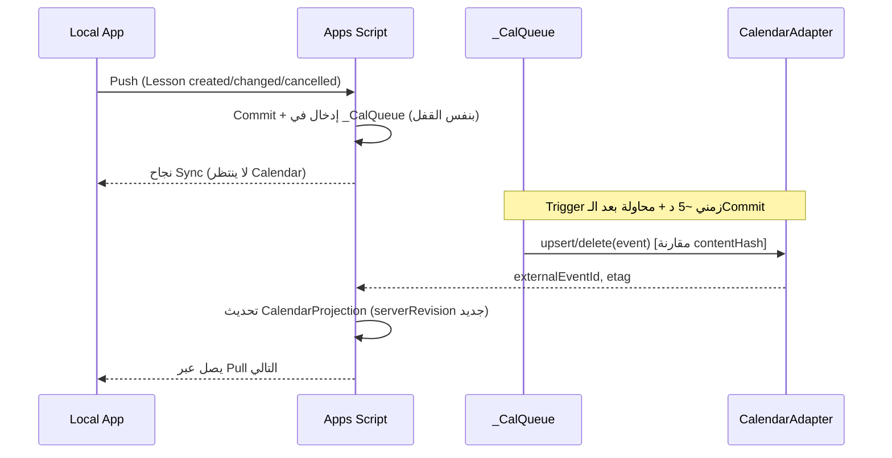

- **الإسقاط لا يمنع المزامنة ولا يوقف التطبيق** عند الفشل (INV-18). حالته `failed` مع إعادة محاولة بـBackoff.
- **الإلغاء:** إعداد لحذف الحدث أو وسمه «ملغاة».
- **الانحراف (Drift):** إن تغيّر `etag`/المحتوى خارجيًا ⇒ `driftDetected`؛ السلوك بحسب إعداد: إعادة الكتابة (افتراضي) أو ترك.
- **يتيم (`orphaned`):** المصدر حُذف والحدث باقٍ ⇒ تنظيف.
- **مواعيد المدرس الشخصية:** `PersonalEvent` ⇒ إسقاط اختياري. **استيراد Busy Blocks (قراءة فقط)** لحساب الوقت الحر مؤجل V1.2 كمدخل تكاملي وليس مصدر حقيقة.
- **الحدود:** يُحسب حد إنشاء الأحداث اليومي؛ الإسقاط الأولي يُقسَّم على أيام إن لزم.

---

# K. Drive / File Model

## K.1 الكيانات

`File` (وصف) · `FileReference` (ربط بهدف + غرض + رؤية) · `StorageProvider` (واجهة داخلية: `local`, `drive`, مستقبلًا غيرهما). **لا Blob في Sheets أو في سجلات الكيانات.**

## K.2 تنظيم Drive (اقتراح)

```text
Jihad/<orgSlug>/
   files/<yyyy>/<mm>/<fileId>          (الاسم = المعرّف؛ لا أسماء طلاب في أسماء الملفات)
   thumbs/<fileId>
   backups/<yyyy-mm-dd>/…
```

## K.3 تدفق الرفع (يعمل Offline)

1. الصورة تُضغَط على العميل (أقصى بُعد وجودة ثابتان) وتُحسب `sha256`.
2. تُحفظ Blob في `file_blobs` + سجل `File(status=local_only)` + `FileReference` **بمعاملة واحدة** (وعملية Outbox للسجلين). الواجهة تعمل فورًا.
3. **طابور رفع منفصل** `file_upload_queue` (ليس Outbox): أجزاء بحجم ثابت، `uploadId + chunkIndex` **Idempotent**، استئناف بعد الانقطاع.
4. عند الاكتمال يكتب الخادم `storageRef` ويحدّث `File.status=available` ⇒ يصل للعميل بـPull.
5. **إزالة التكرار:** نفس `sha256` في المنظمة ⇒ ربط الملف الموجود.

## K.4 التنزيل والعرض

Blob المحلي أولًا؛ وإلا يُطلب من الخادم (مع التحقق من `FileReference` ونطاق الطالب) ويُخزَّن بسياسة LRU. **Drive ليس تبعية للتطبيق الأساسي** (فقدانه = ملفات `missing` لا توقف).

## K.5 الحذف والاحتفاظ

حذف `File` = Tombstone ⇒ سلة Drive بعد مدة احتفاظ ⇒ حذف نهائي. `FileReference` المحذوفة لا تحذف الملف إن كان مرتبطًا بغيرها.

## K.6 ملفات أولياء الأمور

لا روابط Drive عامة. الوصول عبر **وسيط خادمي** بالتحقق (`FileReference.parentVisible` + نطاق الأبناء)؛ حدّ حجم أدنى/أقصى موثّق (خطر R-06).

---

# L. Parent Portal Model

## L.1 البنية

- **مدخل/تطبيق منفصل** (`portal/`) بـService Worker خاص (نطاق مسار مختلف) وقاعدة IDB **خاصة** `jihad_portal` تحفظ آخر لقطة للقراءة فقط. لا يحمل أي كود Domain للمدرس ولا يفتح قاعدة المدرس (INV-28).
- **V1: قراءة فقط.** لا كتابة من البوابة.
- يعمل الولي عبر **Apps Script المنظمة** دون حاجة لحساب Google.

## L.2 مسار التفعيل (Onboarding)

```text
المدرس ينشئ/يدعو ولي الأمر
        ↓
Invitation + Activation Code (استخدام واحد، ينتهي)
        ↓
ولي الأمر يفعّل الحساب
        ↓
إعداد PIN/اعتماد أولي
        ↓
جلسة موثّقة (Authenticated Parent Session)
        ↓
Parent Scope
        ↓
كل الأبناء المصرَّح لهم
```

| الخطوة | التفصيل المعماري |
|---|---|
| **الدعوة** | تُنشأ `PortalInvite` (سر عشوائي طويل، يُخزَّن **مُجزّأً**)، مرتبطة بـ`Parent`، بصلاحية زمنية واستخدام واحد. تُسلَّم خارج النظام (رسالة/رابط) |
| **التفعيل** | يُدخل الولي رمز التفعيل. يُستهلك الرمز **مرة واحدة** ويُبطَل. لا يُخزَّن **رمز دائم في الرابط** ولا في الـURL بعد التفعيل (INV-42) |
| **الاعتماد** | يضع الولي PIN (أو عبارة) ⇒ `PortalCredential` (تجزئة بملح وفلفل). طول/تعقيد PIN يُحدَّد (OQ-16) |
| **الجلسة** | `PortalSession`: رمز عشوائي مُجزّأ عند الخادم، مرتبط بالجهاز، انتهاء منزلق + مطلق، قابل للإبطال. الرمز في رأس/جسم الطلب لا في الـURL |
| **جهاز جديد** | يستلزم PIN (أو دعوة جديدة). عدد محاولات محدود |
| **الاستعادة** | إعادة دعوة من المدرس (لا اعتماد على بريد تلقائي بسبب حصة Gmail) |
| **الحد من التخمين** | عدّادات في `CacheService` لكل (حساب، جهاز) + قفل مؤقت تصاعدي |

> **قيد صريح:** Apps Script لا يوفر PBKDF2/bcrypt أصليًا؛ تُستخدم تجزئة تكرارية بملح وفلفل (من Script Properties) **مع الاعتماد الأساسي على تحديد المعدل والقفل**. تُقيَّم البدائل في Spike SP-6.

## L.3 حسم نطاق الوصول (على الخادم، في كل طلب)

```text
جلسة صالحة؟ → PortalAccount active؟ → Parent
   → allowedStudentIds = { s | ParentStudentRelationship(parent, s)
                              .canViewPortal && الفترة سارية && الطالب غير مؤرشف }
   → studentId في الطلب ∈ allowedStudentIds ؟ وإلا 404 (لا 403؛ منعًا للتعداد)
   → قراءة pv_* فقط ⇒ حقول Whitelist
```

`/student?id=123` **غير كافٍ إطلاقًا** (INV-43). النتيجة قد تُخزَّن مؤقتًا ≤ 60 ث.

## L.4 الحساب الواحد والأبناء المتعددون

`Parent` واحد ⇒ `PortalAccount` واحد ⇒ **كل** الأبناء عبر `ParentStudentRelationship`. لا ربط مباشر بطفل واحد. واجهة البوابة: مبدّل أبناء.

### إدارة العلاقة (مع حفظ التاريخ)

| العملية | التنفيذ | أثر البوابة |
|---|---|---|
| **إضافة طفل** | صف علاقة جديد (`validFrom = اليوم`) | يظهر عند إعادة بناء الإسقاط وفي الطلب التالي |
| **إزالة العلاقة** | `validTo = اليوم` (لا حذف) | يختفي الطفل في الطلب التالي؛ الجلسة لا تُلغى (النطاق يُعاد حسابه) |
| **تغيير العلاقة** (النوع/الأعلام) | إنهاء الصف الحالي + صف جديد (تاريخ محفوظ) أو تعديل الأعلام مع تدقيق | تُعاد الحسبة فورًا |
| **أكثر من ولي أمر لطفل** | صفوف علاقات متعددة؛ `isPrimary` لواحد فقط | كل ولي يرى ما تسمح به علاقته |
| **صلاحيات العلاقة** | الأعلام الحالية `canViewPortal`, `canReceiveMessages`؛ **نقطة توسّع**: حقل `permissions` إضافي بـMigration عند الحاجة (∞) | — |
| **سياسة سجل ما قبل العلاقة/بعدها** | ولي الأمر يرى بيانات الفترة السارية فقط؛ **السجلات الداخلية تبقى محفوظة** ولا تُحذف | Projection يُعاد بناؤه |

## L.5 الشاشات (V1) والوضع Offline لولي الأمر

الأبناء (تبديل) · اليوم/القادم · السجل (حصص/ما شُرح/حضور) · الواجبات · (V1.1) النتائج/التقارير المسموحة. Offline: آخر لقطة مخزّنة بوسم «آخر تحديث»؛ الخروج/الإلغاء يمسح القاعدة المحلية؛ الإبطال الخادمي يسري عند أول اتصال (مخاطرة مقبولة محدّدة).

## L.6 نموذج التهديدات المختصر

| التهديد | الدفاع |
|---|---|
| تعداد معرّفات الطلاب | 404 + نطاق من العلاقات + رموز عشوائية |
| سرقة رمز الجلسة | انتهاء، ربط بجهاز، إبطال، تخزين IDB (لا localStorage) + CSP |
| إعادة استخدام رابط الدعوة | استخدام واحد + انتهاء + تجزئة |
| تخمين PIN | تحديد معدل + قفل + تجزئة بملح/فلفل |
| تسريب ملاحظة داخلية | `TeacherNote` كيان/ورقة لا يدخل الإسقاط أبدًا (INV-23) |
| علاقة أُلغيت | تُعاد حسبة النطاق في كل طلب |
| إغراق Apps Script | Cache + Rate limit + لقطات صغيرة |

---

# M. Authentication / Authorization Model

## M.1 التمييز بين المفاهيم

| المفهوم | يجيب عن |
|---|---|
| Authentication | من أنت؟ |
| Authorization | ماذا يُسمح لك؟ |
| Local Unlock (PIN) | هل حامل الجهاز مخوَّل لفتح التطبيق الآن؟ (لا يثبت هوية أمام الخادم) |
| Portal Auth | هوية ولي الأمر — **منفصلة منطقيًا وماديًا** عن هوية الموظفين |

## M.2 مصادقة الموظفين

1. **Google Sign-In (OIDC):** العميل يحصل على ID Token ⇒ الخادم يتحقق منه (نقطة تحقق Google) ويطابق `sub` مع `User.authSubject` ⇒ يصدر **Access Token قصير الأجل + Refresh Token مرتبط بالتثبيت**، كلاهما مُجزّأ عند الحفظ (`AuthSession`).
2. **مطالبة الملكية (First Owner Claim):** أثناء Setup يُولَّد **رمز إعداد لمرة واحدة** (مُجزّأ في `_Meta`)؛ أول مستخدم يُقدّم الرمز + ID Token يُربط كـ Owner. يمنع استيلاء غريب على منظمة جديدة.
3. **العمل دون اتصال:** الجلسة المحلية + PIN. انتهاء صلاحية Token لا يمنع العمل المحلي؛ يمنع المزامنة فقط.
4. **PIN محلي:** مُجزَّأ (PBKDF2 عبر WebCrypto)، قفل تلقائي بمهلة، تحديد محاولات؛ **ليس تشفيرًا للبيانات** (§2.6). بيومتري (WebAuthn) اختياري لاحقًا.
5. **لا سر في الواجهة الأمامية:** لا مفاتيح خاصة، لا أسرار API (INV-15).

## M.3 الصلاحيات (RBAC + النطاق)

**الكتالوج ثابت في الكود** `<module>.<resource>.<action>`. أمثلة: `students.record.read/write`, `lessons.schedule.write`, `lessons.correct`, `attendance.write`, `notes.teacher.read`, `notes.parent.write`, `portal.manage`, `assessments.write`, `finance.read/write`, `settings.manage`, `users.manage`, `license.manage`, `backup.manage`.

| الدور | أساسي (V1) | افتراضيًا ممنوع |
|---|---|---|
| owner | كل شيء | — |
| teacher | طلابه/مجموعاته/حصصه/حضور/واجبات/ملاحظات/بوابة | إدارة المستخدمين/الترخيص/المالية (إلا بمنح) |
| assistant | عرض طلاب/حصص/جدول/بوابة | كتابة/مالية/إدارة |
| secretary | تسجيل طلاب، بيانات اتصال، مواعيد، ولي أمر | مالية، ترخيص، إعدادات حساسة |
| accountant | مدفوعات/تقارير مالية (V1.2) | محتوى أكاديمي |
| administrator | إدارة تشغيلية | ترخيص/تحويل ملكية |

**النطاق `own`:** المدرس يرى فقط ما يخصه إلا إن مُنح `organization`. في V1 (مدرس واحد) يطابق كل شيء.

## M.4 طبقات التحقق (أربع لا ثلاث)

**`organizationId` وحده ليس حدًا أمنيًا** (D-12، INV-39). قبل أي قراءة أو كتابة حساسة يتحقق الخادم من:

```text
Authenticated Identity  +  Organization  +  Role/Permission  +  Resource Scope
```

1. **الواجهة (UX):** إخفاء/تعطيل — **ليس حماية**.
2. **الخدمة المحلية (Application Service + AccessGuard):** فحص صلاحية Offline على نسخة الصلاحيات المخزنة (`permissionsRevision`) و`AccessGrant` (§H).
3. **الخادم (سلطة):** مصادقة ← **فحص المنظمة الثلاثي** (غائبة ⇒ رفض؛ موجودة ومختلفة عن `_Meta.organizationId` الخادمي ⇒ رفض؛ مطابقة ⇒ تابع — التفصيل الكامل في §G.4 خطوة 1، INV-57) ← صلاحية العملية ← **نطاق المورد/الملكية (`own|organization`)** ← Input ← علاقة الكيان. **لا يُوثَق بالعميل.**
4. **شرعية الحالة (Domain المشترك):** الانتقال مسموح من الحالة الحالية.

## M.5 التغيير أثناء Offline

صلاحية سُحبت والعميل Offline: عملياته تُرفض عند المزامنة بـ`FORBIDDEN` وتُحجر مع شرح (لا حذف صامت). يُعرض ذلك بوضوح ويمكن تصديرها.

## M.6 المراجعة (Audit)

يُسجَّل: تسجيل الدخول، تغيير الصلاحيات، إنشاء/إلغاء دعوة بوابة، العمليات المرفوضة، تفعيل/نقل ترخيص، تصدير/استعادة نسخة. **لا يُسجَّل** أي سر.

---

# N. Licensing Model

## N.0 المبدأ والقرار

**القرار (OQ-04): Commercial-Grade Practical Enforcement** — إنفاذ تجاري عملي قوي، **دون ادعاء DRM مطلق**.

> «License security in a client-side PWA cannot provide absolute protection against a determined owner of the client environment.»

هذا **حد معماري موثَّق** وليس فشلًا في التصميم. الهدف: منع النسخ والمشاركة والاستخدام غير المرخّص العادي، وتنظيم الاستخدام بسياسات واضحة، **دون أن يتعطل النظام** بسبب انقطاع الإنترنت.

المكوّنات المطلوبة: ECDSA P-256 · تحقق بمفتاح عام · تحقق Offline · هوية Installation · هوية Device · Activation · Entitlements · انتهاء صلاحية · Transfer · Grace · **Revocation عند توفر الاتصال** · إنفاذ Offline · مقاومة عبث مناسبة لمتصفح/PWA. **Apps Script ليس نقطة الثقة الوحيدة** (ADR-015، INV-49).

## N.1 الفصل بين المفاهيم

`Product` · `Customer` · `Organization` · `License` · `Installation` · `Device` · `Activation` · `Entitlement` (+ `Transfer`). لا مفهومان يشتركان في معرّف.

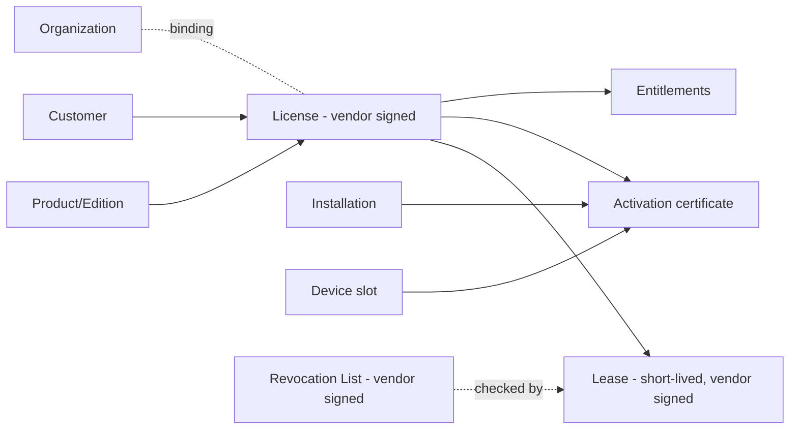

## N.2 الأطراف ومصدر الثقة

| الطرف | المسؤولية | لا يفعل |
|---|---|---|
| **License Authority (البائع)** | يحتفظ بالمفتاح الخاص؛ يصدر License وActivation Certificate وLease وقوائم الإبطال. **لا يحتفظ ببيانات الطلاب** (فقط معرّفات ترخيص/تثبيت وتلميح جهاز) | لا يتصل ببيانات المنظمة |
| **التطبيق (PWA)** | يحمل المفتاح العام (`keyId` مع تدوير) ويتحقق **Offline** من كل شيء؛ يطبّق السياسة | لا يحمل مفتاحًا خاصًا |
| **Apps Script المنظمة** | سجل التثبيتات/الأجهزة، وتطبيق حدود العدد كسياسة تشغيلية (طبقة ردع ثانوية)، تمرير Check-in | **ليس** مرجع صلاحية الترخيص؛ مالكه هو العميل |

## N.3 القطع الموقّعة (Artifacts)

| القطعة | الغرض | العمر |
|---|---|---|
| **License Token** | الحقوق: `licenseId, productKey, edition, customerRef, notBefore, expiresAt, entitlements, maxInstallations, maxDevices, expirationPolicy, graceDays, offlinePolicy{leaseDays, softRefreshDays, offlineGraceDays}, formatVersion, keyId, signature` | طويل (شهور/سنة) أو دائم |
| **Activation Certificate** | يربط License بـ`installationId` (+ مفتاح عام للتثبيت) | حتى Transfer/إبطال |
| **License Lease** | تفويض **قصير الأجل** يجدَّد عند توفر الاتصال؛ يحمل `validUntil` و`revocationListVersion` | `leaseDays` (مثلاً 30–90، OQ-15) |
| **Revocation List** | قائمة موقّعة بمعرّفات تراخيص/تفعيلات مُبطَلة، بإصدار | تُجلب عند الاتصال وتُخزَّن |

**الـLease هو ما يحل التناقض بين Offline والإبطال:** لا يمكن الإبطال الفوري Offline، لكن **أقصى نافذة لاستمرار ترخيص مُبطَل = عمر الـLease + `offlineGraceDays`** (نافذة معلنة وقابلة للضبط).

## N.4 القرار: الصلاحية ≠ توفر الخادم

```text
License Validity  (هل الحق ساري؟)      — من التوقيع + الزمن الموثوق + الإبطال المعروف
Server Availability (هل الخادم متاح؟)   — حالة اتصال فقط، **ليست** حكمًا على الصلاحية
```

- **Internet OFF + ترخيص محلي صالح + Lease ضمن السياسة = التطبيق يعمل** حسب Offline License Policy.
- **ترخيص منتهٍ = تُطبَّق سياسة الانتهاء المضبوطة حتى لو الإنترنت متاح.** (الاتصال قد يجلب تجديدًا صدر من البائع؛ فإن لم يوجد يبقى منتهيًا.)
- فشل Apps Script/Sheets **لا يغيّر حالة الترخيص** (INV-37).

### N.4.1 محوران متعامدان

**المحور 1 — Validity (محلي، مشتق من التوكن/الشهادة/الزمن/الإبطال):**

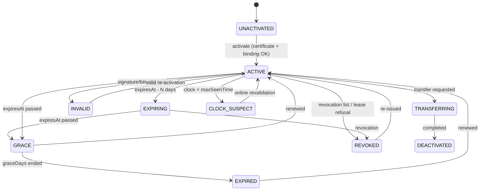

**المحور 2 — Lease Freshness (محلي، مشتق من زمن آخر Lease):**

`FRESH` (< `softRefreshDays`) → `STALE` (بين `softRefreshDays` و`leaseDays`) → `LEASE_GRACE` (حتى `leaseDays + offlineGraceDays`) → `OVERDUE` (بعدها). التجديد الناجح يعيد `FRESH`.

**الاتصال (ظرف تشغيلي فقط):** `ONLINE | OFFLINE` — لا يدخل في الحكم إلا عبر تجديد Lease.

### N.4.2 جدول السياسة: `Validity × Freshness → AccessMode`

| Validity | FRESH / STALE | LEASE_GRACE | OVERDUE |
|---|---|---|---|
| **ACTIVE / EXPIRING** | `FULL` | `FULL_NOTICE` | `READ_EXPORT_ONLY` حتى تجديد |
| **GRACE** (منتهٍ ضمن سماح) | `FULL_NOTICE` | `FULL_NOTICE` | `READ_EXPORT_ONLY` |
| **EXPIRED** | حسب `expirationPolicy` (افتراضي `READ_EXPORT_ONLY`) | نفس | نفس |
| **REVOKED** | `READ_EXPORT_ONLY` | نفس | نفس |
| **INVALID / UNACTIVATED** | `ACTIVATION_REQUIRED` | نفس | نفس |
| **CLOCK_SUSPECT** | `READ_EXPORT_ONLY` حتى إعادة تحقق أونلاين | نفس | نفس |

`AccessMode ∈ {FULL, FULL_NOTICE, READ_EXPORT_ONLY, ACTIVATION_REQUIRED}`. **في كل الأوضاع: الوصول للتصدير وسلامة البيانات محفوظان** (INV-24). `expirationPolicy` يحدَّد في التوكن: `read_export_only` (الافتراضي) | `hard_activation_required` (شديد؛ لا يوصى به).

## N.5 التفعيل

**V1 يدوي Offline قابل للتحويل إلى Online:**
```text
1) Installation Request = installationId + مفتاح عام للتثبيت + وصف الجهاز + orgId
2) يرسله المستخدم للبائع (واتساب/بريد — كتجربة «Machine ID» في الحسام)
3) البائع يوقّع License + Activation Certificate + أول Lease
4) يلصق المستخدم مفتاح التفعيل ⇒ WebCrypto يتحقق ⇒ Activation محلي
5) عند أول اتصال: تسجيل Installation/Device في خادم المنظمة + إشعار البائع (اختياري)
```
**Online لاحقًا:** نقطة تفعيل عند البائع تؤدي نفس الخطوات آليًا بلا تغيير في النموذج.

## N.6 الحدود الصريحة (Honest Limits) — خطر R-03

- الكود في المتصفح قابل للفحص والتعديل؛ **مالك بيئة العميل مصمِّم على العبث يستطيع تجاوز أي فحص محلي.**
- Apps Script **لا يتحقق من توقيع بمفتاح عام** ويقع تحت سيطرة العميل؛ لذلك **لا يُعتبر حماية**.
- **النتيجة:** نصمم لـ**رفع كلفة التجاوز ومنع الاستخدام العادي غير المرخّص**، ونثبّت ذلك للتجار والعملاء بوضوح.

## N.7 تدابير مقاومة العبث المناسبة لـPWA

| # | التدبير | ما يمنعه |
|---|---|---|
| 1 | توقيع ECDSA P-256 على License/Certificate/Lease/Revocation (تحقق بمفتاح عام مضمَّن مع `keyId`) | تزوير التوكن |
| 2 | ربط بـ`installationId` + **مفتاح غير قابل للتصدير** (WebCrypto `extractable=false`) وتحدّي توقيع عند التفعيل/التجديد | نسخ التوكن لتثبيت آخر |
| 3 | **Lease قصير الأجل** يجدَّد أونلاين + قائمة إبطال موقّعة | ترخيص مُبطَل يعمل للأبد |
| 4 | حارس الساعة `maxSeenTime` (رتيب) | إرجاع ساعة الجهاز لتمديد الصلاحية |
| 5 | إعادة تحقق من `AccessGrant` في نقاط متعددة (إقلاع، قبل الكتابة، دوري، بعد Pull) لا مرة واحدة | إصلاح فحص وحيد |
| 6 | `EntitlementService` كنقطة فحص وحيدة (لا فحوص مبعثرة) | ثغرات فروع الميزات |
| 7 | حدود العدد (Installations/Devices) عند خادم المنظمة كسياسة تشغيلية + كشف نفس `installationId` من جهازين | مشاركة واضحة |
| 8 | لا اعتماد على التعتيم (Obfuscation) كحماية | — |

## N.8 الإبطال (Revocation Strategy)

- **الآلية:** البائع يضيف `licenseId/activationId` إلى **Revocation List** موقّعة بإصدار متزايد.
- **التوزيع:** يجلبها التطبيق عند الاتصال (خلفية) من **خادم البائع** (لا خادم المنظمة) ويخزّنها.
- **الإنفاذ:** عند رؤية إبطال ⇒ `REVOKED` ⇒ `READ_EXPORT_ONLY`. **بلا اتصال** يبقى الإبطال غير معلوم حتى نهاية الـLease (النافذة المعلنة).
- **الرفض عند التجديد:** طلب Lease لترخيص مُبطَل يُرفض؛ العميل ينتقل لـ`REVOKED`.

## N.9 Transfer

مسح التخزين/تثبيت جديد ⇒ `Installation` جديد ⇒ شاشة الخانات المستخدمة ⇒ اختيار خانة للاستبدال ⇒ `LicenseTransfer` ⇒ الجهاز القديم `replaced` ⇒ شهادة جديدة. **ليس** «امسح البيانات وثبّت من جديد».

## N.10 Entitlements

نقطة فحص وحيدة `EntitlementService.can(feature|limit)` من التوكن. القيم: `maxStudents, maxTeachers, portal, assessments, advancedReports, googleIntegration, finance`. الميزة الجديدة = Entitlement + FeatureFlag من البداية؛ **لا فروع كود لعميل**.

## N.11 ما يبقى للتحديد (OQ)

`leaseDays / softRefreshDays / offlineGraceDays / graceDays / expirationPolicy` الافتراضية (OQ-15) · استضافة License Authority (OQ-19).

---

# O. Organization / Multi-user Model

## O.1 الوضع الافتراضي V1

```text
Organization (1)
  └── User (1)  ← Owner + Teacher (دوران على مستخدم واحد)
        └── Person (هو نفسه)
```

**المدرس ≠ المنظمة.** لذلك إضافة مدرس/مساعد لاحقًا = سجلات `User` + `UserRole` جديدة، **بلا تغيير مخطط**.

## O.2 التوسّع بلا إعادة بناء

| المتطلب المستقبلي | كيف يدخل |
|---|---|
| مدرس ثانٍ | `User` + `UserRole(teacher, scope=own)`، الحصص/الطلاب لهم `teacherUserId` أصلًا |
| مساعد/سكرتير | أدوار موجودة؛ التفعيل فقط |
| مركز بفروع (`V3`) | كيان `Branch` + عمود `branchId?` **إضافي** بـMigration (اختياري، لا يكسر الموجود) |
| عدة منظمات لمستخدم | قاعدة `jihad_org_<id>` لكل منظمة + قائمة في `jihad_meta` |
| Backend مركزي | نفس عقد الـAPI (ADR-013) و`organizationId` جاهز |

## O.3 دعوة مستخدم

Owner ينشئ `User(status=invited)` + دعوة ⇒ المستخدم يسجّل Google Sign-In ⇒ الخادم يربط `authSubject` ⇒ `active`. **الدعوة ذات صلاحية واستخدام واحد.**

## O.4 العزل

- **مادي:** Spreadsheet لكل منظمة (ADR-001).
- **منطقي:** `organizationId` في كل سجل/عملية/طلب؛ الخادم يرفض أي عدم تطابق. **لكنه ليس حدًا أمنيًا وحده** (§M.4، INV-39): الحدّ = هوية مصادَقة + منظمة + صلاحية + نطاق المورد.
- **محلي:** قاعدة IDB لكل منظمة.
- **Portal:** لا يعبر بين المنظمات إطلاقًا.

---

# P. Migration Strategy

## P.1 خمسة إصدارات مستقلة (PHASE 0 §72)

| الإصدار | يتغير عند | مكانه |
|---|---|---|
| Application Version (SemVer) | أي إصدار | manifest/`_kv` |
| **Local DB Version** | بنية IDB | `DB_VERSION` + `_migrations` |
| **Remote Schema Version** | أعمدة/أوراق Sheets | `_Meta.schemaVersion` + `_Schema` |
| **API Version** | عقد الطلبات | Header + `_Meta.apiVersion` |
| License Format Version | صيغة التوكن | داخل التوكن |

## P.2 الترحيل المحلي

- سلسلة **`Migration N→N+1`** مُسمّاة ومرقمة؛ لكل واحدة: `up`، **`verify`** (فحص بعد التنفيذ)، وسجل في `_migrations` (`id, from, to, appliedAt, checksum, status`).
- **بنية** داخل `versionchange`؛ **بيانات** ثقيلة كـ Data Migration قابلة للاستئناف بعد الفتح.
- **نسخة احتياطية تلقائية للـOutbox** (وتصدير سريع) قبل أي ترحيل يمس بيانات.
- الفشل ⇒ `RECOVERY_DECISION` (لا نصف ترحيل صامت).
- **ممنوع:** تغيير `DB_VERSION` أو إضافة مخزن/فهرس بلا Migration (INV-14).
- **الاختبار:** لكل إصدار سابق **Fixture** لقاعدة قديمة تُرقّى وتُفحَص (Regression).

## P.3 الترحيل البعيد (Sheets)

- **Expand → Migrate → Contract:** الإضافة أولًا (أعمدة جديدة اختيارية، أوراق جديدة)، ثم ترحيل البيانات، ثم إزالة لاحقًا بعد تجاوز كل العملاء. **لا إعادة تسمية أعمدة** (تُهمَل وتُنشأ جديدة).
- الربط بالاسم (§E.2) يجعل إضافة الأعمدة آمنة بلا كسر.
- التنفيذ عبر دالة إدارية `Setup.migrate()` **بموافقة Owner** وبعد `sheet_copy` احتياطي، وتسجيل في `_Meta` و`AuditLog`.

## P.4 توافق العميل والخادم

كل Handshake يقارن: `clientApiVersion` بنطاق `[minClientApiVersion, apiVersion]` وتوافق `schemaVersion`. خارج النطاق ⇒ `UPDATE_REQUIRED`/وضع قراءة (لا كتابة بمخطط غير مفهوم). لأن خلفية كل منظمة نشر مستقل، **تخلف الخادم عن العميل حالة متوقعة** وتُعالج بالتفاوض لا بالافتراض.

## P.5 ترحيل بيانات الكيانات (الأمثلة المخطَّط لها)

إضافة `Lesson.pricingSnapshot` (V1.2) · إضافة `Branch/branchId` (V3) · انتقال `Note.visibility` غير موجود أصلًا (تصميم يتفادى الحاجة).

---

# Q. Backup / Recovery Model

## Q.1 الفصل الحاسم

| | Synchronization | Backup |
|---|---|---|
| الغرض | إبقاء الأجهزة والخادم متسقين | استعادة بعد كارثة/خطأ بشري |
| الاتجاه | Client ↔ Server | نسخة مجمَّدة (Snapshot) |
| الكود | Sync Engine | Backup Service **منفصل** |
| الفشل | لا يفسد النسخ الاحتياطية | لا يوقف المزامنة |
| الحالة في الصحة | منفصلة | منفصلة |

## Q.2 الأنواع

| النوع | ماذا | أين | متى |
|---|---|---|---|
| `client_export` | تصدير كامل لقاعدة المنظمة (حزمة + Manifest + Checksum) بما فيها Outbox | ملف على الجهاز/مشاركة | يدوي + تذكير + **قبل الترحيل** |
| `sheet_copy` | نسخ Spreadsheet كامل | Drive (مجلد `backups/`) | يومي/أسبوعي بـTime Trigger + قبل الترحيل البعيد |
| `drive_snapshot` | تصدير JSON مجزَّأ للكيانات | Drive | اختياري/مكمّل |

**تحذير أمني:** نسخة الـSpreadsheet تحوي أوراق `X` المُجزَّأة؛ **تُحذف هذه الأوراق من النسخة** أو يُقيَّد مجلد النسخ بصرامة (خطر R-08).

## Q.3 الاستعادة (Backup → Restore → Validation → Rebuild)

1. **اختيار** نسخة وقراءة `Manifest` (نسخة التطبيق، `dbVersion`، `serverSchemaVersion`، `dataEpoch`، أعداد الكيانات، Checksum).
2. **التحقق** (Checksum، توافق الإصدارات، اتساق المفاتيح الأجنبية) قبل لمس البيانات الحية.
3. **البناء في قاعدة مؤقتة** `jihad_restore_tmp` (ترحيل إن لزم).
4. **التبديل الذري:** الاسم الحالي يُنقل إلى `_pre_restore_<ts>` (يُحتفظ به) ثم تُفعَّل الجديدة.
5. **`dataEpoch++`** ⇒ الأجهزة الأخرى تكتشف العالم الجديد وتعيد Bootstrap (§G.9). العمليات المعلّقة تُصدَّر للمراجعة لا تُرفع تلقائيًا.
6. **الاستعادة على الخادم** (من `sheet_copy`): إجراء Owner إداري بأثر ثقيل، موثّق ومُدقَّق.
7. **اختبار استعادة دوري** (نسخة تُستعاد فعليًا في بيئة اختبار) — لا نعتمد على نسخ غير مُجرَّبة.

## Q.4 السيناريوهات

| السيناريو | المعالجة |
|---|---|
| تلف/اقتلاع قاعدة الجهاز | Re-bootstrap من الخادم (+ إنقاذ Outbox إن أمكن) |
| فقدان جهاز | تثبيت جديد + Transfer + Bootstrap |
| حذف بيانات خطأً | استعادة من Tombstone (داخل الاحتفاظ) |
| مزامنة أفسدت بيانات | `sheet_copy` + `dataEpoch++` |
| فقدان الخادم/الحساب | استيراد `client_export` إلى Spreadsheet جديد عبر أداة استعادة إدارية |
| عطل Google مؤقت | لا شيء؛ التطبيق يعمل محليًا |

## Q.5 سياسات الاحتفاظ (مقترحة، تُعتمد في OQ-09)

| البيانات | الاحتفاظ |
|---|---|
| Tombstones | **≥ 180 يومًا** (تتجاوز أطول Offline متوقع) ثم Purge + رفع `floorRevision` |
| `_Ops` | 30 يومًا |
| `_Changes` | حتى التقليص (§E.4) |
| AuditLog | 24 شهرًا (ثم أرشفة) |
| نسخ الـSpreadsheet | آخر 7 يومية + 8 أسبوعية + 6 شهرية (قابلة للضبط) |
| `client_export` | بيد المستخدم |
| السجلات التاريخية المهمة (حصص/حضور/نتائج/مالية) | **لا تُحذف حذفًا نهائيًا بلا سياسة موثّقة** (INV-13) |

**الأهداف المقترحة:** RPO ≤ 24 ساعة للخادم (`sheet_copy` يومي) وRPO≈0 للجهاز (الكتابة المحلية فورية)؛ RTO تعافي جهاز ≤ دقائق (Bootstrap). **تُؤكَّد في OQ-09.**

---

# R. Logical ERD

> رسوم منطقية (مفاتيح وعلاقات فقط) مقسّمة لتبقى مقروءة. الرموز: `||--o{` = 1:N، `}o--o{` = N:M عبر كيان وسيط.

## R.1 الهوية والمنظمة والوصول

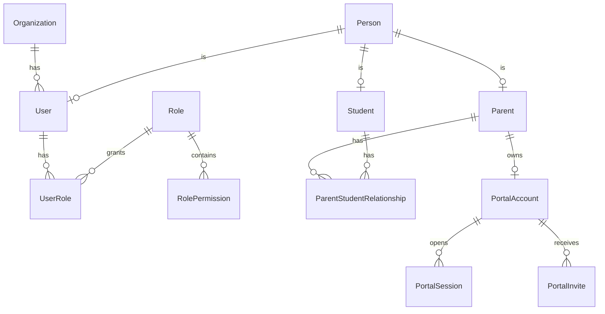

## R.2 النموذج الأكاديمي

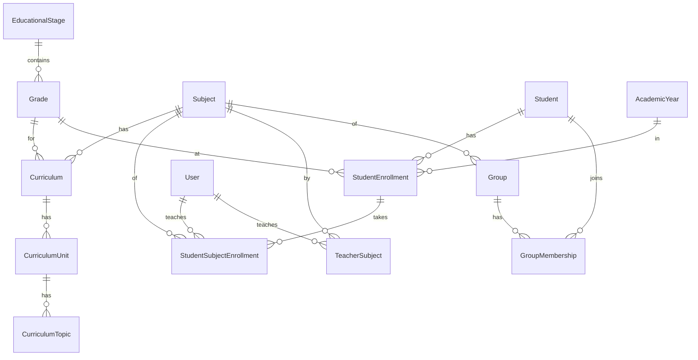

## R.3 الجدولة والحصص

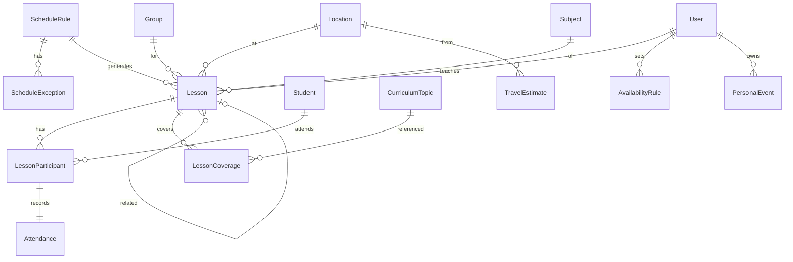

## R.4 الواجبات والاختبارات والملاحظات

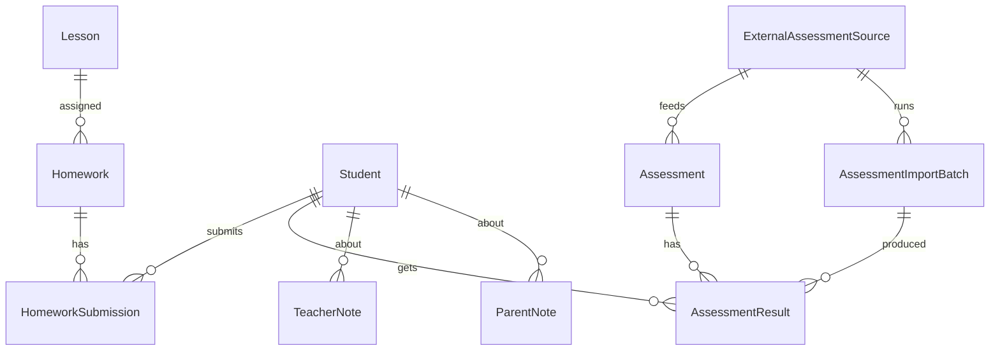

## R.5 الإشعارات و Calendar والملفات

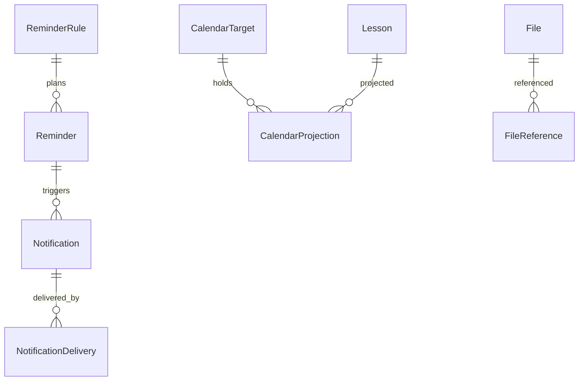

## R.6 الترخيص والمزامنة

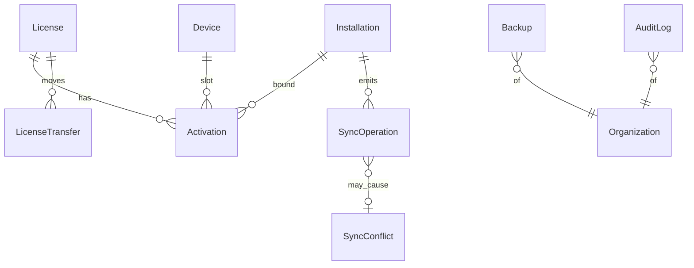

---

# S. TIME & DATE ARCHITECTURE

المشروع كثيف الجداول؛ خلط Date وDateTime هو مصدر أخطاء مواعيد مستقبلية. القواعد هنا **ملزمة** لكل كود ومخطط.

## S.1 أنواع القيم

| النوع | المعنى | التمثيل | مثال |
|---|---|---|---|
| **Instant** | لحظة مطلقة | عدد صحيح ms منذ epoch (UTC) | `1790323200000` |
| **LocalDate** | تاريخ تقويمي بلا وقت/منطقة | نص `YYYY-MM-DD` | `2026-09-27` |
| **LocalTime** | وقت حائط بلا تاريخ | نص `HH:mm` (24 ساعة) | `18:00` |
| **TimeZoneId** | منطقة IANA | نص | `Africa/Cairo` |
| **Zoned schedule** | نية موعد: (`localDate`, `localStart`, `timeZone`) | ثلاثة حقول | — |
| **Duration** | مدة | دقائق (int) | `60` |
| **Interval** | فترة | بداية شاملة، نهاية **غير** شاملة | — |

**ممنوع:** نصوص أزمنة حرة، تخزين محلي كنص مع Offset مبهم، كائنات `Date` لتمثيل تاريخ فقط.

## S.2 أي حقل هو الحقيقة؟

| الكيان/الحالة | المرجع | الحقول المشتقة |
|---|---|---|
| `Lesson` **مجدولة** (`scheduled`) | **نية الوقت المحلي**: `localDate` + `localStart` + `timeZone` | `startsAtUtc/endsAtUtc` **مخزّنة مشتقة** (تُعاد حسابها إن تغيّرت بيانات المنطقة الزمنية) |
| `Lesson` **بدأت/اكتملت** | **`startsAtUtc`/`endsAtUtc`** (حقيقة مجمَّدة عند `in_progress`) | الحقول المحلية تُجمَّد |
| `PersonalEvent` | Instant + `timeZone` (`allDay` = LocalDate) | `localDate` |
| `ScheduleRule` | `startsOn/untilOn` (LocalDate) + `startLocal` (LocalTime) + `timeZone` | — |
| قيم مثل `dueOn, heldOn, birthDate, validFrom` | **LocalDate** (لا وقت) | — |
| طوابع `createdAt/updatedAt/startedAt/completedAt` | **Instant** | — |

## S.3 التكرار والـDST

- التكرار الأسبوعي يُحسب **بالتوقيت المحلي للقاعدة** (`byWeekday` + `startLocal` في `timeZone`) ثم يُحوَّل لـInstant. لا إزاحة UTC ثابتة.
- **الفجوة (Spring-forward، وقت محلي غير موجود):** يُنقل إلى أول وقت صالح بعد الفجوة، ويُوسَم الحدث لتنبيه المستخدم.
- **التكرار المزدوج (Fall-back، وقت محلي غامض):** يُختار **الحدوث الأول** (الإزاحة الأسبق).
- قواعد التوقيت الصيفي **تتغير سياسيًا**؛ لا تُشفَّر في الكود. المرجع بيانات IANA عبر `Intl`/بيئة التشغيل.
- **التوليد يتم على العميل حصرًا** (نفس الدالة الحتمية)؛ الخادم لا يحسب مواعيد حائط، تفاديًا لاختلاف إصدارات بيانات المناطق بين المتصفح وApps Script.

## S.4 المنطقة الزمنية

| الحالة | القاعدة |
|---|---|
| المنظمة | `Organization.defaultTimeZone` تُستخدم عند إنشاء قواعد/أحداث جديدة |
| الحصة/القاعدة | تحمل `timeZone` خاصة ولا تتبع الجهاز |
| جهاز في منطقة مختلفة (مدرس مسافر) | **العرض بتوقيت الحصة** افتراضيًا؛ مؤشر «الآن» بتوقيت الجهاز؛ خيار تبديل العرض |
| تغيير `defaultTimeZone` | لا يمس القواعد/الحصص القائمة |
| نقل مدرس لمنطقة أخرى | تقسيم القاعدة (§F.2.3-6) |

## S.5 Calendar Timezone

الإسقاط إلى Calendar يرسل **(تاريخ + وقت محلي + `timeZone` بمعرّف IANA)** للأحداث المستقبلية (يطابق النية)، وInstant للأحداث المنتهية. لا إرسال Offset فقط.

## S.6 حسابات السفر والوقت الحر

- المدد **بالدقائق (int)**؛ الحساب داخل سياق المنطقة (Zoned) لا بجمع ثوانٍ على نص.
- `TravelEstimate.durationMin` تقدير ثابت (V1)؛ الاعتماد على وقت اليوم/الازدحام لاحقًا.
- الحصص العابرة لمنتصف الليل: `localDate` = تاريخ **البداية**؛ `DailyPlan` يقتطع.
- الوقت الحر = فترات العمل − الحصص − الأحداث − الهوامش، كلها Intervals بنهاية غير شاملة.

## S.7 تاريخ الحصة

- **`occurrenceKey`** = التاريخ المحلي **الأصلي** للتكرار (ثابت أبدًا).
- **`localDate`** = التاريخ **الفعلي الحالي** (يتغير عند النقل).
- الحصة المنقولة الجديدة كيان مرتبط بـ`relatedLessonId`؛ الأصلية تحتفظ بـ`occurrenceKey`.

## S.8 الأزمنة التاريخية

`createdAt/updatedAt` = ساعة العميل (للعرض)، **لا تُعاد كتابتها** ولا تُستخدم لحسم التعارض (INV-25). حقيقة الترتيب `serverRevision` + `serverAt` في `_Changes`. يُسجَّل `clockOffset` عند انحراف >دقيقتين. الحصص المكتملة لا يُعاد حساب أزمنتها إطلاقًا.

## S.9 التقويم وعرض التاريخ

- التخزين **ميلادي ISO دائمًا**؛ العرض الهجري خيار عرض فقط (مستقبلي).
- أيام الأسبوع رقمية ISO (الإثنين=1)؛ **بداية الأسبوع** إعداد منظمة (مثل السبت).
- أرقام العرض (هندية/غربية) إعداد عرض؛ لا يؤثر على التخزين.

## S.10 متطلبات الاختبار

اختبارات Golden حول: انتقالات DST (فجوة/تكرار)، 29 فبراير، حدود السنة، منتصف الليل، تغيير المنطقة، بداية الأسبوع، وتدوير (Round-trip) `Zoned ↔ Instant`. اختبار قبول Sheets للتواريخ كنص (§E.3).

---

# T. DATA LIFECYCLE POLICY

## T.1 تصنيف الحذف

| المصطلح | المعنى | من يفعله | قابل للاستعادة؟ |
|---|---|---|---|
| **Archive** | إخفاء من الاستخدام اليومي مع بقاء المراجع | مستخدم بصلاحية | نعم (فورًا) |
| **Delete (Tombstone)** | حذف منطقي؛ يظهر في «المحذوفات» | مستخدم بصلاحية `*.delete` | نعم داخل الاحتفاظ (≥180 يومًا) |
| **Purge** | إزالة نهائية | **سياسة فقط**، لا واجهة | لا |
| **Cancel** | حالة نطاق (مثل حصة ملغاة) — ليست حذفًا | مستخدم | نعم بصلاحية |

**قاعدة:** أي كيان له سجلات تاريخية تعتمد عليه **لا يُحذف**؛ يُؤرشف. (INV-13)

## T.2 الجدول

| الكيان | Create | Active | Update | Archive | Delete | Restore | الحفظ التاريخي |
|---|---|---|---|---|---|---|---|
| **Person** | مع Student/Parent/User | نعم | حقول مدمجة 3-way | يتبع دور الشخص | Tombstone فقط إن لا مراجع | نعم | لا يُحذف إن ارتبط بسجلات |
| **Student** | Person + Student | `active/paused` | نعم | `graduated/archived` | Tombstone إن لا حصص/نتائج؛ وإلا أرشفة فقط | نعم | حصصه/حضوره/نتائجه تبقى |
| **Parent** | Person + Parent | نعم | نعم | `archived` | Tombstone إن لا علاقات فعّالة | نعم | علاقاته التاريخية تبقى |
| **ParentStudentRelationship** | صف بـ`validFrom` | داخل الفترة | تغيير الأعلام/النوع | — | لا حذف: `validTo` | إنشاء صف جديد | التاريخ كله محفوظ |
| **StudentEnrollment / SSE** | عند التسجيل | `active` | نعم | `completed/withdrawn` | لا | نعم | لا يُدمَّر عند تغيير الصف/المرحلة |
| **Group / GroupMembership** | نعم | نعم | نعم | `archived` / `left` | Tombstone للمجموعة الفارغة تاريخيًا فقط | نعم | العضويات التاريخية تبقى |
| **Subject / Curriculum** | نعم | نعم | نعم | `archived` | لا إن استُخدمت | نعم | تبقى للمراجع |
| **Location** | نعم | نعم | نعم (اللقطة تحمي الماضي) | `archived` | Tombstone إن لا مراجع | نعم | `locationSnapshot` في الحصص |
| **ScheduleRule** | نعم | `active` | تقسيم للمستقبل | `paused/ended` | لا (تُنهى) | إعادة تفعيل | تبقى للحصص المولَّدة |
| **Lesson (مولَّدة)** | توليد حتمي | `scheduled…` | حقول + آلة الحالة | — | **لا**: تُلغى أو تُتخطى (INV-46)؛ تنظيف النظام لـ`rule_superseded` مسموح | `cancelled→scheduled` بصلاحية | لا حذف؛ تبقى بحالتها |
| **Lesson (يدوية)** | UUIDv7 | نعم | نعم | — | Tombstone (بصلاحية وسبب) قبل `in_progress` فقط | نعم | بعد `in_progress` لا حذف |
| **Participant / Attendance / Coverage** | مع الحصة | نعم | نعم | — | يتبع الحصة؛ لا حذف بعد الإكمال | مع الحصة | جزء من سجل الحصة |
| **Homework / Submission** | نعم | `assigned` | نعم | `closed` | Tombstone قبل أي تسليم فقط | نعم | بعد تسليم لا حذف |
| **TeacherNote / ParentNote** | نعم | نعم | نعم | — | Tombstone (ParentNote المنشورة: إلغاء نشر أولًا) | نعم | تبقى داخليًا |
| **Assessment / Result** | نعم | `published` | نعم (تعديل موثّق) | `closed` | لا للنتائج؛ الاختبار يُلغى | إعادة فتح بصلاحية | نتائج لا تُحذف (INV-13) |
| **Reminder / Notification / Delivery** | مشتقة/حتمية | — | — | `expired` | تنظيف تلقائي بعد مدة | إعادة بناء | لا قيمة تاريخية (Local) |
| **File / FileReference** | محليًا ثم رفع | `available` | وصف فقط | — | Tombstone ← سلة Drive ← حذف نهائي بعد الاحتفاظ | نعم داخل الاحتفاظ | الوثائق الرسمية لا تُحذف بسهولة |
| **CalendarProjection** | من المصدر | `synced` | من المصدر | `detached` | يتبع المصدر (`orphaned`) | إعادة إسقاط | قابلة لإعادة البناء |
| **User / UserRole** | دعوة | `active` | نعم | `suspended/archived` | لا (تُؤرشف) | نعم | التدقيق يعتمد عليها |
| **PortalAccount / Session / Invite** | دعوة | `active` | — | `suspended/revoked` | جلسات/دعوات تنتهي وتُنظَّف | إعادة دعوة | التدقيق يبقى |
| **AuditLog** | تلقائي | — | **لا** | أرشفة بعد 24 شهرًا | **لا** | — | إلحاق فقط |
| **Installation / Device / License** | عند التثبيت/التفعيل | — | تحديثات حالة | `retired/replaced` | لا | Transfer | سجل الأجهزة يبقى |
| **Backup** | تلقائي/يدوي | `complete` | — | `expired` | حسب الاحتفاظ | — | — |
| **SyncOperation / Conflict** | تلقائي | `pending` | — | `acked` | تنظيف بعد الاعتماد؛ **Quarantine لا يُحذف صامتًا** | إعادة محاولة | — |

## T.3 صلاحيات وتأكيدات

الأرشفة والحذف صلاحيتان منفصلتان؛ الحذف يتطلب تأكيدًا وسببًا للكيانات ذات الأثر، ويُدقَّق. لا حذف مجمّع بلا معاينة.

---

# U. FAILURE MATRIX

**الرموز:** «محلي» = سلوك التطبيق على الجهاز. كل صف يحدد ما يراه المستخدم، السلوك المحلي، التعافي، سلامة البيانات، إعادة المحاولة، التسجيل.

| # | الحالة | ما يراه المستخدم | السلوك المحلي | التعافي | سلامة البيانات | إعادة المحاولة | التسجيل |
|---|---|---|---|---|---|---|---|
| 1 | **الإنترنت غير متاح** | شارة «Offline» 🟡 + عدد المعلّق | كل الوظائف تعمل؛ Outbox يتراكم | تلقائي عند `online` | لا فقد | Backoff + فور `online` | حدث اتصال |
| 2 | **Apps Script غير متاح** (5xx/Timeout/Quota/نشر محذوف) | «تعذّرت المزامنة» + سبب مقروء | كأعلاه | إعادة؛ إن `DEPLOYMENT_GONE` دعوة لإعادة الربط (§V) | لا فقد | Backoff أسّي | كود الخطأ + `correlationId` |
| 3 | **Sheets غير متاح/قفل/Quota** | كأعلاه | كأعلاه | الخادم يعيد `BUSY/RETRY_LATER` | WAL يمنع نصف كتابة (§E.4) | Backoff | `_Health` |
| 4 | **Drive غير متاح** | ملفات «قيد الرفع»/«غير متاحة» | Blob محلي يُعرض؛ الرفع يتأجل | استئناف الرفع المجزّأ | لا فقد؛ الوصف محفوظ | طابور رفع منفصل | حالة File |
| 5 | **Gmail غير متاح/Quota** | «رسالة لم تُرسل» في الإدارة | Delivery `failed` | إعادة ضمن الحصة؛ Fallback (Portal) | لا أثر على Domain | Backoff/يوم تالٍ | Delivery.error |
| 6 | **Calendar غير متاح/Quota** | «التقويم غير محدّث» | لا أثر على الحصص | إعادة الإسقاط | Domain سليم (INV-18) | Time trigger | CalendarProjection.error |
| 7 | **IndexedDB تالفة** | شاشة تعافي | فتح مقيَّد | إنقاذ Outbox ← قاعدة جديدة ← Bootstrap/Backup | فقد محلي غير مُزامَن محتمل؛ يُصدَّر ما أمكن | — | تقرير تعافٍ |
| 8 | **مزامنة منقطعة** | «مزامنة جزئية» | `cursor`/`sync_bootstrap` محفوظان | استئناف | لا فقد؛ Leases تنتهي | تلقائي | perTypeResult |
| 9 | **إعادة تشغيل الجهاز أثناء المزامنة** | لا شيء غالبًا | Lease تنتهي ⇒ `pending` | عند الفتح | Idempotent (§G.12) | تلقائي | — |
| 10 | **عملية مكررة وصلت** | لا شيء | — | الخادم يعيد النتيجة المخزَّنة/مكافئ | لا تكرار | — | `duplicate_op` |
| 11 | **تعارض** | شارة في صندوق التعارضات | العملية `conflict`؛ نسختان محفوظتان | قرار المستخدم ← عملية جديدة | لا فقد؛ الأول التزامًا يبقى | — | SyncConflict |
| 12 | **ترخيص منتهٍ Offline** | إشعار/وضع قراءة حسب السياسة | `AccessGrant` يتغير | تجديد أو إدخال مفتاح جديد | البيانات + التصدير محفوظان | عند الاتصال | Audit |
| 13 | **فشل التحقق من الترخيص** | `ACTIVATION_REQUIRED` | لا كتابة | إعادة تفعيل | البيانات سليمة (INV-24) | — | سبب الفشل بلا أسرار |
| 14 | **مسح تخزين المتصفح** | معالج تعافٍ (لا «تثبيت جديد» أعمى) | لا قاعدة ⇒ RECOVERY | Bootstrap + Transfer للجهاز | ما لم يُزامَن **يُفقد** (لذا تذكير النسخ) | — | حدث تعافٍ |
| 15 | **إعادة تثبيت PWA** | كأعلاه | Installation جديد | Transfer + Bootstrap | كأعلاه | — | Audit |
| 16 | **تغيّر الجهاز** | تفعيل جهاز جديد | Installation جديد | Transfer + Bootstrap | البيانات على الخادم سليمة | — | LicenseTransfer |
| 17 | **تغيّر حساب Google** | «سجّل الدخول من جديد» أو «إعادة ربط الخلفية» | يعمل محليًا | (أ) تسجيل دخول موظف مختلف ⇒ `authSubject` غير مطابق؛ (ب) تغيّر مالك الـSpreadsheet/النشر ⇒ إعادة ربط (Rebind) بنفس `organizationId` | لا تُكتب بيانات لمنظمة مختلفة (`organizationId`/`dataEpoch`) | بعد إعادة الربط | Audit |

---

# V. DEPLOYMENT MODEL & DATA OWNERSHIP

## V.1 القاعدة

**Client owns client data.** الـSpreadsheet وDrive وCalendar وGmail في حساب العميل/المنظمة. لا تعتمد المعمارية على حساب Google واحد للبائع يحوي بيانات كل العملاء (INV-41). **البائع يحتفظ فقط بـ License Authority** (مفاتيح، سجلات تراخيص، معرّفات تثبيت) — **لا بيانات طلاب**.

## V.2 نموذج النشر المزدوج

| | **مستخدم عادي (Standard)** | **مستخدم متقدم (Advanced)** |
|---|---|---|
| يوفّر المشروع | Spreadsheet Template (يحوي مشروع Apps Script) + تعليمات + Deployment Wizard/دليل | كود Apps Script + `docs` |
| ينفّذ العميل | نسخ القالب + تشغيل Setup + نشر Web App بأقل عدد خطوات | ينشر بنفسه (clasp أو يدويًا) |
| البيانات | حساب العميل | حساب العميل |
| **وقت التشغيل** | **متطابق تمامًا** بين النموذجين | |

## V.3 تدفق الإعداد (V1، بلا Provisioning معقد — INV-48)

```text
Template
   ↓
Setup            (يهيّئ الأوراق والـSchema وزرع الأدوار، ويولّد organizationId ورمز إعداد لمرة واحدة)
   ↓
Bind Organization (التطبيق يربط عنوان النشر + رمز الإعداد ⇒ يصبح المستخدم Owner: §M.2)
   ↓
Register Installation (Installation + Device + تفعيل الترخيص)
   ↓
Ready            (Bootstrap أولي ثم تشغيل Offline)
```

- **Setup** دالة إدارية في وحدة `Setup` تنفَّذ بموافقة المالك.
- **Bind** يتطلب إنترنت (OQ-01).
- **Standard مقابل Advanced** يختلفان في *كيف نُشر الخادم* فقط.

## V.4 التحديثات والتوافق

كل منظمة لها نشر مستقل ⇒ **تخلف إصدار الخادم عن العميل متوقَّع** (R-13). لذلك: تفاوض إصدار في كل Handshake (§P.4)، توافق للخلف، Expand→Migrate→Contract، و«تحديث الخلفية» إجراء موثّق (نسخة كود جديدة + `Setup.migrate()` بعد نسخة احتياطية). آلية التحديث الدقيقة للمستخدم العادي تُصمَّم في PHASE 2 (OQ-17).

## V.5 الأمان في النشر

- نشر Web App بوصول واسع (لازم لبوابة الأهل دون حساب Google) **لا يعني أمانًا بالخفاء**: كل طلب يُصادَق ويُفوَّض خادميًا (§27 من الموجّه).
- أسرار النشر (الفلفل، رمز الإعداد) في Script Properties، لا في `_Meta` ولا في المستودع.
- تغيّر مالك الحساب/النشر ⇒ إجراء **Rebind** بنفس `organizationId` (§U-17).

## V.6 خارج نطاق V1

Cloud Provisioning آلي، خادم مركزي يستضيف بيانات العملاء، مزامنة متعددة المنظمات على نشر واحد. **نقاط التوسّع:** عقد API مستقل عن التخزين (ADR-013) و`organizationId` في كل سجل.

---

# W. APPS SCRIPT BLUEPRINT (بلا كود)

## W.1 الوحدات ومسؤولياتها

| الوحدة | المسؤولية |
|---|---|
| **Router** | نقطة الدخول (`doGet/doPost`)، تحليل الطلب، تفويض للخدمات، تنسيق الأخطاء الموحّد |
| **Auth** | التحقق من هوية الموظفين (Google ID Token)، إصدار/تجديد الجلسات، جلسات البوابة (تجزئة) |
| **Authorization** | Identity + Organization + Role/Permission + Resource Scope (§M.4) |
| **Validation** | مدققات Domain المشتركة + قيود Unique/FK + حدود المدخلات |
| **Sync** | Push/Pull/Bootstrap، WAL، `committedRevision`، `_Ops`، Conflict |
| **Sheets Repository** | **الوحيد** الذي يعرف `SpreadsheetApp`: `SchemaRegistry`، `id→row`، `ChangeLog` |
| **Drive Adapter** | رفع مجزّأ، تنزيل عبر وسيط، تنظيم المجلدات |
| **Calendar Adapter** | إسقاط الأحداث (Upsert/Delete)، Drift، تقويم مخصص |
| **Gmail Adapter** | إرسال رسائل النظام/الأهل بحصص ومعدل |
| **Backup** | نسخ Spreadsheet (`sheet_copy`)، استبعاد الأوراق `X`، الاحتفاظ |
| **Audit** | إلحاق سجلات التدقيق (لا أسرار) |
| **Health** | فحوصات (WAL معلّق، تطابق `committedRevision`، حصص، إصدارات) |
| **Config** | قراءة الإعدادات (`_Meta` + Script Properties) |
| **Setup** | تهيئة أول مرة، `migrate()`، Rebind، Bind |
| _إضافية_: **Projection** (Portal `pv_*` + طابور Calendar)، **RateLimit** (CacheService)، **LicenseClient** (تمرير Check-in فقط) |

## W.2 مستويات الاعتماد

```text
L4  Router
L3  Sync · Projection · Backup · Health · Setup
L2  Auth · Authorization · Validation · Audit · RateLimit · LicenseClient
L1  Sheets Repository · Drive Adapter · Calendar Adapter · Gmail Adapter
L0  Config  (+ Domain المشتركة النقية)
```

**قاعدة:** الاستدعاء إلى **الأسفل فقط**. لا استدعاء إلى الأعلى ولا بين وحدات المستوى نفسه إلا ما ورد أدناه.

## W.3 قواعد الاعتماد (Dependency Rules)

| الوحدة | يجوز لها استدعاء | **يُمنع عليها استدعاء** |
|---|---|---|
| **Router** | Auth, Authorization, Validation, RateLimit, Sync, Projection, Backup, Health, Setup, Audit | Sheets/Drive/Calendar/Gmail مباشرة |
| **Auth** | Sheets Repository (الجلسات)، Config، Audit | Drive/Calendar/Gmail، Sync |
| **Authorization** | Sheets Repository (أدوار/علاقات)، Domain المشتركة، Config | أي Adapter، Sync |
| **Validation** | Domain المشتركة، Sheets Repository (فحص Unique/FK) | Adapters، Auth |
| **Sync** | Sheets Repository، Validation، Authorization، Audit، Projection **(إدراج في طابور فقط)** | Drive/Calendar/Gmail **مباشرة**، Router |
| **Projection** | Sheets Repository، Calendar Adapter، Config | Gmail، Sync (لا يعيد الدخول) |
| **Backup** | Sheets Repository، Drive Adapter، Audit، Config | Auth, Sync (مسار مستقل: INV-06) |
| **Health** | Sheets Repository، Config | أي كتابة على بيانات الأعمال |
| **Setup** | Sheets Repository، Drive Adapter، Config، Audit | بيانات الأعمال (لا يقرأ/يكتب سجلات دومين عدا الزرع) |
| **Audit** | Sheets Repository | أي وحدة أعمال (لا تبعية دائرية) |
| **Sheets Repository** | Config، خدمات Google (`SpreadsheetApp`) | أي وحدة أعلى، أي منطق أعمال |
| **Drive / Calendar / Gmail Adapters** | Config، خدمة Google الخاصة بها | بعضها البعض، Sheets Repository، أي منطق أعمال |
| **Config** | PropertiesService | أي وحدة |

## W.4 قواعد عامة

1. **لا Google Service خارج L1.** (INV-18)
2. **لا منطق أعمال في Router/Adapters/Repository.** المنطق في Domain المشتركة (ADR-010) أو Services.
3. **حجم الملفات:** لا `Code.gs` ضخم؛ ملف/وحدة بمسؤولية واحدة.
4. **Time-driven Triggers:** Projection worker · Backup · Health · تنظيف الجلسات/`_Ops`/`_Wal` · تعافي WAL.
5. **الأخطاء:** عقد موحّد `{code, retryable, message, correlationId}`؛ لا أسرار في السجلات.
6. **قيد العميل (يُتحقق في Spike SP-2):** استدعاءات المتصفح إلى Web App لا تدعم Preflight (`OPTIONS`) كالخوادم العادية؛ يُصمَّم ApiClient كطلبات «بسيطة» (مثل جسم JSON بنوع محتوى `text/plain`) لتفادي CORS Preflight.

---

# X. DESIGN SYSTEM FOUNDATION SPECIFICATION (موجزة)

> **مواصفة مبادئ فقط.** الشعار النهائي وSVG وأيقونات فعلية وCSS وشاشات = **PHASE 2**.

| المحور | المبدأ |
|---|---|
| **Light-first** | الثيم الفاتح أصل؛ خلفيات مضيئة هادئة؛ لا داكن ثقيل ولا Glassmorphism مبالغ ولا تدرجات مزعجة |
| **Arabic RTL** | الاتجاه RTL أصلي لا مقلوب؛ الأيقونات الاتجاهية فقط تُعكس؛ الأرقام: إعداد (هندية/غربية) |
| **Mobile-first** | تصميم للهاتف أولًا؛ أهداف لمس ≥ 44px؛ استخدام بيد واحدة؛ أداء على أجهزة متوسطة |
| **Typography** | خط عربي بتغطية كاملة وأوزان متعددة وأرقام متسقة؛ **يُستضاف محليًا (Self-hosted) ومُجزَّأ** ليعمل Offline؛ ارتفاع سطر مريح للعربية؛ سلّم أحجام واضح |
| **Icon style** | مجموعة أيقونات خطية موحّدة على شبكة واحدة وسماكة موحّدة، واضحة في الأحجام الصغيرة |
| **Color system** | ألوان **دلالية (Semantic Tokens)** لا خام: Primary/Secondary/Accent/Background/Surface/Text + Success/Warning/Error/Info؛ **لوحة زاهية متسقة** مختلفة بوضوح عن الحسام |
| **Accessibility** | تباين WCAG AA (نص 4.5:1، مكونات 3:1)؛ الحالة لا تعتمد على اللون وحده؛ تركيز مرئي؛ دعم قارئ الشاشة بالعربية؛ احترام تقليل الحركة |
| **Component philosophy** | Tokens ← Primitives ← Composites ← Features. **كل مكوّن يمتلك حالاته:** Loading / Empty / Error / **Offline / Pending-Sync / Conflict** |
| **قيد عرض** | تُراجع قيود سلامة العرض على الهاتف المستفادة من الحسام (عناصر `fixed`/`backdrop-filter`/`filter`) ضمن قواعد النظام في PHASE 2 |
| **مشتقات لاحقة** | مفهوم الشعار وفلسفة الهوية والقياسات → PHASE 2 |

---

# Y. PRELIMINARY REPOSITORY STRUCTURE (معماري أولي؛ النهائي في PHASE 2)

```text
docs/           التوثيق: architecture/، adr/، audits/، runbooks/
schema/         Schema Registry (تعريف آلي لكل كيان)
src/            تطبيق PWA (طبقات مفصولة)
public/         ما يُخدَم كما هو (manifest، Service Worker، أيقونات جاهزة)
assets/         موارد التصميم (خطوط، صور مصدر)
tests/          اختبارات عقد/مزامنة/ترحيل/ترميز Sheets
migrations/     ترحيلات محلية وبعيدة
apps-script/    مشروع الخادم (وحدات §W) + مخرجات بناء Domain المشتركة
```

| المجلد | المسؤولية | **ممنوع فيه** |
|---|---|---|
| `docs/` | وثائق المعمارية، ADR مرقّمة، تقارير التدقيق، Runbooks (Setup/Backup/Recovery) | أكواد تنفيذ، أسرار |
| `schema/` | تعريفات الكيانات (مصدر لمخازن IDB وأعمدة Sheets والمدققات وأنواع TypeScript-like) | بيانات فعلية |
| `src/domain/` | كيانات وقواعد وآلات حالة وحسابات وقت **نقية** (تُبنى لتُشارَك مع Apps Script) | أي I/O، DOM، IDB، شبكة |
| `src/application/` | Use Cases، Ports، Unit of Work، AccessGuard | IndexedDB مباشرة، `fetch` |
| `src/data/` (Repositories + LocalDatabaseAdapter + Migrations) | التخزين المحلي والـMigrations | منطق أعمال، شبكة |
| `src/sync/` | Coordinator، Push/Pull، Conflicts، Bootstrap | UI، Use Cases |
| `src/integrations/` | ApiClient، NotificationProviders، LicenseVerifier، FilePicker | تعديل Domain |
| `src/notifications/` | Reminder/Notification/Providers Router | Google APIs مباشرة |
| `src/auth/`, `src/licensing/` | مصادقة محلية، Entitlements، AccessGuard | أسرار/مفاتيح خاصة |
| `src/ui/` (+ `src/features/`) | الواجهة والشاشات ومكوّنات النظام | وصول للتخزين/الشبكة |
| `src/portal/` | **مدخل بوابة الأهل** (بناء منفصل) | كود Domain للمدرس |
| `public/` | Manifest، Service Worker، أيقونات | منطق أعمال (INV-04) |
| `migrations/local/`, `migrations/remote/` | سلاسل ترحيل مرقّمة + تحقق | تغييرات بلا أرقام |
| `tests/` | Contract/Sync/Migration Fixtures/Sheets-encoding/Domain golden | بيانات عملاء حقيقية |
| `apps-script/` | وحدات §W وقواعد الاعتماد؛ مخرجات بناء Domain **مولَّدة لا تُعدَّل يدويًا** | بيانات/أسرار؛ منطق أعمال خارج Services/Domain |

**Git-friendly:** `.gitignore` يستبعد: مفاتيح خاصة (ترخيص/توقيع)، بيانات عملاء، تصديرات/نسخ احتياطية، ملفات اعتماد Apps Script المحلية، `.env`. `README` وCHANGELOG وADR منذ اليوم الأول. **الهيكل النهائي (أسماء المجلدات الفرعية وقواعد الاعتماد الآلية) يُعتمد في PHASE 2.**

---

# 8. الأداء والحجم

**فرضيات الحجم (تصميمية، تُقاس لاحقًا):** آلاف الطلاب · آلاف أولياء الأمور · عشرات آلاف الحصص سنويًا · سنوات من السجل · ملفات كثيرة.

| المحور | التقنية | أين |
|---|---|---|
| فتح سريع | UI_READY من IDB، حد أدنى في LOCAL_BOOTSTRAP، نافذة ساخنة | §H، §G.2 |
| عدم تحميل الكل | Pagination بمؤشر، Lazy لتاريخ أقدم، `sync_coverage` | §D.4، §G.2 |
| فهرسة | فهارس مركّبة مسمّاة لكل استعلام حرج | §D.3 |
| Delta Sync | `serverRevision` + `_Changes` + حساب صف مباشر + `committedRevision` | §E.4، §G.8 |
| Batching | Push ≤50، Pull ≤500، `setValues` مجمّعة، رفع مجزّأ | §G، §K |
| Caching | `CacheService` لـ`id→row` ولقطات Portal؛ Caches محلية مشتقة | §E.6، §A.14 |
| Aggregates | `CurriculumProgress`، `DailyPlan` تزايديًا | §A.14 |
| نمو Sheets | تقسيم سنوي + تقليص `_Changes` | §E.4، §E.5 |
| العمل أثناء المزامنة | الكتابة المحلية غير محجوبة؛ تدخل الدفعة التالية | §G.13 |

**قص الحجم عند الحاجة (V1 أخف):** يمكن تأجيل `ScheduleException`، `TravelEstimate/Buffer`، `AvailabilityException`، `NonTeachingPeriod`، `Assessment*`، `CalendarProjection`، `Notification` الخارجية — دون تغيير النموذج، فهي إضافات لا تكسر الأساس (مبدأ Simple Core + Strong Foundation).

---

# 9. التسليم إلى PHASE 2 وما يحتاج Spike / Proof of Concept

## 9.1 ما ينتقل إلى PHASE 2 (Architecture Blueprint)

1. **الهيكل النهائي للمجلدات** وقواعد الاعتماد الآلية (§Y أولي).
2. **تفصيل وحدات Apps Script** وعقد الـAPI الكامل (§W مخطط).
3. **الهوية البصرية الكاملة:** الشعار (مفهوم ثم SVG)، الألوان النهائية، الأيقونات، Tokens، CSS، الشاشات (§X مبادئ).
4. **استراتيجية Service Worker** وتحديث التطبيق وOffline Shell.
5. **نموذج التهديدات الكامل** وسياسة CSP وحماية التخزين.
6. **استراتيجية الاختبار** (Unit/Contract/E2E/Regression/Golden للوقت).
7. **تصميم تجربة الإعداد** للمستخدم العادي (Wizard/دليل) وآلية تحديث الخلفية (OQ-17).
8. **ملفات ADR الفعلية** (ADR-001…019).
9. **مراجعة خوارزمية المزامنة** تفصيليًا (طلب المراجع) على بيانات/سيناريوهات.

## 9.2 Spikes / Proofs of Concept المطلوبة **قبل** تثبيت التنفيذ

| # | الموضوع | السؤال الذي يجيب عنه | يقرّر |
|---|---|---|---|
| **SP-1** | الإشعارات على الأجهزة المستهدفة (§I.8) | ما الموثوق فعلًا والتطبيق مغلق؟ | الحاجة لـWeb Push أو غلاف أصلي؛ صياغة وعد المنتج |
| **SP-2** | Apps Script Web App كواجهة API من PWA | CORS/Preflight، الزمن، حدود الحجم، التزامن، `LockService` تحت حمل | شكل ApiClient وحدود الدفعات |
| **SP-3** | أداء Sheets: `id→row`، حساب صف `_Changes`، تكلفة WAL عند 50k–200k صف | هل يفي الأداء بالفرضيات؟ | عتبات التقسيم/التقليص، الحاجة لخلفية بديلة |
| **SP-4** | IndexedDB على الأجهزة: `persist()`، الاقتلاع، أداء الفهارس عند ~100k حصة | هل الاحتفاظ والأداء كافيان؟ | سياسة النسخ، النافذة الساخنة |
| **SP-5** | ECDSA P-256 + مفاتيح غير قابلة للتصدير + Lease/Revocation | هل التدفق يعمل على المتصفحات المستهدفة؟ | تفاصيل الترخيص |
| **SP-6** | تجزئة PIN في Apps Script (بدائل PBKDF2) | أقوى خيار عملي؟ | تصميم Portal Credential |
| **SP-7** | Calendar: حصص الإنشاء، Drift، تذكيرات Offline على الجهاز | حدود الإسقاط والاعتمادية | نافذة الإسقاط والوعد |
| **SP-8** | Drive: رفع مجزّأ، تنزيل عبر وسيط، حدود الحجم | ما الحد العملي للملفات؟ | سياسة الملفات |

---

# 10. PHASE 1 EXIT CRITERIA

لا تُعتبر PHASE 1 **Approved** إلا بموافقتك الصريحة على:

- [ ] **Entity Dictionary (§A)** بما فيها فصل Person/User/Student/Parent/PortalAccount وكيانات الترخيص المعدّلة (Lease/Revocation).
- [ ] **العلاقات (§B)** و**آلات الحالة (§C)** — خصوصًا Lesson وSyncOperation و**License بمحورين (§N.4)**.
- [ ] **بنية IndexedDB (§D)** (قاعدتان، Unit of Work، ترحيلات).
- [ ] **Sheets (§E)** بما فيها **WAL و`committedRevision`** (§E.4).
- [ ] **هوية المزامنة (§F) ومواصفة الهوية الحتمية (§F.2)** والإجابات الثمانية.
- [ ] **خوارزمية المزامنة (§G)** ومراجعتها (§2.9، §G.12–G.13).
- [ ] **Bootstrap State Machine (§H)** ببوابة القرار و`AccessGrant`.
- [ ] **الإشعارات (§I) وCapability Matrix (§I.4)** وخطة الـSpike.
- [ ] **الترخيص (§N)** بما فيه الحدود الصريحة وسياسة Validity×Freshness.
- [ ] **بوابة ولي الأمر (§L)** بمسار التفعيل وإدارة العلاقات.
- [ ] **الأقسام الجديدة:** Boundaries (§6)، Source of Truth (§7)، Time & Date (§S)، Data Lifecycle (§T)، Failure Matrix (§U)، Deployment (§V)، Apps Script Blueprint (§W).
- [ ] **دروس الحسام الرسمية (§5)** وكتالوج الثوابت (§13).
- [ ] **قبول/رفض** كل من ADR-001…019 (§1.2).
- [ ] **مراجعة الأسئلة المفتوحة (§11)** وقرار بشأن OQ-15 وOQ-18 على الأقل (تؤثر على Spikes).

---

# 11. OPEN QUESTIONS

## 11.1 المحسومة

| # | القرار | المرجع |
|---|---|---|
| OQ-01 | أول ربط يحتاج إنترنت؛ بعده Offline إلزامي | D-01 |
| OQ-04 | Commercial-Grade Practical Enforcement (ليس DRM) | D-02 |
| OQ-06 | دعوة + رمز تفعيل + PIN؛ جلسة؛ لا رمز دائم في الرابط | D-04 |
| OQ-13 | نشر مزدوج (عادي/متقدم)؛ بيانات في حساب العميل | D-06/D-07 |

## 11.2 المتبقية

| # | السؤال | الأثر | الافتراض الحالي |
|---|---|---|---|
| OQ-02 | هل تلزم مزامنة **ثنائية** مع Calendar لاحقًا؟ | ADR-006 | لا |
| OQ-03 | خصوصية عناوين أحداث Calendar (أسماء ظاهرة أم «حصة»)؟ | §J | خيار؛ الافتراضي مختصر |
| OQ-05 | هل يُنسب تقدم المنهج للطالب الغائب؟ | CurriculumProgress | لا |
| OQ-07 | تشفير البيانات المحلية V1؟ | §2.6 | لا؛ قفل تطبيق فقط |
| OQ-08 | نافذة Bootstrap الساخنة (−90/+180) وعتبة الخلفية البديلة؟ | §G.2 | كما هي؛ تُقاس |
| OQ-09 | الاحتفاظ وRPO/RTO | §Q.5 | كما في الجدول |
| OQ-10 | أكثر من جهاز للمدرس في V1؟ | التعارض | نعم |
| OQ-11 | المراحل/الصفوف الافتراضية المزروعة وقابلية التخصيص | بيانات مرجعية | قابلة للتعديل |
| OQ-12 | هل `Person` مشتركة بين منظمات؟ | الهوية | لا |
| OQ-14 | دعم الفروع قبل V3؟ | `Branch` | لا |
| **OQ-15** | القيم الافتراضية: `leaseDays / softRefreshDays / offlineGraceDays / graceDays / expirationPolicy` | §N، تجربة Offline | 60 / 14 / 14 / 30 / `read_export_only` (مقترحة للنقاش) |
| OQ-16 | طول/نوع PIN ولي الأمر وسياسة القفل | §L | 6 أرقام + قفل تصاعدي |
| OQ-17 | تفاصيل Wizard للمستخدم العادي وآلية تحديث الخلفية | §V | PHASE 2 |
| OQ-18 | الأجهزة/المتصفحات المستهدفة وعتبات القبول للـSpike | §I.8 | يحدّدها المالك |
| OQ-19 | استضافة License Authority (نقطة يملكها البائع؟) وتوزيع قائمة الإبطال | §N | نقطة خفيفة بيد البائع |
| OQ-20 | أي التذكيرات «Must-Deliver» وأيها «Nice-to-Have»؟ | §I.5 | قبل الدرس/تغيير/إلغاء = Must |

---

# 12. ARCHITECTURAL RISKS

| # | الخطر | الشدة | التخفيف |
|---|---|---|---|
| **R-01** | الإشعارات المحلية لا تُضمن والتطبيق مغلق | **عالية** | Capability Matrix، Fallbacks، Catch-up، **Spike SP-1**، Calendar كـFallback (لا أساس)، غلاف أصلي لاحقًا |
| R-02 | حصص وأداء Apps Script/Sheets | عالية | دفعات صغيرة، قفل قصير، Cache، **SP-2/SP-3** |
| **R-03** | الترخيص قابل للتجاوز من مالك بيئة العميل | **عالية (تجارية)** | موثَّق كحد معماري؛ Lease + إبطال + ربط + حارس ساعة؛ لا اعتماد على Apps Script وحده |
| R-04 | اقتلاع IndexedDB | متوسطة | `persist()`، PWA مثبّتة، Re-bootstrap، Backup، **SP-4** |
| R-05 | تعقيد المزامنة (Over-engineering) | متوسطة | تنفيذ الحد الأدنى أولًا؛ قص الحجم §8؛ WAL مبرَّر بإخفاقات حقيقية |
| R-06 | ملفات/بوابة عبر Apps Script (حجم/زمن) | متوسطة | ضغط، رفع مجزّأ، وسيط بتحقق، **SP-8**، مسار نقل الخلفية |
| R-07 | انحراف قواعد Domain بين العميل والخادم | متوسطة | ADR-010 + اختبارات عقد + متجهات هوية حتمية |
| R-08 | تسريب أسرار عبر نسخ Spreadsheet | متوسطة | استبعاد أوراق `X`؛ تقييد المجلد |
| R-09 | نمو Sheets | متوسطة | تقسيم سنوي + تقليص؛ عتبة الانتقال (OQ-08) |
| R-10 | استنساخ التثبيت | منخفضة–متوسطة | مفتاح غير قابل للتصدير + كشف نفس `installationId` |
| R-11 | صعوبة Setup على غير التقنيين | متوسطة | Template + Wizard (OQ-17) |
| R-12 | ساعات أجهزة خاطئة | منخفضة | لا اعتماد عليها في الفصل؛ `maxSeenTime` |
| R-13 | تعدد إصدارات الخلفيات في الميدان | متوسطة | تفاوض إصدار + Expand/Contract |
| **R-14** | تعقيد WAL/التعافي في Apps Script (حالات حدّية) | متوسطة | اختبار قتل التنفيذ بعد كل خطوة؛ **SP-3** |
| **R-15** | ضعف تجزئة PIN في Apps Script (بلا PBKDF2) | متوسطة | تحديد معدل + قفل + فلفل؛ **SP-6** |
| **R-16** | قيود CORS/Preflight لـApps Script Web App | متوسطة | ApiClient بطلبات بسيطة؛ **SP-2** |
| **R-17** | توليد الحصص الحتمي: أخطاء DST/المناطق الزمنية | متوسطة | اختبارات Golden (§S.10)؛ التوليد على العميل فقط |

---

# 13. ARCHITECTURAL INVARIANT CATALOG

قواعد **لا تُكسر** أثناء التنفيذ إلا بـ**ADR موثَّق ومعتمد**. كل ثابت في تصنيف رئيسي واحد. (1–36 من النسخة السابقة كما هي؛ 37–56 أضيفت في هذه المراجعة.)

## 13.1 Security

- **INV-08** Parent لا يستطيع تجاوز Scope أبنائه.
- **INV-09** Organization Isolation إلزامي (مادي ومنطقي).
- **INV-10** Server-side Authorization إلزامي.
- **INV-26** الأسرار وأوراق `X` **لا تخرج** في Pull/Sync/تصدير أبدًا.
- **INV-28** Portal V1 قراءة فقط، يقرأ من `pv_*` حصرًا، وتطبيقه منفصل بقاعدته وServiceWorker.
- **INV-38** فتح IndexedDB ≠ السماح باستخدام التطبيق؛ لا عرض/كتابة قبل `AccessGrant`.
- **INV-39** `organizationId` **ليس حدًا أمنيًا وحده**؛ كل عملية حساسة تتحقق من هوية مصادَقة + منظمة + دور/صلاحية + نطاق المورد.
- **INV-42** لا رموز دائمة في الروابط؛ روابط الدعوة/التفعيل استخدام واحد وتنتهي؛ الجلسات لا تُمرَّر في URL.
- **INV-43** وصول ولي الأمر للأبناء مشتق دائمًا من جلسة مصادَقة ← Parent ← علاقة سارية ← Server-side؛ معرّف طالب في الطلب لا يكفي.
- **INV-57** نطاق المنظمة يُفرَض من `_Meta.organizationId` الخادمي حصرًا، لا من `organizationId` الوارد في الطلب/الجلسة (يُستخدَم للمطابقة فقط)؛ **غيابها من الطلب تُرفَض فورًا دون استدلال أو قيمة افتراضية** (ADR-R05).

## 13.2 Data Integrity

- **INV-13** لا حذف نهائي للبيانات التاريخية المهمة بلا سياسة احتفاظ موثّقة.
- **INV-14** لا تغيير Schema (محلي/بعيد) بلا Migration.
- **INV-21** ربط السجلات بـ**المعرّف فقط**؛ لا مطابقة أسماء/نصوص.
- **INV-22** كل كتابة على كيان مزامَن تُنشئ عملية Outbox **في نفس المعاملة**.
- **INV-29** المعرّفات UUID عميل (حتمية للمشتقّ)؛ لا معرّفات تسلسلية من الخادم.
- **INV-30** كل سجل مزامَن يحمل `organizationId` ويرفض الخادم عدم التطابق.
- **INV-31** أي عملية مدمّرة (ترحيل/استعادة/تقليص) تسبقها نسخة احتياطية.
- **INV-32** الوقت: لحظات UTC + `tz`؛ التواريخ `YYYY-MM-DD` نصًا؛ لا نصوص زمنية حرة؛ التكرار بالتوقيت المحلي.
- **INV-33** المال أعداد صحيحة بوحدة صغرى + عملة؛ التصحيح بقيد عكسي.
- **INV-45** هوية السجلات المولَّدة حتمية **وثابتة** (لا تتغير بتغيّر المحتوى أو التوقيت أو الجهاز).
- **INV-46** الحصة المولَّدة لا تُحذف بنيويًا بقرار المستخدم (تُلغى/يُتخطى موعدها)، وأفق التوليد **أقل** من الاحتفاظ بالـTombstones.
- **INV-51** الأخطاء تحفظ معلومات تشخيص كافية للتعافي (رمز، سياق، `operationId`, `correlationId`) دون أسرار.
- **INV-58** `Installation.bootstrapState` صريح، يُكتَب دائمًا في نفس معاملة `Installation`؛ لا فرع إقلاع يعامل تثبيتًا موجودًا بـ`bootstrapState≠READY` كمنظمة سليمة جاهزة (ADR-R01).
- **INV-59** أي تغيير في `Lesson.startsAtUtc/endsAtUtc` أو انتقالها لحالة نهائية يُبطل، ضمن نفس المعاملة المحلية، كل `Reminder` بحالة `planned` مرتبط عبر `[targetType,targetId]`، ويحاول إلغاء أي تسجيل مقابل لدى نظام التشغيل. **إلغاء نظام التشغيل جهد أفضل غير مضمون (Layer A، §I.9)؛ الضمان القاطع يقتصر على مسارات Layer B** (ADR-R02).

## 13.3 Sync

- **INV-06** Sync ليس Backup.
- **INV-12** كل عملية Sync Idempotent؛ **وتشمل:** التحديث لسجل غير موجود يعيد `NOT_FOUND` ولا يُنشئ سجلًا أبدًا.
- **INV-25** ساعة الجهاز لا تفصل في التعارض؛ الترتيب بـ`serverRevision`.
- **INV-35** لا «نجاح كامل» عند نجاح جزئي.
- **INV-36** لا Fallback ضمني بين عمليات مختلفة (تحديث⇢إنشاء، حذف⇢أرشفة…)؛ كل Fallback قرار مُسمّى.
- **INV-44** لا يقرأ Pull إلا مراجعات `≤ committedRevision`؛ وكل دفعة Push تُلتزم عبر WAL قابل للإعادة.
- **INV-47** Monotonic Apply: لا يُكتب سجل بمراجعة أقدم فوق أحدث.
- **INV-50** Bootstrap/الاستعادة لا يكتب فوق الخادم أعمى؛ `dataEpoch` مختلف ⇒ لا Push قبل المراجعة.
- **INV-53** حالة المزامنة المعروضة مشتقة من آخر نجاح فعلي مسجَّل.
- **INV-60** `create` لهوية حتمية موجودة مسبقًا بمحتوى غير مكافئ يُفحَص أولًا بحارس الملكية البشرية (`isModified`، يمنع أي استبدال بصرف النظر عن الإصدار)؛ عند غيابه، يُقارَن إصدار المصدر بعد تحقق خادمي مستقل عبر `ScheduleRuleVersionSnapshot` غير قابلة للتغيير — لا ثقة بادعاء العميل لرقم الإصدار وحده؛ غياب اللقطة التاريخية ضمن الاحتفاظ رفض قابل لإعادة المحاولة (`RETRYABLE_SOURCE_VERSION_UNAVAILABLE`) لا دائم، وغيابها خارج الاحتفاظ رفض دائم بسبب صريح (`RULE_VERSION_EXPIRED`) (ADR-R03).
- **INV-61** نتيجة العملية تميّز `APPLIED` (`current==from`) عن `ALREADY_APPLIED` (تطابق `operationId` **و** `requestFingerprint` الكامل في `_Ops`) عن `NOOP_CONVERGED` (تطابق قيمة نهائية بلا هذا الدليل) عن `IDEMPOTENCY_KEY_REUSE` (نفس `operationId`، بصمة مختلفة — رفض صريح لا نجاح صامت). تطابق القيمة النهائية وحده، أو وجود `operationId` مجردًا، لا يُثبتان Replay أبدًا (ADR-R04).

## 13.4 Offline

- **INV-05** Google Sheets ليست مصدر التشغيل عند فتح التطبيق.
- **INV-07** Local DB هي مصدر التشغيل Offline.
- **INV-11** لا Full Sync عند كل فتح؛ `UI_READY` لا ينتظر الشبكة.

## 13.5 Performance

- **INV-54** لا `getAll()` على مخزن غير محدود؛ القوائم الكبيرة مصفَّحة (Paginated) ومفهرسة.
- **INV-55** لا مسح كامل لورقة في مسار المزامنة؛ قراءة نطاقات/أعمدة ضيقة فقط.

## 13.6 Architecture

- **INV-01** UI لا يصل مباشرة إلى IndexedDB.
- **INV-02** UI لا يصل مباشرة إلى Google APIs.
- **INV-03** Domain لا يعرف Google APIs (ولا DOM ولا IndexedDB).
- **INV-04** Service Worker لا يحتوي Business Logic.
- **INV-17** Calendar Projection وليس مصدر الحقيقة.
- **INV-18** Gmail وDrive وForms وWhatsApp وCalendar Adapters وليست Domain Logic، **وفشل أي منها لا يوقف Sync ولا التطبيق.**
- **INV-19** لا Feature كبيرة قبل نموذج بيانات مناسب.
- **INV-20** لا تعديل معماري لراحة مؤقتة.
- **INV-27** لا انتقال حالة تلقائي مبني على الوقت؛ المستخدم يقرّر.
- **INV-34** Caches (Service Worker، مشتقة) ليست مصدر حقيقة وقابلة للحذف والإعادة.
- **INV-40** Calendar ليس محرك الإشعارات الأساسي؛ Notification Engine الداخلي هو الأساس وCalendar مزوّد/Fallback من فئة **Layer C (Best-Effort/Provider-Dependent، §I.9)**، غير مكافئ لضمان Layer B أبدًا.
- **INV-52** الحقول المشتقة/المُعبَّأة تلقائيًا (Autofill) معرّفة في Domain بقواعد واختبارات.

## 13.7 Licensing

- **INV-16** التحقق من الترخيص يعمل Offline ضمن السياسة المحددة.
- **INV-24** الترخيص لا يحجب وصول المستخدم إلى بياناته ولا يحذفها؛ أقصى أثره قراءة وتصدير.
- **INV-37** **License Validity ≠ Server Availability**: انقطاع الإنترنت/الخادم لا يبطل ترخيصًا محليًا صالحًا؛ وانتهاء الترخيص يُطبَّق بسياسته ولو كان الإنترنت متاحًا.
- **INV-49** صلاحية الترخيص تُشتق من قطع موقّعة قابلة للتحقق محليًا، لا من استجابة خادم المنظمة وحده.

## 13.8 Privacy

- **INV-23** ملاحظات المدرس الداخلية **لا تدخل** أي Projection أو Portal أو Adapter (الفصل بالكيان لا بعلم).
- **INV-41** Client owns client data: لا يعتمد النظام على حساب Google واحد للبائع يحوي بيانات العملاء.

## 13.9 Deployment

- **INV-15** لا Secrets ولا مفاتيح خاصة في GitHub ولا في الواجهة.
- **INV-48** V1 بلا Cloud Provisioning: Template → Setup → Bind → Register → Ready.
- **INV-56** كل Handshake يفاوض `apiVersion/schemaVersion`؛ لا كتابة بمخطط/عقد غير متوافق.

---

# 14. NEXT PHASE & FINAL GATE

**التوقف هنا.** لم يُكتب أي كود، ولم تُنشأ ملفات تنفيذية أو Sheets أو Apps Script أو هيكل GitHub فعلي. هذه النسخة **مُدمَجة** من: PHASE 1 REVISED (v1.1) + تقرير المعالجة (CF-01, RC-05, RC-03, RC-04, RC-12) + PHASE 1.2 (أربع تصحيحات) + PHASE 1.3 (C-01, C-02, C-03) — كوثيقة واحدة متسقة داخليًا، لا أربعة ملفات منفصلة.

```text
PHASE 0  ✅ approved (foundation)
PHASE 1  🟢 DESIGN CONSOLIDATED (Final Consolidated Baseline)
MERGE CONSISTENCY  🟢 PASS (see PHASE_1.4_MERGE_CONSISTENCY_REPORT.md)
HUMAN APPROVAL     ⏳ REQUIRED
IMPLEMENTATION     🔴 NOT AUTHORIZED
PHASE 2            🔴 NOT AUTHORIZED
```

> **FINAL GATE:** لا تُعتبر PHASE 1 معتمدة إلا بموافقة المالك **الصريحة**. لا انتقال إلى PHASE 2 قبلها.


